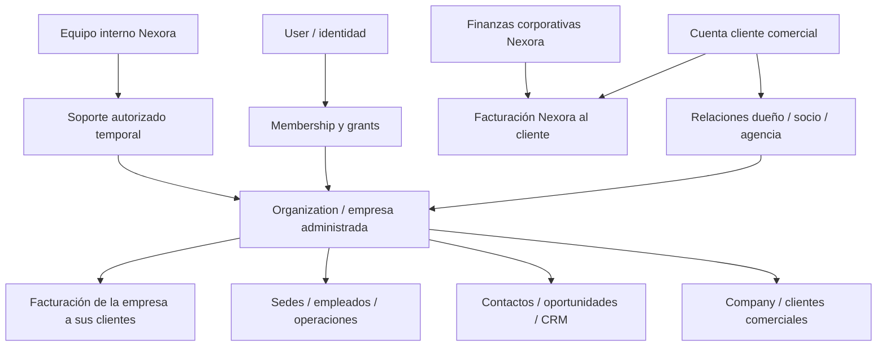

# GotNexora — Revisión del master plan y decisiones de producto

Fecha: 2026-10-28 (America/Denver). Versión: propuesta de alineación 1.0. **No es implementación ni autorización de producción.**

## 1. Fuentes y precedencia

Fuente primaria: master plan humano de 59 secciones, preservado sin cambios en `gotnexora-master-plan-original.md`. Complementos: decisiones humanas en este chat sobre empresas propias/socios/agencias, accesos de equipos e internos de Nexora, acceso remoto con permiso del cliente y separación de facturación. La copia original mantiene su texto; este documento añade precisión y marca qué sigue siendo propuesta.

Base de código ya inspeccionada: main b35b3a21afa48005eb49a2f7231e455eeeef35b6. Reconciliación del PR19 de 52 conceptos, revisión parcial de código con límites documentados. PR18 (Stripe platform revenue) está separado. No se vuelve a certificar producción ni se supone auditoría completa del repositorio. Antes de código significativo, completar el Current State Report de sección6 y Transformation Plan A–P de sección58 con evidencia faltante.

Las decisiones humanas explícitas prevalecen sobre recomendaciones anteriores. En particular, **queda reemplazada la propuesta simplificada de que toda empresa administrada es solo Company cliente del tenant**. Hay que distinguir la empresa operadora administrada de los clientes comerciales de esa empresa. La retención NO ha sido decidida todavía.

## 2. Resultado ejecutivo de la comparación

El master plan ya incluye multitenencia (7), entidades base (8), permisos (30), auditoría (31), privacidad/exportación/retención (33), flags (52), aprobaciones (53) y autonomía limitada (54). También exige no construir todo a la vez (57), dos golden workflows primero (46) y un plan antes de cambios destructivos (58).

Falta hacer explícitos:
1. Cuenta cliente comercial y grupo/agencia que administra varias empresas operadoras, propias o de terceros, con permisos diferentes por empresa.
2. Relación de socio/propietario/agencia separada de la concesión efectiva de acceso, y acuerdos entre cuentas sin trasladar datos ni propiedad automáticamente.
3. Personal interno de Nexora, áreas, delegación y permisos de administración de plataforma separados del equipo cliente.
4. Catálogo de capacidades habilitadas por Nexora y límites comerciales separados del permiso de una persona.
5. Acceso asistido remoto autorizado, temporal, revocable y auditable sin compartir contraseñas.
6. Tres dominios financieros separados: cobro Nexora→cliente, facturación comercial de cada empresa cliente, finanzas corporativas de Nexora.
7. Confidencialidad por registros/equipos/campos, CRM privado/compartido y aislamiento en búsquedas, exportaciones y herramientas IA.
8. Orden de entrega por dependencias y cortes verticales, sin interpretar los números de las secciones como fases rígidas que obliguen a implementar los 52 modelos antes de eventos/inbox.

## 3. Decisiones humanas confirmadas y pendientes

### Confirmadas como requisitos de producto

- Un cliente puede administrar empresas propias como dueño o socio y empresas ajenas como agencia, incluso combinadas.
- Puede invitar personas de distintas áreas y niveles, concediendo acceso completo, limitado o ninguno según módulo, acción, empresa e información compartida.
- Debe poder decidir si comparte su CRM; pertenecer a una agencia o ser jefe no concede automáticamente acceso a datos de otra empresa o equipo.
- Nexora define capacidades disponibles para cada cuenta cliente y gestiona sus equipos internos por área con delegaciones propias.
- Soporte remoto requiere permiso del cliente. No existe autorización universal del personal de Nexora sobre datos cliente.
- Facturación propia de cada empresa cliente y facturación/finanzas de Nexora deben distinguirse.

### Propuestas técnicas todavía no aprobadas

Los nombres Account, Organization, Company, AccessGrant, SupportSession y BillingAccount son orientativos. No se autorizan nuevas tablas por aparecer aquí. Duración máxima de soporte, capacidades sensibles, reglas de transferencia, scopes privados/compartidos, períodos de retención, catálogos de roles y normativa fiscal aplicable requieren decisión concreta antes de implementar su etapa.

## 4. Modelo conceptual corregido: cuenta, empresa y cliente comercial

Propuesta:

- **Cuenta cliente / CustomerAccount:** relación comercial con Nexora (plan, propietario comercial, facturación de plataforma, límites). No sustituye automáticamente User/Subscription actual. Una cuenta puede financiar uno o varios espacios, sujeto a reglas comerciales.
- **Empresa administrada / Organization:** frontera de datos de una empresa operadora propia o de tercero, con usuarios/membresías, módulos y sus datos. El nombre UI puede ser «Mi empresa». Confirmar si legal entity y workspace siempre coinciden antes de migrar; una empresa con sedes no implica múltiples tenants.
- **Cliente comercial / Company:** empresa a la que la empresa operadora vende o presta servicios; NO es la misma entidad que CustomerAccount ni necesariamente otra Organization con login.
- **Personas / User:** identidad reutilizable; Membership pertenece a Organization. Employee es registro laboral opcional de un negocio, no equivalente a User.
- **Administración delegada / ManagementRelationship:** vínculo entre cuenta/empresa y otra empresa, con relación owner/partner/agency y alcance de administración. El vínculo comercial no constituye permiso de datos. Un tercero puede tener cuenta propia y otorgar acceso a una agencia sin mover sus datos al tenant de la agencia.
- **Acceso / AccessGrant:** sujeto usuario/equipo/rol, empresa objetivo, capacidad y scope, con fecha y origen. La materialización exacta debe coordinarse con Point30 para evitar dos motores de permisos.

Casos obligatorios de aceptación:
1. Persona dueña de A y socia de B; marketing accede solo al CRM de A.
2. Agencia atiende a C y D; un ejecutivo ve solo C y un supervisor tiene lectura de ambos mediante grants explícitos.
3. C revoca la agencia: D no cambia; la agencia pierde APIs, exportaciones, jobs, almacenamiento, embeddings, prompts y sesiones de C.
4. Company «Cliente X» de A no se convierte automáticamente en Organization ni en cuenta de pago.
5. Mover/transferir la administración no copia ni fusiona datos; el plan debe resolver identidad y titularidad de cada empresa antes de cualquier backfill.
6. Compartir CRM permite scopes definidos y auditables; un contacto de A nunca se comparte con B solo por email coincidente.

Diagrama conceptual propuesto:

## 5. Permisos y confidencialidad: ampliación de secciones7,30,32,36,51,52

### Separar cuatro decisiones

1. **Disponibilidad comercial (entitlement):** Nexora habilita módulos/funciones/límites para la cuenta/empresa según contrato y políticas. No autoriza por sí sola a todas las personas a usarlos.
2. **Autorización de persona:** rol/capacidad por empresa y acción. Un cliente solo delega capacidades que posee y tiene derecho a delegar.
3. **Alcance de datos:** todo el módulo, equipo, asignados, propios, registros compartidos o campos permitidos, con reglas de conflicto explícitas.
4. **Condiciones de ejecución:** estado cuenta/empresa/membresía, vigencia grant, consentimiento soporte, aprobaciones y límites de acción.

Propuesta de evaluación: autenticar → resolver empresa y contexto → verificar estado → disponibilidad módulo/límite → capacidad → scope del recurso/campo → aprobación si corresponde → ejecutar → auditar. Default deny. Una feature flag controla despliegue, no sustituye permiso ni entitlement. No permitir que un allow amplio venza un deny explícito sin una política de precedencia aprobada.

No usar una única marca «administrador» para plataforma, cliente y empresa. Distinguir namespaces de capacidades: plataforma (gestionada por Nexora), administración de cuenta y negocio dentro de Organization. Roles configurables son agrupaciones de capacidades, no nombres que conceden poderes mágicos.

Acciones a mapear: listar/ver, crear, editar, archivar, eliminar, exportar, compartir, aprobar, invitar, cambiar permisos, acceder a información financiera, gestionar credenciales y configurar agentes. Campos sensibles necesitan política consistente también en búsqueda, exportación, reportes y contexto IA. Filtrar registros al servidor; no ocultarlos solo en UI.

Tablas conceptuales adicionales a reconciliar con los 52 conceptos, NO adiciones automáticas: CustomerAccount, ManagedOrganizationRelationship, Team/TeamMember, ResourceShare, DataScope, AccountEntitlement/EntitlementOverride, PlatformStaffMembership/Role y política común de autorización. Entitlements no son Permissions; roles de staff no son MembershipRole cliente. Cada nuevo concepto tendrá fila en la próxima revisión de matriz antes de cualquier DDL.

## 6. Acceso remoto asistido: extensión nueva de30,31,32,33,53

«Remoto» significa acceso asistido al espacio dentro de Nexora, no control del dispositivo del cliente ni escritorio remoto externo por defecto. Confirmar cualquier producto distinto antes de implementarlo.

Flujo propuesto:
1. Cliente autorizado solicita/acepta soporte para empresa y caso concreto.
2. Se muestran operador/área, motivo, duración, scopes y si puede escribir. Recomendación inicial: lectura, sin acceso automático a finanzas, credenciales, cambios de permisos, exportaciones o documentos restringidos.
3. Crear solicitud y aprobación ligadas al alcance y versión; validar identidad de ambos lados y autenticación reforzada para inicio según política aprobada.
4. Emitir sesión delegada temporal y específica, con actor real de Nexora y empresa objetivo. No sustituir password, no generar sesión indistinguible del cliente y no guardar su contraseña.
5. Banner visible durante soporte; registrar inicio/consultas sensibles/acciones/fin; expiración y revocación efectivas en servidor. Verificar sesión en cada operación; no solo al entrar.
6. Escrituras requieren scopes específicos y, si sensible, aprobación adicional. El agente IA no puede ampliar la sesión.
7. Cliente puede terminar acceso; cerrar tokens/sesiones y cancelar trabajo pendiente que dependa de esa autorización. No revertir automáticamente efectos externos ya realizados: registrar y compensar según caso.
8. Resumen accesible al cliente y trazabilidad para Nexora, sin volcar secretos o cuerpos personales a logs.

SupportAccessRequest/SupportSession debe reutilizar Approval/AuditLog con política de scopes, no duplicar dos sistemas de aprobación. La retención de sesiones y logs sigue pendiente. Un supuesto acceso de emergencia no está autorizado por el requisito de soporte; no implementarlo como excepción oculta. El consentimiento debe darlo alguien con capacidad para ese ámbito, no cualquier usuario invitado.

Pruebas de aceptación: permiso denegado/no expirado/expirado/revocado; operador de marketing sin acceso soporte; sesión solo empresaA; lectura no escribe; token no delega más; cliente ve actor real; revocación bloquea trabajos y retrieval; acciones financieras/secretos denegados salvo permiso expreso independiente.

## 7. Facturación y finanzas: tres dominios con contratos separados

### A. Facturación de plataforma (Nexora → cuenta cliente)

Subscription/Invoice actuales por User y proyección Stripe del PR18 son evidencia existente/en rama, respectivamente. Mantenerlos compatibles mientras se diseña el vínculo comercial CustomerAccount/BillingAccount. No cambiar a Organization por inferencia. Definir quién paga varias empresas, límites/consumo asignados, moneda, factura y cambios de titularidad. No mezclar tenant-client sales con MRR plataforma. Finanzas Nexora ve agregados y datos de cobro según atribuciones.

### B. Facturación operativa de cada empresa (empresa cliente → sus clientes)

Dominio independiente: invoice/quote comercial, emisor empresa, receptor Company/Contact, líneas, moneda/impuestos, numeración, estado, pagos/créditos y evidencias. Un invoice de Stripe por usar Nexora no es una factura comercial de limpieza. No reutilizar Invoice actual cambiando silenciosamente su significado. Elegir entidad o adapter distinto después de reconciliar sección13/17/24/51 y decisiones fiscales. Requisitos jurisdiccionales y facturación electrónica no se suponen; son preguntas de etapa, no reglas inventadas.

### C. Finanzas corporativas de Nexora

Ingresos de plataforma, gastos/proveedores y reportes financieros internos. Separar capacidades de staff, acceso y almacenamiento; no tratar Nexora como un tenant universal que ve los libros de todos sus clientes. Puede implementarse con integración contable existente en vez de libro contable nuevo. No declarar un sistema contable completo por disponer de métricas Stripe. La operación de pagos requiere políticas y aprobación específicas.

Finance Agent futuro (24,57) consume herramientas autorizadas sobre estos dominios; no tiene permiso transversal. Respeta monedas y separa cobrado, devengado, estimado y MRR. Distinguir reportes propios de la empresa de reportes internos de Nexora. No expandir agresivamente Finance/HR hasta que los golden workflows de46 sean confiables.

## 8. Corrección de terminología y orden de ejecución

### Revenue Engine no equivale a Stripe revenue

Sección46 define Revenue Engine: WhatsApp → Lead → calificación IA → CRM → Opportunity → seguimiento → cita/cotización → venta. PR18 es **Platform Billing Revenue Projection**. Mantener el nombre histórico del PR para trazabilidad pero aclarar alcance en toda planificación. Ni merge ni deploy de18 certifica golden workflowA.

### Punto8 es diseño de datos, no todos los productos completos

La sección8 pide diseñar/reconciliar entidades y evitar duplicados. Las funcionalidades de inbox, documentos, contratos, operaciones y agentes se entregan bajo10–28,35–39 y los golden workflows. No exigir implementar todos los productos del listado8 antes de empezar9 (eventos): sería contrario a47/57. Corregir la regla anterior «no pasar9 hasta implementar todos los52»: no iniciar código de eventos sin su diseño de datos/permiso acordado, pero sí avanzar por cortes de dependencias coordinados.

Criterios revisados:
- **Diseño punto8 completo:** todos conceptos reconciliados (incluidas adiciones), relaciones/propiedad/acceso/integridad definidos con evidencia, decisiones bloqueantes resueltas para el corte y diferimientos explícitos. No equivale a funcionalidad completa.
- **Fundación desplegada:** solo las entidades necesarias para el corte vigente, con migración, pruebas y verificación real. Registrar estado por concepto.
- **Golden workflowsA/B completos:** pruebas de extremo a extremo, evidencia, autorización, reintentos y piloto controlado; no por apariencia de demo.
- **Programa completo:** secciones y fases implementadas/verificadas según aceptación; no con un PR de documentación.

## 9. Secuencia revisada y primeros diez trabajos de ingeniería

Nombres E0–E9 son trabajos propuestos, NO reemplazan numeración1–59 ni son etapas ya autorizadas para producción.

| Trabajo | Resultado concreto | Dependencia y aceptación |
|---|---|---|
| E0 | Incorporar original humano, esta revisión y correcciones al PR19; registro de decisiones | Solo docs; preservar main/PR18; validar cobertura59 y cambios humanos |
| E1 | Completar Current State Report6 + Transformation Plan58 A–P con evidencia faltante | Inventario reproducible de repo/migraciones/RLS/storage/jobs/integraciones; KEEP/IMPROVE/etc por módulo; sin afirmar auditoría no hecha |
| E2 | Aprobar ADR cuenta comercial/empresa administrada/Company cliente y casos dueño/socio/agencia | Matriz de escenarios y quién controla/financia/revoca; no DDL ambiguo |
| E3 | Contrato común de autorización con Point30, entitlements, staff y scope de datos | Resolver grants/denies/compartición/roles/delegación; tests de casos negativos antes de CRUD nuevo |
| E4 | Contrato de soporte remoto y retención con33/53 | Requisitos de consentimiento/tiempo/acciones/revocación; sin password sharing ni acceso global |
| E5 | Primer corte aditivo Contact+Company+mapping CRM y AuditEvent mínimo | E2/E3; sin backfill automático ambiguo; compatibilidad CrmLead; pruebas tenancy; PR pequeño |
| E6 | Modelo de eventos9 e inbox/Channel/Conversation/Message con adapters51 | Firma/dedupe/outbox/handoff11 y permisos; no mensajes simulados presentados reales |
| E7 | Golden workflowA46: WhatsApp oficial→calificación→oportunidad→followup→venta | Consentimiento/optout/canales23; pruebas de efectos, reintentos, acceso y humanos; piloto sintético |
| E8 | Archivos/versiones/conocimiento/reglas y golden workflowB12–16/46 | Malware/storage privado/retrieval tenant/citas/evaluaciones44; acciones aprobadas53 |
| E9 | Cleaning Operations MVP y piloto45, luego Copilot/integración | Operaciones17–21/evidencias; controlar alcance por46/57; Finance/HR ampliado después |

PR18: revisión y eventual publicación es trabajo paralelo de facturación plataforma, con gates de migración/app ya definidos y autorización aparte. No bloquear E1/E2 documental por su merge ni usarlo para certificar Revenue Engine.

Toda implementación sigue48–49: requisito→evidencia→diseño→archivos/DDL/seguridad→código→pruebas→documentación→regresiones. Branch/PR revisable; no merge o producción sin autorización. Coordinar auto-deploy. Pruebas locales sintéticas sin secretos prod, staging antes de aplicar migración, rollback práctico probado. No plazos de90 días como garantía; auditar primero.

## 10. Decisiones todavía pendientes (sustituyen preguntas antiguas D1–D3 simplificadas)

1. **Unidad comercial y empresa:** una cuenta cliente puede administrar varias empresas (confirmado). Falta quién posee el contrato/plan, si una empresa puede tener varios pagadores/agencias y reglas de transferencia. Propuesta: identidad estable de empresa con relaciones explícitas.
2. **Delegación y roles:** confirmado acceso variable por empresa/área. Falta quién puede invitar, delegar, compartir CRM/exportar finanzas y resolver deny vs grants. Propuesta: capacidades por namespaces y scopes, sin herencia automática por jerarquía.
3. **Entitlements Nexora:** confirmado control de funciones del cliente. Falta catálogo comercial, límites y excepciones aprobables por área. Propuesta: políticas versionadas y administración de entitlements auditada, sin mezclar con feature flags.
4. **Soporte remoto:** consentimiento confirmado. Faltan alcance por defecto, duración máxima, reautenticación y quién puede aprobar cada dato. Propuesta lectura temporal, ampliación explícita; no fijar30/60min ni política de emergencia sin decisión.
5. **Retención:** no hay plazos aprobados. Faltan exportación, borrado, archivo, legal hold y conservación de backups/logs. Propuesta clasificación de datos con políticas por dominio; no «guardar todo siempre» ni eliminación automática implícita.
6. **Facturación operativa/corporativa:** tres dominios confirmados. Faltan jurisdicciones, proveedores contables, impuestos, numeración, pagos, monedas y fases. No inventar cumplimiento legal o reglas fiscales.
7. **Compartir CRM:** confirmado opcional. Faltan granularidad de compartición y si terceros ven solo lecturas, exportan o editan y qué sucede al revocar. Propuesta scope explícito por empresa/equipo/registro/campo, auditable.

No solicitar aprobar de nuevo los requisitos ya confirmados; preguntar solo lo que define una implementación concreta. La revisión de este documento no autoriza acceder a cuentas de clientes reales.

## 11. Registro de cobertura de las 59 secciones

Estado aquí indica alineación documental, NO implementación. «Se mantiene» significa requisito conservado de la fuente humana; su estado de código queda en el Current State Report. «Precisar» significa complemento requerido por decisiones nuevas o dependencia con el punto8.

| Sección | Título original | Revisión necesaria / requisito conservado |
|---|---|---|
| 1 | YOUR ROLE | Mantener auditoría, evolución y aprobación de cambios destructivos. |
| 2 | PRODUCT VISION | Precisar visión multiempresa propia/socios/agencia, sin perder objetivo de negocio. |
| 3 | CORE USER EXPERIENCE | Mantener acciones con evidencia y permisos reales. |
| 4 | FIRST REFERENCE VERTICAL: COMMERCIAL CLEANING | Mantener Cleaning como primer vertical configurable, no core hardcoded. |
| 5 | TARGET ARCHITECTURE | Añadir administración de plataforma, entitlements y soporte consentido como capacidades transversales. |
| 6 | PHASE ZERO — AUDIT EXISTING GOTNEXORA | Completar auditoría real por módulo; PR19 no equivale a auditoría integral. |
| 7 | MULTI-TENANT ARCHITECTURE | Precisar cuenta comercial vs empresa administrada vs Company cliente, delegación y revocación multiempresa. |
| 8 | CORE DATA MODEL | Actualizar reconciliación52 con conceptos adicionales propuestos y límites de cierre de diseño vs implementación. |
| 9 | EVENT-DRIVEN BUSINESS MODEL | Diseñar eventos junto al primer corte, sin bloquearlos hasta construir todos los dominios de8. |
| 10 | NEXORA INBOX | Mantener WhatsApp oficial; conversación persistente, no notas/UI simulada. |
| 11 | HUMAN HANDOFF | Mantener handoff de cliente a humano; NO confundir con soporte remoto del personal Nexora. |
| 12 | KNOWLEDGE ENGINE | Extender permisos de fuente/empresa/campo y revocación a retrieval/embeddings. |
| 13 | DOCUMENT INTELLIGENCE | Distinguir factura comercial de factura de suscripción; mantener trazabilidad de versiones. |
| 14 | CONTRACT INTELLIGENCE | Mantener análisis explicable y escalamiento, no aprobación legal automática. |
| 15 | COMPANY RULES ENGINE | Mantener reglas versionadas; añadir quién puede editarlas por empresa/área. |
| 16 | CLEANING CONTRACT ANALYSIS | Mantener pack Cleaning y comparaciones deterministas, sin inventar supuestos financieros. |
| 17 | NEXORA OPERATIONS | Mantener operaciones genéricas por empresa y sede. |
| 18 | CLEANING OPERATIONS | Mantener equipo/cliente/sede separados de cuenta comercial Nexora. |
| 19 | EVIDENCE SYSTEM | Mantener evidencia, consentimiento y acceso restringido, incluida sesión de soporte. |
| 20 | INCIDENT INTELLIGENCE | Mantener historial y análisis determinista primero. |
| 21 | SUPPLY MANAGEMENT | Precisar unidades, ledger y permisos antes de stock real. |
| 22 | SALES AI | Aplicar capacidades habilitadas, scope de datos y aprobaciones de acción. |
| 23 | FOLLOW-UP ENGINE | Mantener consentimiento/optout/políticas por canal. |
| 24 | NEXORA AI SPECIALISTS | Separar tres dominios financieros y permisos; Finance/HR después de golden workflows confiables. |
| 25 | NEXORA COPILOT | Aplicar autorización a toda herramienta y contexto, incluso soporte delegado. |
| 26 | AI ACTION FRAMEWORK | Cambios de permisos/finanzas/acceso remoto sensibles requieren política explícita. |
| 27 | AI PROVIDER ABSTRACTION | Mantener abstracción y privacidad por cuenta/empresa; no modelo único. |
| 28 | STRUCTURED OUTPUTS | Mantener JSON validado y datos de documentos como datos. |
| 29 | PROMPT SECURITY | Mantener protección contra instrucciones de archivos y exfiltración por soporte/agente. |
| 30 | PERMISSIONS | Ampliar con roles internos Nexora, cuenta, empresa, equipos, capabilities, scopes, entitlements y delegación. |
| 31 | AUDIT TRAIL | Añadir actor real/efectivo de soporte, concesión/revocación y cambios de habilitación comercial. |
| 32 | SECURITY | Añadir sesiones soporte temporales, reautenticación y secretos separados de capacidades. |
| 33 | PRIVACY | Retención/exportación/borrado ya previstos; faltan políticas concretas, sin plazos inventados. |
| 34 | OBSERVABILITY | Observar soporte, permisos, facturación y workflows sin registrar contenido/secretos innecesarios. |
| 35 | BACKGROUND JOBS | Revocación debe afectar jobs; reintentos con autorización vigente, no grants cacheados ilimitados. |
| 36 | COST CONTROL | Distinguir presupuesto/consumo/entitlement de permiso de usuario y facturación operativa. |
| 37 | NEXORA INSIGHTS | Mantener evidencia y scope de acceso por insight. |
| 38 | EXECUTIVE INTELLIGENCE | Datos reales, por empresa; no mezclar ingresos de plataforma con rentabilidad de clientes. |
| 39 | INDUSTRY PACK ARCHITECTURE | Mantener packs configurables y permisos de instalación/alcance. |
| 40 | UX PRINCIPLE | Usar lenguaje empresa/equipo/ayuda autorizada; complejidad solo admin. |
| 41 | MOBILE FIRST | Soporte, aprobación/revocación y acceso compartido también deben ser utilizables en móvil. |
| 42 | INTERNATIONALIZATION | Jurisdicción/moneda fiscal no se deduce del idioma. |
| 43 | TESTING | Añadir casos agencia/propias, delegación, entitlements, sharing, soporte revocado y facturación separada. |
| 44 | AI EVALUATIONS | Mantener datasets anonimizados y evaluación de citas/seguridad, no demos. |
| 45 | MAYOR EXCELSIOR PILOT | Mantener piloto controlado sin datos de cliente reales innecesarios. |
| 46 | FIRST TWO GOLDEN WORKFLOWS | Corregir alias: PR18 Stripe≠Golden WorkflowA Revenue Engine comercial. |
| 47 | 90-DAY BUILD STRATEGY | Ajustar calendario por dependencias: Core+permisos+eventos antes de dos workflows; no prometer fechas sin auditoría. |
| 48 | DEVELOPMENT PROCESS | Mantener cambios pequeños, auditados, con criterios por etapa. |
| 49 | DATABASE MIGRATIONS | Mantener migración versionada y staging; no SQL manual de producción. |
| 50 | API DESIGN | API autoriza empresa+scope+acción; account/platform/support namespaces diferenciados. |
| 51 | INTEGRATION ARCHITECTURE | Añadir ownership de integración multiempresa y AccountingAdapter por dominio financiero. |
| 52 | FEATURE FLAGS | Flag no sustituye entitlement, permiso ni consentimiento. |
| 53 | APPROVAL SYSTEM | Reusar approvals para soporte con alcance/tiempo/versión, no cheque en blanco. |
| 54 | NEVER ALLOW AUTONOMY WITHOUT BOUNDARIES | Soporte y agentes nunca amplían sus grants ni límites por instrucciones de contenido. |
| 55 | BUSINESS OUTCOME | Mantener outcomes medibles en cada entrega. |
| 56 | PRODUCT NORTH STAR | Mantener confianza mediante evidencia y acciones autorizadas. |
| 57 | DO NOT BUILD EVERYTHING AT ONCE | Prioridad protege golden workflows; finanzas propias requeridas se diseñan sin expandir producto contable completo. |
| 58 | INITIAL COMMAND | Actualizar Transformation Plan A–P y primeras10 tareas con esta revisión; aprobación antes de cambio destructivo. |
| 59 | FINAL ENGINEERING PRINCIPLE | Auditar autorizador, datos y resultado de cada acción, incluidas sesiones delegadas. |

## 12. Cambios en PR19 y validación de esta revisión

- Agregar copia inalterada del master original y esta revisión.
- Marcar la reconciliación anterior como baseline técnico parcial, actualizada por estas decisiones. Sus propuestas Company/Organization y regla de bloqueo hasta implementar todo8 quedan reemplazadas por secciones4/8 de esta revisión.
- Actualizar prompt maestro con requisitos confirmados y orden basado en dependencias; no otorgar permiso para cambios destructivos, soporte sobre clientes reales, merge o producción.
- Mantener PR18 separado como billing plataforma; confirmar estado al reanudar cada etapa.
- Verificaciones documentales:59 secciones originales y59 filas de cobertura; los52 conceptos siguen como baseline y se agregan conceptos propuestos sin tabla automática; originales conservados; diff solo docs.
- No se ejecuta auditoría legal/fiscal, prueba de seguridad física, código de aplicación ni migración en esta entrega.
- Siguiente paso concreto: revisar decisiones1–7 y completar E1/E2; no comenzar una normalización ambigua ni construir toda la plataforma a la vez.
