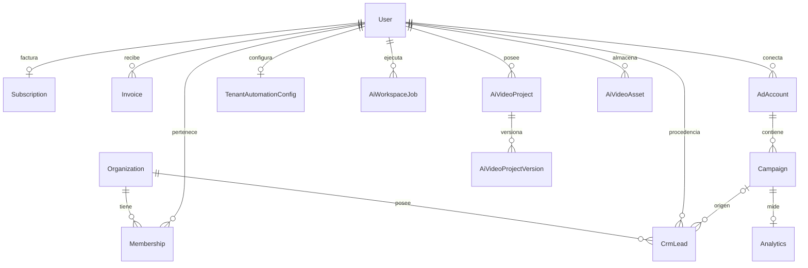
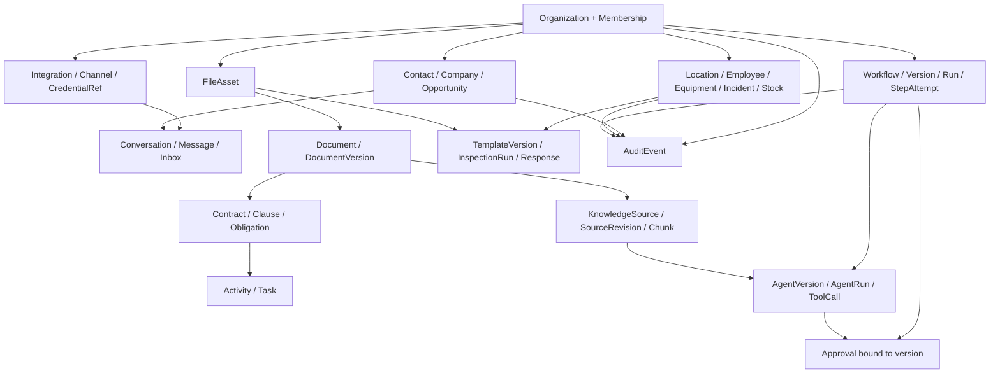

# Punto 8 — Reconciliación integral de Core Data Model

Fecha: 2026-10-28 (America/Denver). Estado: **DISEÑO PROPUESTO PARA REVISIÓN; NO IMPLEMENTADO**.

## 1. Base, método y límites de evidencia

Base inspeccionada: main `b35b3a21afa48005eb49a2f7231e455eeeef35b6`, identificada por los resultados de búsqueda y base del PR18. PR17 está integrado. PR18 está abierto, sin merge, HEAD `60c178716bec6b40003365e0bdc06856e0a067f3`; sus tablas nuevas no pertenecen a main. No se consultó producción ni secretos.

Cursor Cloud Agents reportó degradación y falló en los intentos anteriores. Se usó GitHub para leer archivos completos y búsquedas del código. No hubo checkout ejecutable local: la descarga falló por red y la política rechazó la elevación. La evidencia es de código versionado, no una certificación de todas las tablas físicas, funciones SQL, buckets o automatizaciones n8n externas. Una búsqueda sin resultados NO demuestra ausencia absoluta de implementación. Las ausencias de esta matriz significan «sin modelo en el schema Prisma revisado» salvo otra precisión.

Se leyeron CLAUDE.md y .github/copilot-instructions.md. AGENTS.md devolvió 404 en la base inspeccionada. El texto antiguo de Copilot describe siete modelos y no se toma como inventario actual. El runbook FR004 también conserva secciones históricas de pre-8B1 que no deben ejecutarse como estado actual. La orden humana de ramas/PR prevalece sobre la instrucción antigua de push a main.

### Catálogo de evidencia

Todas las rutas siguientes se leen en la base indicada salvo PR18:

- **S1** `prisma/schema.prisma`: 23 modelos: `User`, `Organization`, `Membership`, `Subscription`, `AdAccount`, `Campaign`, `Analytics`, `Invoice`, `CrmLead`, `CrmWorkspaceSettings`, `TenantAutomationConfig`, `AiWorkspaceUsage`, `AiWorkspaceJob`, `AiVideoProject`, `AiVideoProjectVersion`, `AiVideoAsset`, `LeadCapture`, `VerificationToken`, `PaymentSettings`, `ConnectionRequest`, `AdminWorkspaceConfig`, `AttributionSession`, `AttributionEvent`. PostgreSQL; relaciones, índices y defaults se inspeccionaron en el archivo completo.
- **S2** `src/lib/tenancy/tenant-context.ts` (`resolveTenantContext`) y `src/lib/tenancy/resolve-crm-write-organization.ts` (`resolveCrmWriteOrganization`): JWT identifica actor; cabecera exige Membership y Organization ACTIVE; política CRM permite los tres roles activos; granularidad se remite a Point30.
- **S3** `src/app/dashboard/conversaciones/page.tsx`, `buildMessages`, `channelForLead`: conversaciones derivadas de leads; mensajes de ejemplo con horas fijas y notas. No es un historial persistido.
- **S4** `src/app/api/crm/leads/[leadId]/message/route.ts`, POST: filtro por organizationId; envío Twilio condicionado a configuración; concatena el mensaje a notes y actualiza lastContactedAt. Respuesta saved puede ser solo registro de nota.
- **S5** `src/app/dashboard/crm/page.tsx`, `UI_STAGES`, `UI_TO_CRM`, `leadRiskLevel`: etapas y alertas calculadas desde lead. `src/app/dashboard/pipeline/page.tsx` redirige al CRM (búsqueda de código).
- **S6** `src/app/api/ai/studio/upload/route.ts` POST y `src/app/api/ai/studio/library/route.ts` GET/PATCH/DELETE: recursos de video por userId, metadata AiVideoAsset y storage externo/local. Revisados completos; el diseño genérico de documentos no se presume existente.
- **S7** Búsquedas `contract`, `audit`, `approval`, `inspection`, `knowledge`: términos comerciales/documentación no prueban entidades. `src/lib/audit-flow.ts` es flujo comercial de auditoría, no AuditLog. Revisar sus consumidores antes de reutilizar.
- **S8** `src/lib/meta-webhook-security.ts`: META_LEAD_ID_NOTE_PREFIX, firma HMAC, payload n8n sin secretos; dedupe provisional en notes. S1: AdAccount y TenantAutomationConfig contienen campos de credenciales; no se leyó ningún valor.
- **S9** `src/app/api/admin/ai-usage/route.ts` GET: contabiliza AiWorkspaceJob por herramienta/usuario; no demuestra agentes versionados o llamadas individuales.
- **S10** `docs/database/fr-004-migration-integrity-runbook.md`, `package.json`: Prisma y Supabase mantienen historiales distintos; validadores greenfield/prodsim/8B existentes. Runbook histórico no es permiso de mutación.
- **S11** PR18 y su lista de archivos: `StripeWebhookEvent`, `PendingStripeInvoice`, proyección de suscripción/facturas e idempotencia Stripe en rama; NO desplegado. No usar como inbox universal sin revisar scope y semántica.

## 2. Estado real y reglas de lectura

8B6 completo en producción es antecedente documentado de esta conversación, no nueva auditoría de producción. CRM tiene organizationId obligatorio y userId retenido; otras tablas siguen mayormente por usuario. Esto no equivale a multitenencia completa.

Las 52 decisiones siguientes son **propuestas pendientes de aprobación**, incluidas las de reutilización. Ningún concepto nuevo se declara implementado. «Crear» expresa una brecha y una opción de diseño, no autorización de crear tablas ahora. Todos se asignan a T0–T9; ninguno se excluye por conveniencia. El diseño de roles/permisos analiza la necesidad, sin implementar Point30 por inferencia.

## 3. Matriz de los 52 conceptos

Ámbito por defecto de las propuestas nuevas: organización activa, actor userId y comprobación de membresía. Excepciones globales requieren decisión explícita. Los detalles comunes de acceso, riesgos, claves y ciclo se desarrollan en las secciones 4–6 y forman parte de cada fila. Evidencia S1 significa schema, no base física.

| Concepto | Evidencia actual y cobertura | Decisión y duplicidad a evitar | Relación/brecha concreta | Etapa | Criterio mínimo de aceptación |
|---|---|---|---|---|---|
| organizations | Organization; Membership [S1,S2] | Reutilizar y extender; tenant no es empresa cliente | slug único; status; 1:N membresías/CRM; faltan dominios restantes | T0 | Tenant suspendido deniega acceso; sin segunda organización canónica |
| users | User [S1] | Reutilizar identidad; conservar userId como actor | email único; autenticación; 1:N membresías; identidad no es empleado | T0 | Un usuario pertenece a dos tenants sin fuga |
| organization_members | Membership [S1,S2] | Reutilizar; no crear OrganizationMember duplicado | único organizationId+userId; rol/status; índices user/status y org/status | T0 | Invitado/suspendido/removido no accede |
| roles | MembershipRole enum OWNER/ADMIN/MEMBER [S1,S2] | Reutilizar base; diseño granular depende Point30 | Sin Role persistente; no dar permisos por nombres inventados | T0 | Matriz aprobada de capacidades y compatibilidad roles actuales |
| permissions | Sin modelo en schema; política transitoria [S2] | Diseñar catálogo/capacidades; implementación coordinada con Point30 | CRUD por capacidad y tenant; default deny; no permiso global por omisión | T0 | Casos allow/deny por acción y membresía |
| contacts | CrmLead.name/email/phone [S1] | Crear Contact separado si se aprueba; conservar lead como captura comercial | Deduplicar por tenant con revisión humana; nunca email global único | T1 | Un contacto con varias oportunidades, sin pérdida de leads |
| companies | CrmLead.company String [S1] | Crear Company cliente; no reutilizar Organization tenant | Normalizar texto conservando valor original y mapeo ambiguo | T1 | Dos clientes homónimos no se fusionan automáticamente |
| locations | Sin modelo en schema [S1] | Crear Location ligada a Company; alcance por aprobar | Tenant + companyId; dirección estructurada/timezone; sin tratar como tenant | T6 | Location de otro tenant no se puede vincular |
| employees | User y Membership no son registro laboral [S1] | Crear Employee separado con userId opcional; decisión de producto | Empleado sin login; vínculo opcional; datos mínimos y retención por decidir | T6 | Baja laboral no borra identidad ni historial |
| channels | CrmWorkspaceSettings flags; TenantAutomationConfig; UI channelForLead [S1,S3] | Crear Channel como instancia de comunicación; reutilizar integración | No inferir canal por teléfono; vínculo integración y dirección proveedor | T2 | Dos números WhatsApp distintos tienen instancias distintas |
| conversations | UI buildMessages genera ejemplos desde lead [S3] | Crear Conversation persistente; no marcar UI como historial real | tenant+channel+externalThreadId; contactos participantes | T2 | Recargar muestra mensajes reales ordenados |
| messages | Notas del CrmLead; ruta POST message [S4] | Crear Message y estado de entrega; extraer notas solo con evidencia | id proveedor único por integración; direction; sent/delivered/failed | T2 | Reintento no duplica; saved no significa delivered |
| pipelines | Kanban de CrmLead y UI_STAGES [S5] | Crear Pipeline tenant; preservar CRM existente durante transición | tenant+key único; 1:N etapas y oportunidades; no video-pipeline | T1 | Un tenant configura dos pipelines sin mezclar etapas |
| pipeline_stages | CrmLead.stage String; UI_TO_CRM [S5] | Crear PipelineStage; mapeo explícito de etapas actuales | pipeline+key único; orden; clase abierta/ganada/perdida propuesta | T1 | Movimiento a etapa de otro pipeline se rechaza |
| opportunities | CrmLead combina persona/empresa/stage/value [S1,S5] | Separar Opportunity de Contact; no renombrar lead destructivamente | contact/company opcionales según contrato; pipeline/stage; amount+currency | T1 | Dos negocios del mismo contacto tienen valores independientes |
| activities | CrmLead.notes y lastContactedAt [S1,S4] | Crear Activity cronológica; distinguir de Message/AuditLog | actor; tipo; occurredAt; relación explícita a cliente/oportunidad | T1 | Timeline preserva procedencia sin duplicar cuerpo del mensaje |
| tasks | CrmLead.nextAction String [S1] | Crear Task con vencimiento/asignación/estado | tenant+assigneeMembershipId; Activity para completado; no parseo ciego | T1 | Tarea persiste y respeta acceso del asignado |
| documents | AiVideoAsset y PDF generado no son DMS [S1,S6] | Crear Document lógico sobre recurso binario reutilizable | metadata/título/clase; 1:N versiones; permisos tenant | T3 | Nueva versión no reemplaza evidencia anterior |
| document_versions | AiVideoProjectVersion especializado [S1] | Crear DocumentVersion; no reutilizar timeline de video | document+version único; checksum; storage ref inmutable | T3 | Ediciones concurrentes no reutilizan número |
| document_chunks | Sin modelo [S1] | Crear chunks derivados y versionados; compartir pipeline con knowledge | documentVersionId; ordinal; offsets; parserVersion; embeddingVersion | T3 | Reindexar una versión no mezcla fragmentos de otra |
| contracts | Términos web no son contratos operativos [S1,S7] | Crear Contract referenciando versión documental | company; status; vigencia; currency si aplica; decisión legal pendiente | T4 | Contrato aprobado referencia versión inmutable |
| contract_clauses | Sin modelo [S1] | Crear Clause con localización exacta en versión | contractVersion/documentVersion; índice y rango; revisión humana | T4 | Cláusula extraída no se presenta aprobada por IA |
| contract_obligations | Sin modelo [S1] | Crear Obligation; generar Task mediante enlace único | cláusula; responsable; fecha/recurrencia; estado; evidencia de cumplimiento | T4 | Reejecutar extracción no duplica obligaciones aprobadas |
| knowledge_sources | Sin modelo; no confundir job.prompt con conocimiento [S1] | Crear fuente procedente de documento/URL/conector | tenant; sourceType; locator; revisión y política ingestion | T3 | Fuente mantiene procedencia y puede revocarse |
| knowledge_chunks | Sin modelo [S1] | Reutilizar representación común de chunk con DocumentChunk | Una tabla Chunk+SourceRevision propuesta, no dos copias de texto idéntico | T3 | Consulta cita versión y respeta permisos |
| company_rules | qualificationPrompt/hotLeadAction en configuración [S1] | Crear Rule versionada; migrar solo reglas inequívocas | Company cliente opcional; tenant; condición/acción tipadas; aprobación | T4 | Cambio crea versión y no altera ejecuciones históricas |
| playbooks | welcomeMessage/prompts/config no son playbook versionado [S1] | Crear Playbook con pasos/referencias a Rule/WorkflowVersion | tenant; scope; versión; estado draft/published/retired | T4 | Una ejecución referencia versión publicada |
| alerts | Alertas UI derivadas de updatedAt/confidence [S5] | Crear Alert persistente con acuse/cierre; separar Insight | dedup tenant+rule+subject+window; severidad; lifecycle aprobado | T5 | Reevaluar no crea alertas repetidas |
| insights | Analytics y prioridad de lead derivada [S1,S5] | Reutilizar datos fuente; crear Insight explicable si necesita ciclo propio | evidencia; periodo; método/modelVersion; TTL a decidir | T5 | Insight muestra evidencia y fecha de cálculo |
| incidents | Sin modelo [S1] | Crear Incident operativo; separar de error de job | tenant; location; severity; state; opened/resolved; responsable | T6 | Estado y evidencia sobreviven cambio de responsable |
| equipment | Sin modelo [S1] | Crear Equipment con código tenant y location | tenant+assetTag; estado; fabricante/serie opcional; histórico ubicación | T6 | Serie no es ID global ni obliga a fusionar tenants |
| equipment_incidents | Sin modelo [S1] | Vincular Incident a Equipment; no duplicar incidente | Join explícito EquipmentIncident si M:N se aprueba | T6 | Un incidente puede afectar varios equipos con permisos consistentes |
| supplies | Sin modelo [S1] | Crear Supply como catálogo tenant | tenant+sku; unidad base; trazabilidad lote si negocio exige | T6 | Cantidad no suma unidades incompatibles |
| supply_levels | Sin modelo [S1] | Diseñar ledger movimientos + proyección nivel, no contador sin rastro | supply+location; cantidad Decimal; idempotencyKey; política stock negativo | T6 | Dos consumos concurrentes respetan regla de stock |
| inspections | Sin modelo [S1] | Tratar como dominio/definición; no crear tercera copia de template/run | Plan recurrente InspectionSchedule solo si necesidad confirmada | T7 | Cada pantalla distingue plan, plantilla y ejecución |
| inspection_templates | Sin modelo [S1] | Crear plantilla con versiones publicadas inmutables | template; revision; items tipados; unidad/tolerancia; autor | T7 | Publicar no reescribe formularios ya ejecutados |
| inspection_runs | Sin modelo [S1] | Crear run con snapshot/versión y sujeto location/equipment | estado; inspector; started/submitted/reviewed; unique schedule occurrence | T7 | Reintento de envío no duplica ejecución |
| inspection_items | Sin modelo [S1] | Separar definición del ítem y respuesta por run | templateItemId y snapshot; respuesta tipada; evidencia; no un JSON ambiguo | T7 | Respuesta numérica con unidad no se acepta como texto arbitrario |
| attachments | AiVideoAsset storageKey/mimeType/sizeBytes [S1,S6] | Crear recurso FileAsset genérico y enlaces tipados; adaptar video sin romperlo | checksum; tenant; storage; scanStatus; tamaño BigInt propuesto | T3 | Subida+DB fallida tiene limpieza; enlace cross-tenant rechazado |
| photos | Sin modelo foto; assets especializados video [S6] | Reutilizar FileAsset image/* con metadata foto cuando necesario | capturedAt; contexto; EXIF mínimo; permisos/consentimiento a decidir | T3 | No duplicar binario para foto usada en dos evidencias |
| workflows | TenantAutomationConfig/n8nWebhookUrl y JSON admin [S1,S8] | Crear definición estable; integrar n8n como motor externo | workflow tenant; trigger; engine/externalRef; no duplicar instancia n8n | T8 | Trigger enlaza versión publicada y tenant validado |
| workflow_versions | Sin modelo [S1] | Crear versión inmutable con esquema de definición | workflow+version; graph; input/output schema; checksum | T8 | Editar draft no cambia run iniciado |
| workflow_runs | AiWorkspaceJob no representa toda ejecución [S1] | Crear Run con vínculo motor/correlationId | workflowVersionId; status; requestKey; timestamps; actor | T8 | Dos triggers mismos requestKey producen un run |
| workflow_steps | Sin modelo [S1] | Separar StepDefinition de StepRun/Attempt | run+node+attempt; input/output refs redacted; errorCode; retryAt | T8 | Reintento conserva intentos previos |
| integrations | AdAccount/ConnectionRequest/TenantAutomationConfig [S1,S8] | Reconciliar en Integration y adaptadores existentes | provider; tenant; externalAccountId; scope/estado; ownership decidido | T2 | Una cuenta externa no se reasigna a otro tenant por input |
| integration_credentials | Tokens en AdAccount/config; PaymentSettings secret [S1] | Extraer referencias a vault/cifrado con rotación; no copiar secretos | IntegrationCredential metadata+secretRef; keyVersion; expires/revoked | T2 | Nunca respuesta/log incluye secreto; rotación probada |
| webhook_events | Meta marcador en notas [S8]; StripeWebhookEvent solo PR18 | Reusar patrón inbox sin confundir AttributionEvent con delivery | provider+integration+eventId único; raw ref mínimo; status/attempts | T2 | Firma inválida no escribe; duplicados/concurrencia probados |
| ai_agents | AiWorkspaceJob.tool/prompts [S1] | Crear AgentDefinition/Version; no equiparar herramienta a agente | tenant; instrucciones versionadas; tool policy; modelo config | T9 | Agente publicado no recibe permisos implícitos |
| ai_agent_runs | AiWorkspaceJob y créditos existentes [S1,S9] | Extender/adaptar jobs con vínculo AgentRun; no doble cobro | agentVersion; correlation/run; status; usage; budget | T9 | Un reintento no consume crédito dos veces |
| ai_tool_calls | AiWorkspaceJob.tool no es traza de llamadas [S1] | Crear ToolCall por AgentRun con intentos y efecto | toolName/version; requestKey; refs redacted; authorization decision | T9 | Tool externo requiere permiso y dedupe |
| approvals | Sin modelo; textos de aprobación UI no equivalen a sistema [S1] | Crear Approval con decisión humana y versión del objeto | requestedBy; decidedBy; scope; expires; outcome; object version/hash | T8 | Aprobación expirada o de otra versión no autoriza acción |
| audit_logs | Logs aplicación; audit-flow es marketing [S7] | Crear AuditEvent append-only; no reutilizar AttributionEvent | tenant; actor; acción; target typed; correlation; redacted diff | T0 | Mutation crítica y auditoría atómicas; no secretos |
## 4. Contrato común propuesto para entidades nuevas

**Pendiente de aprobación.** Identificadores opacos generados en servidor. Timestamps UTC; zonas IANA en sedes/recurrencias. organizationId NOT NULL en entidades tenant nuevas; createdByUserId opcional solo para actor de sistema identificado. User no es frontera tenant en dominios nuevos. Nunca aceptar tenant del cuerpo sin resolver contexto y permiso.

- Relaciones tenant: FK compuesta (organizationId, parentId) a clave única (organizationId,id), o prueba equivalente de aislamiento físico y aplicación. Una FK id simple más filtro UI no basta. Incluir tabla padre/join para referencias a objetos de varios tipos; evitar resourceType/resourceId sin integridad para adjuntos/aprobaciones críticos.
- Índices propuestos: (organizationId,updatedAt,id) para listas; (organizationId,status,dueAt,id) para trabajo pendiente; claves de proveedor por Integration, nunca ID proveedor global sin analizar colisiones; columnas JSON no sustituyen relaciones consultables.
- Dinero: unidad menor entera+currency y exponente explícito, o Decimal bajo contrato específico. Cantidades físicas Decimal+unit, no Float sin unidad. No sumar monedas ni unidades distintas.
- Borrado: archive/retire para objetos referenciados históricamente; Restrict en relaciones de evidencia; Cascade solo para componentes realmente poseídos y tras política de retención aprobada. User/Organization actuales tienen cascadas: inventariar impacto y no cambiarlas silenciosamente.
- Acceso: por tenant y acción, server-side en todos los endpoints, exportaciones y jobs; permisos de herramienta no heredan automáticamente acceso del admin. No diseñar Role/Permission duplicados hasta decidir convivencia con Point30.
- Versiones: published inmutable; draft editable con optimistic concurrency/version; cada run conserva versionId+snapshot/hash. Secretos nunca en snapshot, prompt, tool result, webhook body de reenvío o audit diff.
- Auditoría: append-only, actor humano/sistema, request/correlationId, target tipado, versión, acción/outcome, datos mínimos redacted. Política de retención, acceso y eliminación sujeta a decisión D3.
- Riesgo común de todas las filas nuevas: fuga tenant, backfill ambiguo, referencias inválidas y ruptura de consumidores actuales. Cada etapa prueba negativos de otro tenant, usuario sin login/403, estado suspendido, ids inválidos, duplicado y concurrencia donde haya efecto.
- No introducir borrado definitivo o cascadas sobre evidencias hasta aprobar retención. No declarar políticas RLS existentes por mirar Prisma; inspección de supabase/migrations y políticas físicas es gate separado antes de producción.

## 5. Diseño por dominio: campos y contratos de implementación

Nombres de modelos orientativos. Columnas listadas son mínimas propuestas, no DDL autorizado. Todas incluyen contrato de sección 4.

### T0 — Identidad, autorización y auditoría

Conservar Organization(id,name,slug,status), User y Membership con unique(org,user). No cambiar autenticación ni passwords en este corte. Reconciliar MembershipRole con Point30: opción recomendada catálogo de capacidades estable y vínculos de rol tenant, no enum diferente por dominio. Role(tenant?,key,name), Permission(key,description), RolePermission(roleId,permissionKey) solo tras D2; roles sistema/tenant no comparten claves accidentalmente.

AuditEvent(id,organizationId?,actorUserId?,actorType,action,targetKind,targetId,occurredAt,correlationId,outcome,redactedDiff). Las referencias polimórficas de auditoría permiten snapshot de target borrado; documentar esa excepción, sin usarla para autorización. Índices (org,occurredAt,id), (org,targetKind,targetId,occurredAt). Escritura dentro de la transacción del efecto; eventos externos usan outbox si no pueden compartir transacción. Auditoría no editable por actor ordinario. Retención/PII en D3.

Gate: prueba de todos los roles actuales y tenant inactivo; revisar rutas antiguas por userId sin migrarlas en masa. Actualizar comentarios desfasados de tenancy solo en etapa autorizada.

### T1 — Clientes y CRM normalizado

Contact(id,org,displayName,status) con ContactPoint(contactId,type,normalizedValue,verifiedAt?,isPrimary); índice org+normalizedValue no implica unicidad automática. Company(id,org,name,externalRef?,status). CompanyContact(companyId,contactId,relationLabel?) permite relación comercial; ambos comparten tenant.

Pipeline(id,org,key,name,isDefault,archivedAt); Stage(id,org,pipelineId,key,label,position,category). Unique(pipelineId,key); categoría OPEN/WON/LOST es propuesta en D1. Opportunity(id,org,contactId?,companyId?,pipelineId,stageId,title,amountMinor?,currency?,ownerMembershipId?,closedAt?,legacyLeadId?). No imponer contacto obligatorio hasta decidir B2B/B2C y múltiples personas. Stage y pipeline consistentes mediante FK/constraint.

Activity(id,org,kind,subjectRef,actor,occurredAt,summary,sourceRef?) no duplica Message.text; Task(id,org,title,state,dueAt?,assignedMembershipId?,subjectRef,completedAt?,completedBy?) tiene ciclo separado. Definir vínculos explícitos para Contact/Company/Opportunity (tablas de enlace o columnas tipadas y constraint de sujeto válido).

Transición: CrmLead queda intacto; tabla de correspondencia LegacyLeadMapping(org,leadId,contactId?,opportunityId?,sourceSnapshotHash,status,reviewReason). No deduplicar leads por email ni fusionar companies por texto sin revisión. Un lead puede representar oportunidad, contacto o ambos: D1. Mantener adapters API y compatibilidad UI; correr comparar lecturas old/new antes de corte. No borrar notas ni nextAction; notas históricas quedan como origen no estructurado.

### T2 — Integraciones, canales, inbox y conversaciones

Integration(id,org,provider,externalAccountId,status,credentialRef?,configVersion,connectedByUserId). Unique(org,provider,externalAccountId), más regla explícita si proveedor no permite dos tenants para misma cuenta (D4). No migrar AdAccount ownership por copiar userId; resolver organización con mapa y membresías, parar ante ambigüedad.

IntegrationCredential(id,integrationId,secretRef,keyVersion,scopes,expiresAt?,revokedAt?,rotatedAt?). Guardar material en vault/cifrado con claves fuera de DB y callbacks seguros; acceder mediante servicio de credenciales y registrar uso sin valor. No generalizar PaymentSettings global a tenant automáticamente.

Channel(id,org,integrationId,type,externalAddress,status). Conversation(id,org,channelId,externalThreadId?,status,assignedMembershipId?,lastMessageAt) y ConversationParticipant(conversationId,contactId?,userId?,externalIdentity). Message(id,org,conversationId,direction,providerMessageId?,idempotencyKey,bodyRef/text,status,occurredAt,sentAt?,deliveredAt?,errorCode?). Cuerpo/adjuntos privados con política D3. Unique(channelId,providerMessageId) cuando no nulo y unique(org,idempotencyKey).

Webhook inbox: Delivery(id,provider,integrationId?,externalEventId,receivedAt,signatureVerifiedAt,status,attempts,lastErrorCode,payloadRef?,retentionExpiresAt). StripeWebhookEvent de PR18 es adapter específico de plataforma/billing por usuario, no razón para crear otro Stripe inbox. Antes de generalizar, decidir claves, livemode, tenant routing y event semantics con D4. AttributionEvent es analytics consentido, no inbox ni auditoría.

Transacción recepción/dedupe; outbox para envío externo; estado accepted/sent/delivered diferenciado. Notes no es fuente fiable para reconstruir mensajes con horas reales: migrar como Activity histórica con contenido original y sin inventar roles/timestamps. UI buildMessages debe dejar de fabricar conversación cuando corte nuevo esté aprobado.

### T3 — Archivos, documentos y conocimiento

FileAsset(id,org,storageProvider,storageKey,mimeType,sizeBytes BigInt,sha256,status,uploadedBy,createdAt). Unique(storageProvider,storageKey); metadata no concede acceso. Estados proposed UPLOADING/QUARANTINED/READY/REJECTED/DELETED. Validación MIME/tamaño, cuarentena/scan por decidir, compensación de fallo DB/upload y limpieza de huérfanos. URLs firmadas bajo autorización y TTL; no secretos en URL pública. No cambiar AiVideoAsset en este PR: mapearlo como recurso especializado con adapter y sin duplicar binarios.

Document(id,org,title,type,currentPublishedVersionId?,status); DocumentVersion(id,org,documentId,version,fileAssetId,sha256,createdBy,publishedAt?) immutable published. Photo puede ser FileAsset image con PhotoMetadata(assetId,capturedAt?,caption?,dimensions?) si D5 exige metadata, sin segunda copia del archivo. Links explícitos a DocumentVersion/Message/InspectionResponse/Incident; mismo tenant.

KnowledgeSource(id,org,kind,documentId?/connectorId?/locator,status,accessPolicy), SourceRevision(id,org,sourceId,revision,documentVersionId?,contentHash,parserVersion,ingestedAt,status). Chunk(id,org,sourceRevisionId,ordinal,textRef/text,startOffset,endOffset,embeddingModel,embeddingVersion,embeddingRef?) con unique(revision,ordinal,parserVersion). DocumentChunk/KnowledgeChunk se cubren con esta infraestructura compartida; no almacenar dos textos idénticos por separado. Decide D5 si documento privado puede indexarse y quién puede consultar cada fuente. Embedding dimension/index es decisión de tecnología posterior, no asumir pgvector instalado.

Revocación de fuente invalida retrieval/cachés; versiones anteriores no se citan como actuales. Reproceso idempotente por contentHash+parser+embeddingVersion; separar almacenamiento de texto y vectores si límites/seguridad lo requieren.

### T4 — Contratos, obligaciones y reglas de operación

Contract(id,org,companyId?,reference,status,effectiveFrom?,effectiveTo?,documentVersionId,currentRevision). No modelar aceptación legal como simple checkbox sin actor/versión/evidencia (D6). Clause(id,org,contractId,documentVersionId,ordinal,startOffset,endOffset,textHash,type,reviewStatus). Obligation(id,org,clauseId,description,ownerMembershipId?,dueAt?,recurrenceDefinition?,status,approvedBy?,evidenceRef?). Extracción IA crea propuestas revisables; no crea obligación legal aprobada.

CompanyRule(id,org,companyId?,key,currentVersion); RuleVersion(id,ruleId,version,conditionSchema,actionSchema,status,effectiveAt?,approvedBy?). Playbook(id,org,key,title), PlaybookVersion(id,playbookId,version,status,steps) enlaza RuleVersion y WorkflowVersion. No duplicar motor de ejecución: Playbook describe procedimiento, Workflow ejecuta. Códigos y schemas de condición/acción requieren diseño API específico por etapa. Vínculo ObligationTask unique(obligationId,occurrenceKey) evita duplicados de tarea.

### T5 — Alertas e insights

Insight(id,org,subjectRef,methodVersion,computedAt,windowStart,windowEnd,evidenceRefs,summary,confidence?,expiresAt?). Modelo no garantiza que la recomendación sea verdad; mostrar procedencia y datos incompletos.

Alert(id,org,ruleVersionId?,subjectRef,dedupKey,severity,status,raisedAt,acknowledgedBy?,acknowledgedAt?,resolvedAt?). Unique(org,dedupKey) para ventana/ocurrencia. Reevaluación actualiza misma alerta o crea ocurrencia nueva según D7. Activity o AuditEvent registran transición, no duplicar estado de negocio. Las heurísticas UI actuales siguen marcadas como derivadas hasta corte aprobado.

### T6 — Operaciones, sedes, empleados, inventario e incidentes

Location(id,org,companyId?,code,address JSON tipado o columnas,timezone,status); unique(org,code). Employee(id,org,userId?,employeeCode,displayName,status); unique(org,employeeCode); sin datos sensibles extra hasta D3. EmployeeLocation(employeeId,locationId,effectiveFrom,effectiveTo?) conserva historial si requerido.

Equipment(id,org,assetTag,locationId?,status,manufacturer?,serialNumber?,purchasedAt?) y EquipmentLocationHistory si el negocio necesita trazabilidad. Incident(id,org,locationId?,type,severity,status,description,reportedAt,reportedBy,assignedMembershipId?,resolvedAt?). EquipmentIncident(org,equipmentId,incidentId) único; no segundo incidente duplicado. Evidencias vía FileAsset.

Supply(id,org,sku,name,unit,status), StockMovement(id,org,supplyId,locationId,type,quantity Decimal,unit,occurredAt,idempotencyKey,reason,actor), SupplyLevel(supplyId,locationId,quantity Decimal,version). Unique(org,idempotencyKey); único(supplyId,locationId). Ledger append-only con reversos; actualización de saldo transaccional y protección de concurrencia. D8 decide permitir stock negativo, lotes/caducidad, conversión de unidades y precisión. No asumir reglas de inventario.

### T7 — Inspecciones

InspectionTemplate(id,org,key,name,status); TemplateVersion(id,templateId,version,publishedAt,checksum); TemplateItem(id,versionId,key,position,responseType,unit?,required,tolerance?) unique(version,key). Se propone reutilizar Workflow trigger para programación o InspectionSchedule dedicado si D9 lo justifica; concepto inspections es dominio, no otra copia de ejecución.

InspectionRun(id,org,templateVersionId,locationId?,equipmentId?,inspectorEmployeeId?,status,startedAt,submittedAt?,reviewedAt?,occurrenceKey). Restricción de sujeto válido y mismo tenant; snapshot inmutable de plantilla. InspectionResponse(id,runId,templateItemKey,responseType,typedValue,unit?,result,answeredAt) unique(run,itemKey); evidencias con links FileAsset. D9 define offline/sync, firmas, tolerancias y quién revisa. Envío idempotente y conflictos explícitos; no last-write-wins sobre revisión firmada.

### T8 — Workflows y aprobaciones

Workflow(id,org,key,name,engine,externalWorkflowId?,status), WorkflowVersion(id,workflowId,version,graph,inputSchema,outputSchema,checksum,publishedAt). StepDefinition pertenece a versión. Run(id,org,workflowVersionId,requestKey,actor,status,startedAt,finishedAt?,externalRunId?), StepRun(id,runId,nodeKey,attempt,status,inputRef,outputRef,errorCode,retryAt?) con unique(run,nodeKey,attempt). No duplicar n8n ejecución como si fuese local: registrar motor y mapa de eventos, no fingir control de ejecución externa.

Approval(id,org,requesterId,subjectVersionRef,contentHash,capability,requestedAt,expiresAt,status,deciderId?,decidedAt?,reason?). Decisión compare-and-set desde PENDING; no aprobar versión cambiada, ni permitir autoaprobación donde D10 lo prohíba. Reintento externo via outbox, compensaciones explícitas; cancelación no implica revertir efecto ya ejecutado.

### T9 — Agentes y llamadas de herramientas

AgentDefinition(id,org,key,name), AgentVersion(id,agentId,version,instructionRef,modelConfig,toolPolicyVersion,status,publishedAt). AgentRun(id,org,agentVersionId,userId,workflowRunId?,requestKey,status,startedAt,finishedAt?,usageRef,budgetSnapshot). ToolCall(id,org,agentRunId,sequence,toolName,toolVersion,requestKey,inputRef,outputRef,status,authorizationRef,approvalId?,attempts). Idempotencia unique(org,requestKey), costos/usage ligados a AiWorkspaceUsage y AiWorkspaceJob mediante adapter.

Reutilizar Job como historial de herramienta/contabilidad cuando corresponda; no renombrar todos los jobs a runs autónomos. D11 decide qué herramientas existen, cuáles tienen efectos y requieren aprobación/presupuesto. No construir el producto de agentes/Point9 de forma implícita: esta etapa fija contrato de datos y enlaza dependencias con ese punto. Autorización tenant y herramienta server-side, límites de tiempo/costo y secretos fuera de prompts/logs.

## 6. Diagramas de reconciliación

### Actual comprobado en schema (subset relevante; no representa despliegue físico)

### Propuesto conceptual (no DDL ni aprobación)

Billing por usuario sigue aparte bajo PR18; no se dibuja como Opportunity.value ni ingreso de cliente.

## 7. Secuencia ejecutable, compatibilidad y aceptación

Cada etapa requiere decisión de diseño aprobada antes de implementar y autorización específica antes de merge/producción. No hay autorización de producción por este documento. Son diez grupos de trabajo propuestos, no numeración oficial adicional a 8A/8B/8C ni promesa de solo diez PR.

| Etapa | Dependencias y corte | API/UI y datos | Pruebas y gate | Rollout / reversión |
|---|---|---|---|---|
| T0 | D1/D2/D3; contrato tenant, IDs, auditoría y permisos | Contratos comunes y endpoints mínimos con deny; sin reemplazar auth | Aislamiento/roles/status; auditoría sin secretos; tenancy 8B | Adición compatible; feature flag por defecto off; conservar app anterior |
| T1 | T0 + decisión CRM | Contact/Company/Pipeline/Opportunity/Activity/Task y adapters CrmLead | fixtures lead mixto, duplicados, múltiples negocios, FK cross-tenant | expand; dry-run mapeo; revisión ambigüedades; dual-read comparación; corte gradual; conservar originales |
| T2 | T0 y Contact mínimo | Inbox/Integration/Channel/Conversation/Message y provider adapters | firma, dedupe, eventos paralelos/reintentos, no falsos delivered, credenciales redacted | activar proveedor/tenant; outbox; reconciliar mensajes; apagar routing nuevo sin borrar historial |
| T3 | T0; D3/D5 | Archivo privado/documentos/versiones/fuentes/chunks y UI verificable | upload compensación, permiso download/retrieval, publicación/concurrencia/versiones | nuevos recursos opt-in; adaptar video aparte; rollback lectores sin borrar blobs |
| T4 | T1+T3+D6 | contratos/cláusulas/obligaciones y reglas/playbooks versionados | referencias inmutables; extracción propuesta; aprobación por versión; tareas sin duplicado | feature flag; no obligaciones legales automáticas; retirar UI nueva, conservar evidencia |
| T5 | T0+T1; T4 para reglas | alertas persistentes/insights explicados | dedupe por ventana, ack/reopen, datos obsoletos | shadow evaluation sin avisos; comparar; activar; detener productor si falla |
| T6 | T0+Company/FileAsset mínimos+D8 | sedes, empleados, equipos, incidentes, stock | cantidades/unidades, ledger concurrente, empleado sin login, evidencias | catálogo antes de movimientos; conteo inicial aprobado; reversos, no reset saldos |
| T7 | T3+T6+D9 | plantillas/versiones/runs/respuestas | plantilla histórica, reintento submit, permisos inspector/revisor; offline si aprobado | piloto sede; conservar snapshots; rollback inicio de runs nuevos |
| T8 | T0+T2+D10 | workflows/versiones/runs/pasos/approvals con adapter motor | duplicate trigger, retry, timeout, aprobación versión, compensación | shadow/disabled triggers; activación explícita; detener triggers, no fingir revertir efectos |
| T9 | T0+T3+T8+D11 | datos agente/versión/run/toolcall vinculados a jobs/usage | costo/idempotencia, tenant tool auth, secreto redacted, approval | tools sin efectos primero; luego aprobados; kill switch; mantener traces |
| Cierre | Todas | reconciliación documental y técnica de 52 filas | pruebas E2E del alcance, metadatos prod, integridad/backfills aceptados | comparar estados; declarar pendientes explícitos; no paso9 por aproximación |

**Primera etapa recomendada:** aprobar decisiones D1–D3 y contrato T0, luego un corte pequeño Contact+Company+mapping de CrmLead antes de mover las lecturas CRM. No iniciar todos los dominios ni generar 52 tablas de una vez. PR18 puede revisarse aparte; no es dependencia automática de documentos/operaciones.

Plan por cada PR de implementación:
1. Verificar main y checkout limpio; preservar ramas; registrar base.
2. Diseño de etapa aprobado y decisiones sin ambigüedad.
3. Migración aditiva versionada, constraints, API y UI del corte, con compatibilidad explícita.
4. DB local desechable validada; seed sintético; pruebas positivas/negativas/concurrencia y regressions afectadas. Secretos prod fuera del proceso.
5. Tipos/lint/build y revisión diff; comprobar que no se modifica historial aplicado.
6. PR revisable con evidencia y preflight/rollout/rollback específicos.
7. Con autorización producción: validar únicos pendientes, historial/checksums y metadatos, backup/PITR operativo según política; coordinar auto-deploy.
8. migrate deploy antes de la app dependiente; status y verificaciones físicas, contadores y smoke de APIs/tenant.
9. Registrar integrado/desplegado/verificado por separado. Si gate falla, detener mutación y conservar diagnóstico sanitizado.

## 8. Decisiones humanas pendientes

| ID | Pregunta bloqueante | Recomendación inicial (no aprobada) | Bloquea |
|---|---|---|---|
| D1 | Producto objetivo: CRM SaaS con varios clientes y operaciones cleaning, o subconjunto inicial? ¿Qué representa un lead y cuántos negocios puede tener una persona? | Company es cliente del tenant; Contact es persona comercial; Opportunity es negocio; conservar captura Lead | T1 y prioridad dominios |
| D2 | ¿Roles/permisos se resuelven en Point30 y qué capacidades mínimas exige cada etapa? | Reutilizar MembershipRole; contrato de capacidades único con Point30; no segundo RBAC | T0 y mutaciones nuevas |
| D3 | ¿Retención/borrado, PII laboral, mensajes, archivos, auditoría y contratos? | Clasificar datos; defaults conservadores sin borrado irreversible; aprobar periodos antes de automatizar | T0/T2/T3/T4/T6 |
| D4 | ¿Una cuenta de integración puede compartirse entre organizaciones? ¿Quién posee cuentas actuales de usuario? | Una instancia explícita por org con revisión de pertenencia; bloquear backfill ambiguo | T2 |
| D5 | ¿Qué documentos pueden indexarse, motor/storage y permisos por fuente? | FileAsset común; versión/documento inmutable; fuente de conocimiento referencia versión y hereda acceso | T3 |
| D6 | ¿Revisión legal, firma y obligaciones automáticas permitidas? | Extracción crea borradores; aprobación humana por versión antes de activar obligación | T4 |
| D7 | ¿Quién recibe alertas, ventanas/dedup/severidades/SLA? | Shadow mode y decisiones antes de enviar notificaciones | T5 |
| D8 | ¿Stock negativo, unidades/conversión/lotes/caducidad, ubicación de equipos? | Ledger con reversos y base unit; reglas explícitas por Supply | T6 |
| D9 | ¿Inspección offline, firma/revisión, recurrencia y sujetos permitidos? | Versiones publicadas y snapshots; envío idempotente; no offline implícito | T7 |
| D10 | ¿Motor n8n/local, aprobaciones, autoaprobación y compensaciones? | Adapter explícito; publicar versión; aprobación ligada a hash; efectos mediante outbox | T8 |
| D11 | ¿Qué constituye agente y qué herramientas/acciones/costos se permiten? ¿Dependencia exacta con punto9? | Diseñar datos aquí; runtime/agentes según alcance aprobado del punto9, sin duplicar jobs | T9/cierre |
| D12 | ¿Se mantiene PR18 como etapa separada y cuándo se autoriza reconciliación histórica de billing? | Revisar PR18 sin asumir que representa todo Core; no backfill sin plan | Revenue Core/publicación |

No se pide aprobar detalles técnicos uno por uno si el usuario ya aprobó el mismo alcance. Estas son decisiones de producto sin respuesta en la evidencia. Ningún diferimiento de conceptos está aprobado.

## 9. Registro inicial de avance

Para las 52 filas: **reconciliación inicial documentada; decisión propuesta pendiente de aprobación; diseño propuesto; implementación futura pendiente**. Los modelos actuales mencionados en cada fila tienen evidencia de main, no garantía de que cumplan todo el concepto nuevo. Diagramas propuestos no son funcionalidad.

- Organization/User/Membership: existentes en main; cierre de alcance futuro todavía sujeto a T0.
- CRM organización/8B6: completo según antecedente; validar regresiones en cambios futuros.
- Revenue Core/8C: PR18 abierto/draft; pruebas reportadas y revisadas en conversación; no integrado ni desplegado; limitaciones de historia/cupones/ciclos explícitas en PR.
- T0–T9: ninguno implementado por este PR documental.
- Punto8 integral: **NOT COMPLETE**. Punto9: no iniciar como continuación automática.

Formato permanente por concepto a actualizar en próximos PR: decisionId/aprobación; designedAt+doc; implementationPR+HEAD; tests+resultado; mergedCommit; deploymentId; migration+checksum; verificación y fecha; brechas/diferimientos aprobados. No marcar una fila completa por tener un modelo homónimo.

## 10. Validación de esta entrega y siguientes gates

- 52 conceptos listados, 52 filas únicas y comparación exacta con alcance solicitado.
- 23 modelos extraídos de schema; referencias S1–S11 distinguen lectura completa/búsqueda/PR.
- Solo documentos nuevos; no cambio producto/schema/migración/main/producción.
- Tipos/build NO ejecutados aquí: no hay checkout ejecutable por bloqueo de descarga. No se atribuyen a esta entrega los tests del PR18.
- Diagramas Mermaid no renderizados automáticamente; revisión textual únicamente.
- Falta inspección completa de supabase/migrations, storage, workflows externos y todos los consumidores no indexados. Es gate explícito antes de cualquier implementación que dependa de ellos; este documento no certifica seguridad física.
- Antes del primer PR de producto, completar esas inspecciones focalizadas y convertir el diseño de la etapa en DDL/contratos revisables con decisiones aprobadas.
