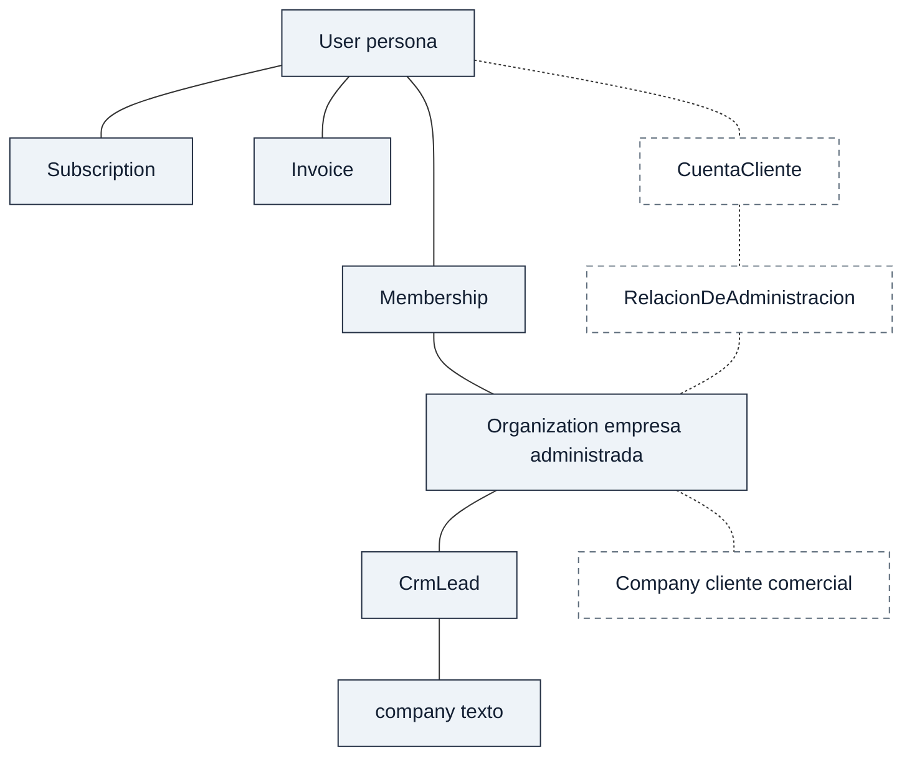

# Punto 8 — Paso 1: identidad de cuenta cliente y empresas administradas

Estado de este paso: **DISEÑO CONCEPTUAL REVISADO — DECISIONES D1–D3 ADOPTADAS / SIN IMPLEMENTAR**.

Registro de decisión: Codex adopta las alternativas recomendadas de D1–D3 bajo la delegación de criterio de la usuaria («confío en ti»), después de presentar esas tres recomendaciones. Esta decisión cierra la elección conceptual de este paso; no equivale a aprobar un esquema físico, una integración a main o un despliegue.

No es implementación, no crea modelos y no cierra el punto 8. Los permisos detallados, el personal de Nexora, el soporte remoto y los tres dominios financieros quedan fuera: este documento solo señala su dependencia.

Base comprobada: `main` `b35b3a21afa48005eb49a2f7231e455eeeef35b6`. Árbol limpio al crear la rama. No se integró el PR 18 ni el PR 19. No se consultó producción, Supabase ni secretos.

## 1. Estado actual

### Archivos usados

| Referencia | Qué se tomó de ahí |
|---|---|
| `prisma/schema.prisma:14-48` | `User` |
| `prisma/schema.prisma:53-98` | estados, `Organization`, `Membership` |
| `prisma/schema.prisma:100-113` | `Subscription` |
| `prisma/schema.prisma:168-215` | `Invoice`, `CrmLead` |
| `prisma/migrations/20260918020000_add_organization_membership/migration.sql:1-57` | alta de `Organization` y `Membership` |
| `prisma/migrations/20260930011200_add_crmlead_organization_tenancy_foundation/migration.sql:1-20` | `CrmLead.organizationId` aditivo y aún nullable en esa migración |
| `prisma/migrations/20261004120000_crmlead_organization_id_not_null/migration.sql:1-5` | `organizationId` pasa a NOT NULL |
| `src/lib/tenancy/tenant-context.ts:24-160` | resolución de persona y empresa activa |
| `src/lib/tenancy/resolve-crm-read-organization.ts:1-38` | lectura CRM por esa empresa |
| `src/lib/tenancy/resolve-crm-write-organization.ts:1-48` | escritura CRM por esa empresa |

El schema declara 23 modelos. Ninguno se llama Company, CustomerAccount, CuentaCliente ni relación de agencia. Este paso no describe el resto de modelos.

### Hechos

1. `User` es la persona. Tiene `email` único, credencial y la relación `memberships`. El comentario en `prisma/schema.prisma:46` la llama identidad humana. No es una empresa.
2. `Organization` es el tenant actual: `name`, `slug` único y `status` `ACTIVE`, `SUSPENDED` o `DEACTIVATED` (`prisma/schema.prisma:72-82`). No tiene clave foránea a un usuario propietario. La migración lo dice de forma explícita: Organization es independiente de User (`prisma/migrations/20260918020000_add_organization_membership/migration.sql:52-57`).
3. `Membership` une una persona y una empresa, como máximo una fila por par (`prisma/schema.prisma:95`). El rol es `OWNER`, `ADMIN` o `MEMBER` (predeterminado `MEMBER`). El estado es `INVITED`, `ACTIVE`, `SUSPENDED` o `REMOVED` (predeterminado `ACTIVE`). Borrar la persona o la empresa borra la fila de membresía (`onDelete: Cascade`). Borrar la persona no borra la empresa.
4. `CrmLead.organizationId` es obligatorio y referencia `Organization` con `ON DELETE RESTRICT` (`prisma/schema.prisma:191-194`, migración `20261004120000`). `userId` se conserva como procedencia y, si se borra el usuario, el lead se borra en cascada. `company` es `String?` (`prisma/schema.prisma:198`): texto libre, no una entidad ni una clave foránea.
5. `Subscription.userId` es único (`prisma/schema.prisma:102`). `Invoice.userId` no es único (`prisma/schema.prisma:170`). Ninguno de los dos tiene `organizationId`. La facturación de plataforma que existe hoy cuelga de la persona.
6. `resolveTenantContext` obtiene la persona del JWT y, si viene, la empresa de la cabecera `x-nexora-organization-id`. Exige una `Membership` de ese par, membresía `ACTIVE` y organización `ACTIVE`. Si hay varias membresías activas y no hay cabecera, devuelve `ORGANIZATION_SELECTION_REQUIRED` y no elige una (`src/lib/tenancy/tenant-context.ts:142-148`).
7. La lectura y la escritura de CRM delegan en ese mismo contexto (`src/lib/tenancy/resolve-crm-read-organization.ts:33-37`, `src/lib/tenancy/resolve-crm-write-organization.ts:43-47`). El comentario de escritura (`src/lib/tenancy/resolve-crm-write-organization.ts:14-15`) registra que hoy cualquier rol `ACTIVE` puede hacer las escrituras CRM existentes y que la distinción fina de capacidades pertenece al punto 30. No existe en estos archivos un vínculo propia, socio o agencia.

### Comentarios que no describen el CRM actual

Estos comentarios siguen en el código y no se corrigen aquí:

- `prisma/schema.prisma:50-52` dice que las tablas de negocio siguen por `userId` y que la autorización por organización todavía no se aplica.
- `prisma/schema.prisma:80` dice que las lecturas de `CrmLead` siguen por `userId`.
- `src/lib/tenancy/tenant-context.ts:8-9` dice que las tablas de negocio siguen siendo de `userId`.

El campo NOT NULL y los dos resolutores CRM son posteriores y, para `CrmLead`, la empresa sale de `TenantContext.organizationId`. El comentario viejo no anula ese hecho.

### Propuestas

No hay propuesta implementada en los archivos leídos. D1–D3 son decisiones conceptuales adoptadas; los detalles de persistencia y los nombres nuevos siguen sujetos al diseño de implementación. Los nombres nuevos no son tablas autorizadas.

## 2. Glosario

| Término | Significado en este paso | Qué no es |
|---|---|---|
| User / persona usuaria | Identidad humana que ya existe. Puede participar en varias empresas. | No es la cuenta cliente de Nexora, ni la empresa administrada, ni el cliente comercial del CRM. |
| Cuenta cliente | Concepto adoptado. Relación comercial de un cliente con Nexora, capaz de reunir varias empresas administradas. | No es `User`, no es `Subscription` y no es la frontera de los datos. Agruparla no abre otras empresas. |
| Organization / empresa administrada | Tenant actual. Frontera de aislamiento de una empresa operadora, propia, de un socio o de un tercero. | No es el cliente comercial escrito en un lead. No es el operador Nexora. No se renombra en este paso. |
| Membership | Vínculo ya persistido entre una persona y una empresa, con rol y estado actuales. | No registra si esa relación comercial es propia, de socio o de agencia. El rol `OWNER` no se lee como título de propiedad comercial. |
| Company / cliente comercial | A quién la empresa administrada vende o atiende. Hoy es el texto `CrmLead.company`. Un modelo futuro sería por empresa. | No es cuenta de Nexora, no inicia sesión y no es otra `Organization` por el hecho de existir. |
| Contacto | Persona comercial atendida dentro de una empresa. Hoy no hay modelo Contact: nombre, email y teléfono van en el propio `CrmLead`, bajo su `organizationId`. | El mismo email en otro lead de otra empresa no une los leads ni las empresas. |
| Agencia | Tipo de vínculo comercial adoptado en el diseño: una cuenta cliente administra una empresa de un tercero. | No es una `Organization` especial, no copia datos y no concede acceso. |
| Operador Nexora | La plataforma que hospeda a las empresas administradas. En los archivos de este paso no hay una entidad de operador distinta de `User` y `Organization`. | No se modela aquí. Depende del punto posterior de personal interno. |

Nombres candidatos, si más adelante se persiste el diseño: `CuentaCliente`, `RelacionDeAdministracion` y `Company`. Pueden cambiar. Este paso no los crea.

## 3. Correspondencias

| Concepto | Entidad actual | Decisión de diseño | Motivo | Riesgo si se duplica o se fuerza |
|---|---|---|---|---|
| Persona usuaria | `User` | Reutilizar | Ya es la identidad, con email único y membresías. | Crear otra tabla de persona partiría el login y la procedencia `CrmLead.userId`. |
| Empresa administrada | `Organization` | Reutilizar como frontera de datos | Ya aísla los leads por `organizationId` y la membresía es por empresa. El slug es único global, no por grupo comercial. | Una segunda tabla tenant obligaría a elegir cuál es la frontera real. |
| Participación de una persona en una empresa | `Membership` | Reutilizar el vínculo; separar su significado comercial | El par único ya impide dos membresías de la misma persona en la misma empresa. | Usar `OWNER` como «dueño comercial» graba una semántica que el enum no tiene. |
| Cuenta cliente de Nexora | No existe | Proponer un concepto distinto | `User` es cualquier persona y `Subscription` es una fila por persona. Ninguno nombra al cliente de Nexora ni puede agrupar empresas sin mezclar aislamiento. | Tratar `Organization` como cuenta funde agrupación y frontera de datos. |
| Vínculo propia / socio / agencia | No existe | Proponer una relación comercial aparte de `Membership` | El requisito dice que ese vínculo no concede permisos. Hoy no hay dónde guardarlo sin reutilizar el rol. | Guardarlo en `Membership.role` mezcla título comercial y participación. |
| Cliente comercial | `CrmLead.company` texto | Separar el concepto; no crear modelo ahora | El texto ya viaja con el lead de una sola empresa. | Normalizar y deduplicar por nombre uniría clientes de empresas distintas. |
| Contacto | Columnas `name`, `email`, `phone` de `CrmLead` | Separar el concepto; seguir en el lead | No hay entidad de contacto. El lead sigue siendo la captura actual. | Un contacto global único por email cruzaría empresas. |
| Facturación de plataforma | `Subscription`, `Invoice` por `User` | Dejar como está | Este paso no decide pagador ni agrupación de suscripciones. | Mover esas tablas a `Organization` o a la cuenta sería otro diseño. |
| Operador Nexora | Sin entidad en este alcance | No proponer modelo | Corresponde al personal interno, que es un punto posterior. | Crear ahora un tenant «Nexora» lo confundiría con una empresa administrada. |

## 4. Relaciones y cardinalidades

### Existentes

| De | A | Cardinalidad | Restricción comprobada |
|---|---|---|---|
| `User` | `Subscription` | 1 a 0..1 | `Subscription.userId` único |
| `User` | `Invoice` | 1 a 0..N | `userId` sin unicidad |
| `User` | `Organization` | N a N | como máximo una `Membership` por par |
| `Organization` | `CrmLead` | 1 a 0..N | `organizationId` obligatorio; borrar la empresa está restringido si hay leads |
| `User` | `CrmLead` | 1 a 0..N | `userId` de procedencia; el borrado del usuario elimina sus leads |
| `CrmLead` | cliente comercial | atributo | `company` texto opcional, sin fila propia |

No hay cardinalidad propia, socio o agencia porque esa relación no existe.

### ¿Hace falta una cuenta cliente además de User y Organization?

Se conservan las tres alternativas evaluadas. Se adopta la tercera como base conceptual; las otras dos quedan descartadas para esta etapa.

| Lectura | Qué permite | Qué no cumple |
|---|---|---|
| Sin cuenta nueva: `User` es el cliente de Nexora | Aprovecha la suscripción ya colgada de la persona. | Una persona puede ser dueña, socia y agencia a la vez, y otras personas participan en la misma empresa. La persona no es el cliente de Nexora. La suscripción tampoco dice qué empresas abarca. |
| Sin cuenta nueva: `Organization` es el cliente de Nexora | Cada empresa ya tiene identidad estable. | El cliente de Nexora puede relacionarse con varias empresas. Si esa agrupación se mete dentro de una sola `Organization`, se pierde el aislamiento. |
| Concepto nuevo `CuentaCliente` | Separa persona, cliente de Nexora y empresa administrada. La cuenta puede tener varias relaciones comerciales sin convertirse en la frontera de los datos. | Exige decidir, antes de cualquier tabla, dónde se ancla el vínculo y si una empresa admite varias relaciones. No responde quién paga. |

Decisión D1 adoptada: incorporar el concepto `CuentaCliente` al diseño. No sustituye a `User` ni a `Organization`. `Organization` sigue siendo la única frontera de aislamiento. La cuenta solo agrupa relaciones comerciales. Agrupar no da acceso de una empresa a otra, no copia CRM, contactos ni documentos, y no fusiona tenants.

Cardinalidades candidatas de esa recomendación:

| De | A | Cardinalidad recomendada | Límite de este paso |
|---|---|---|---|
| `CuentaCliente` | `User` | N a N, sin roles | Solo identidad. Quién administra la cuenta es un punto de permisos posterior. |
| `CuentaCliente` | `Organization` | 1 cuenta a 0..N relaciones; 1 empresa a 0..N relaciones | Cada relación lleva un tipo: `propia`, `socio` o `agencia`. |
| `RelacionDeAdministracion` | `Membership` | ninguna | El vínculo comercial no crea, modifica ni implica una membresía. |
| `Organization` | `Company` | 1 a 0..N, en el futuro | Hoy sigue siendo texto por lead. Dos empresas pueden repetir el mismo nombre sin compartir fila. |

Una empresa puede quedar sin cuenta cliente registrada durante la transición. Su `Organization` no depende de la agencia que la atiende. Una persona puede estar asociada a varias cuentas sin que esas cuentas compartan empresas o leads. La asociación persona–cuenta tampoco concede acceso a las empresas relacionadas.

La cuenta representa al cliente de Nexora, que puede ser una persona o una entidad representada por varias personas; no obliga a crear una cuenta por cada empleado o socio. Los ejemplos con cuentas separadas son posibilidades, no una regla de alta. Los tipos propia, socio y agencia son descriptivos: no certifican propiedad legal ni porcentajes de participación. La agencia puede tener una `Organization` para sus propias operaciones y, a la vez, relaciones de administración con otras empresas; son funciones distintas.

Antes del esquema físico hay que concretar la identidad y el ciclo de vida de estos vínculos, incluido cómo representar tipos simultáneos en un mismo par cuenta–empresa y cómo evitar duplicados. D3 permite varias cuentas relacionadas con una empresa, pero no resuelve esos detalles por sí sola.

Alternativa evaluada y descartada en D2: guardar propia, socio y agencia como atributo nuevo de `Membership`. Obligaría a tener membresía para poder decir que existe un vínculo comercial, y el requisito separa esas dos cosas. También seguiría sin nombrar al cliente de Nexora.

## 5. Diagrama

Leyenda: trazo continuo y clase `existente` = ya está en schema. Trazo discontinuo y clase `propuesto` = diseño futuro, no implementado y no autorizado como tabla. D1–D3 fijan la separación conceptual; no aprueban los detalles físicos.

La línea discontinua hacia `Organization` no atraviesa `Membership`. Esa separación es el punto del diagrama: la agrupación comercial y la participación de la persona son relaciones distintas. `Subscription` e `Invoice` siguen unidos solo a `User`.

## 6. Escenarios sintéticos

Identidades inventadas. No son clientes reales. En todos, la relación comercial no crea membresía y no mueve leads. La membresía, cuando se menciona, es un hecho aparte que este paso no concede.

### 6.1 Dos empresas propias

| Pieza | Valor |
|---|---|
| Persona | Ana |
| Cuenta | cuenta-ana |
| Empresas | org-norte, org-sur |
| Vínculos | cuenta-ana `propia` org-norte; cuenta-ana `propia` org-sur |
| Leads | lead-norte en org-norte; lead-sur en org-sur |
| Separación | Los dos leads no se unen aunque la persona y la cuenta sean las mismas. |
| Dependencia | Un punto posterior decide si Ana tiene `Membership` en cada empresa. Este escenario no la da. |

### 6.2 Socios en una empresa

| Pieza | Valor |
|---|---|
| Personas | Ana y Bruno |
| Cuentas | cuenta-ana y cuenta-bruno |
| Empresa | org-alfa |
| Vínculos | cuenta-ana `socio` org-alfa; cuenta-bruno `socio` org-alfa |
| Otra empresa | org-bruno-propia, solo de cuenta-bruno, tipo `propia` |
| Separación | Las dos cuentas socias no se ven entre sí. org-bruno-propia no entra en org-alfa. Ser socio no abre la otra empresa. |
| Dependencia | Otras personas pueden tener `Membership` en org-alfa sin tener cuenta ni vínculo de socio. Quién puede entrar es el punto de permisos. |

### 6.3 Agencia con tres clientes

| Pieza | Valor |
|---|---|
| Cuenta | cuenta-agencia |
| Empresas | org-c1, org-c2, org-c3, cada una con su propio id |
| Vínculos | cuenta-agencia `agencia` sobre c1, c2 y c3 |
| Leads | un lead distinto en cada empresa |
| Separación | La agencia no es dueña implícita. El lead de c1 no aparece en c2 ni en c3. No hay copia de contactos ni documentos. |
| Dependencia | Cada empresa puede tener, o no, su propia cuenta cliente. Este paso no obliga a que la tenga y no decide quién paga. |

### 6.4 Persona con empresa propia y agencia

| Pieza | Valor |
|---|---|
| Persona | Ana |
| Cuenta | cuenta-ana |
| Empresas | org-norte y org-c1 |
| Vínculos | cuenta-ana `propia` org-norte; cuenta-ana `agencia` org-c1 |
| Leads | lead-norte en org-norte, company «Cliente Palma»; lead-c1 en org-c1, company «Cliente Palma» |
| Separación | El tipo combinado no funde las empresas. El mismo texto de cliente comercial sigue siendo un lead en cada empresa. |
| Dependencia | Igual que en 6.1 y 6.3: la membresía de Ana en cada empresa no se infiere del vínculo. |

### 6.5 Dos empresas con el mismo cliente comercial

| Pieza | Valor |
|---|---|
| Empresas | org-norte y org-sur, sin relación comercial entre ellas |
| Leads | lead-norte.company = «Cliente Palma», email `palma@example.com`; lead-sur.company = «Cliente Palma», mismo email |
| Separación | Dos filas, dos `organizationId`. El nombre y el email no fusionan empresas, leads ni un futuro `Company`. |
| Contacto | Hoy ese email es una columna del lead, no un contacto global. |
| Dependencia | Si más adelante existe `Company`, será una fila por empresa administrada. No se diseña aquí su deduplicación interna. |

### 6.6 Retiro de la agencia en una empresa

| Pieza | Antes | Después del retiro |
|---|---|---|
| cuenta-agencia | `agencia` org-c1 y `agencia` org-c2 | solo `agencia` org-c2 |
| org-c1 | sigue existiendo | sigue existiendo, con sus leads |
| org-c2 | aislada de c1 | no cambia |
| Datos | cada lead en su empresa | no se copian, no se fusionan y no se mueven a la agencia |
| Transferencia y retención | no decididas | este retiro no define borrado ni traspaso |

Dependencia obligatoria del siguiente diseño: terminar la relación comercial y retirar acceso son operaciones distintas. Si la solicitud es retirar el acceso de la agencia, no basta con quitar su vínculo comercial: el flujo debe identificar y revocar los accesos otorgados por esa agencia a org-c1, incluidos los que dependan de ellos. Una membresía independiente de la misma persona requiere identificar su origen y tratarla explícitamente. Este documento no implementa esa regla ni afirma que el sistema actual la cumpla. No se puede declarar completado un retiro de acceso solo por modificar la relación comercial.

## 7. Invariantes y aceptación futura

Invariantes de identidad. No son pruebas de un motor de permisos, porque ese motor no existe en este paso.

1. No se fusionan empresas porque compartan email, nombre, persona, cuenta o agencia.
2. No se fusionan leads, ni un futuro cliente comercial, porque repitan `company` o email en otra empresa.
3. `MembershipRole.OWNER` no demuestra un vínculo `propia`. Hace falta una semántica comercial explícita; hoy no está en el schema.
4. Un vínculo `propia`, `socio` o `agencia` no crea acceso transversal a CRM, contactos o documentos.
5. La agrupación bajo `CuentaCliente` no sustituye el `organizationId` de cada lead.
6. El cliente comercial no es `User`, no es la cuenta cliente y no es `Organization`.
7. El operador Nexora no se representa como empresa administrada en este paso.
8. Retirar la relación de agencia de una empresa deja intactas las demás empresas y no transfiere sus datos.
9. `Subscription` e `Invoice` siguen perteneciendo a `User` hasta un diseño financiero posterior. Este paso no les asigna empresa ni cuenta.

Aceptación cuando una implementación futura exista: los seis escenarios de la sección 6 deben poder representarse sin violar estas invariantes. La comprobación de entonces tendrá que mirar identidad y separación de filas. No se pide ahora un test de permisos que este paso deja sin definir.

## 8. Compatibilidad

Se conserva el comportamiento actual.

- `CrmLead` sigue con `organizationId` obligatorio, `userId` de procedencia y `company` de texto.
- `Membership` sigue siendo el único vínculo persistido entre persona y empresa. Sus roles y estados no cambian de significado.
- `Subscription` e `Invoice` siguen por usuario. No se agrupan ni se reasignan.
- Los resolutores de tenencia siguen eligiendo empresa por membresía activa. No aprenden el vínculo comercial en este paso.

Necesidades posibles de una migración futura, sin escribirla y sin autorizarla:

- Cualquier tabla nueva tendría que ir en una migración aditiva nueva. Las migraciones ya versionadas no se editan.
- No clasificar las membresías actuales como propia, socio o agencia a partir de `OWNER`, `ADMIN` o `MEMBER`.
- No deduplicar `CrmLead` por `company`, email o nombre.
- No mover `Subscription` ni `Invoice` fuera de `User` como parte de la identidad.
- Un enlace futuro entre cuenta y empresa no debe borrar `Organization` ni `CrmLead` al retirarse. Hoy la empresa sobrevive al borrado de la persona, y un lead impide borrar su empresa.
- Alinear los comentarios desfasados de la sección 1 sería un cambio de código, no de este documento.

## 9. Decisiones adoptadas y detalles pendientes

D1–D3 quedan adoptadas bajo la delegación de criterio descrita al inicio. La columna de recomendación conserva la justificación de la alternativa A elegida en los tres casos.

### D1–D3: base conceptual elegida

| Id | Decisión | Alternativas | Recomendación |
|---|---|---|---|
| D1 | ¿El cliente de Nexora es un concepto distinto de `User` y de `Organization`? | A. Nueva `CuentaCliente`. B. Reutilizar `User`. C. Reutilizar `Organization`. | A. B mezcla persona y cliente. C mezcla agrupación y aislamiento. |
| D2 | ¿Dónde se guarda propia, socio o agencia? | A. Relación de `CuentaCliente` hacia `Organization`, separada de `Membership`. B. Atributo nuevo de `Membership`. C. Reutilizar `MembershipRole`. | A. B exige membresía para declarar el vínculo comercial. C contradice el significado actual del rol. |
| D3 | ¿Una empresa puede tener varias relaciones comerciales a la vez? | A. Sí, incluida una agencia junto a otra cuenta. B. Exactamente una. | A. Hace posible el escenario 6.6 sin borrar la empresa ni las otras relaciones. No decide pagador, exclusividad de facturación ni transferencia. |

### Aplazables

| Id | Tema | Por qué puede esperar | Límite |
|---|---|---|---|
| D4 | Persistir `CuentaCliente`, la relación y `Company` | Este paso solo fija el concepto. | No hay DDL autorizado. |
| D5 | Normalizar el cliente comercial frente al texto `company` | El texto ya aísla por lead y empresa. | No deduplicar entre empresas. |
| D6 | Persistencia, ciclo de vida y papel de la asociación persona–cuenta | Se propone capacidad N a N; la participación en la empresa sigue siendo `Membership`. Los roles de cuenta son otro corte. | Asociarse a la cuenta no concede acceso a empresas. |
| D7 | Pagador, agrupación de suscripciones, transferencias y retención | El requisito prohíbe inventarlos. | Sin recomendación de reglas. Siguen en `User` mientras no exista otro diseño. |
| D8 | Permisos, personal Nexora, soporte remoto y finanzas | Puntos posteriores. | Deben respetar D1–D3 adoptadas. No pueden leer `OWNER` como propiedad comercial ni tratar la agencia como acceso. El operador Nexora no nace de este modelo. |

D1–D3 cierran la elección conceptual. Antes de crear tablas siguen siendo necesarios los detalles de identidad, unicidad, ciclo de vida y autorización de los vínculos. El siguiente encargo será acotado a participación y acceso dentro de una empresa, coordinado con el punto 30. Soporte, finanzas y personal interno tendrán sus propios cortes.

## 10. Cierre

| Pieza | Estado |
|---|---|
| Distinción persona, cuenta cliente, empresa administrada y cliente comercial | Diseñada en este documento |
| `CuentaCliente`, relación comercial separada y múltiples vínculos por empresa | Decisiones conceptuales D1–D3 adoptadas bajo delegación |
| Modelos, migraciones, permisos, facturación y resolutores | Sin cambios |
| Paso 2 | No iniciado |
| Punto 8 completo | No |

Límites de la comprobación de esta entrega: las citas de archivo y rango caen dentro de los archivos de la sección 1. Las cardinalidades existentes se contrastaron con `Subscription.userId` único, `Invoice` sin `organizationId`, el par único de `Membership`, `company` como texto y `CrmLead.organizationId` obligatorio con `ON DELETE RESTRICT`. Los seis escenarios se recorrieron de forma lógica contra la sección 7: la relación comercial no crea membresía, no fusiona empresas ni leads y, al retirar la agencia de org-c1, org-c2 y sus leads no cambian. La versión inicial del diagrama se renderizó en local con `@mermaid-js/mermaid-cli` 11.12.0. En la revisión se añadió la relación conceptual persona–cuenta que faltaba; esa revisión no se volvió a renderizar. La renderización inicial comprueba únicamente la sintaxis de aquella versión, no el diseño de producto ni un flujo de la aplicación. No hubo build ni tests de permisos, porque este paso no cambia comportamiento.
