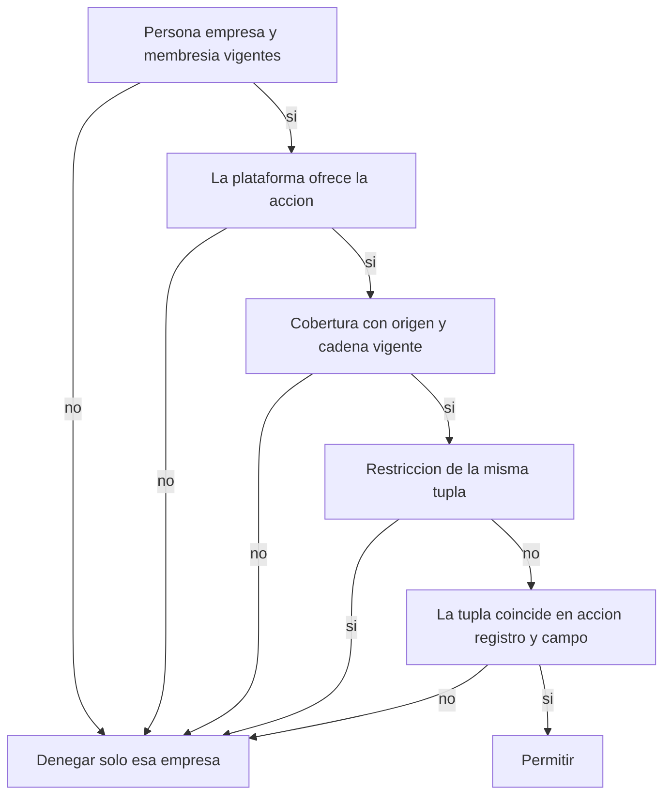

# Punto 8 — Paso 2: participación y permisos dentro de una empresa

Estado de este paso: **DISEÑO CONCEPTUAL REVISADO POR CODEX / SIN IMPLEMENTAR**.

Codex adopta P1–P8, con los límites expresos de este documento, bajo la delegación de criterio de la usuaria. Esta revisión cierra el contrato conceptual del paso 2. No autoriza activar permisos en producción ni resuelve los procedimientos de alta de autoridad, recuperación, persistencia o transición necesarios antes de conectarlo a rutas.

Es un contrato conceptual de acceso. No es implementación, no es una suite ejecutable y no es apto para producción. No crea modelos y no cierra el punto 8. El paso 1 ya adoptó la identidad de cuenta y empresa. Este paso fija quién puede hacer qué dentro de una sola empresa administrada.

Fuente del paso 1, por commit, para que el enlace no dependa de una rama sin integrar:

[docs/point-8-step-01-account-company-boundaries.md en 34a19eb](https://github.com/mariamayorcruz/Nexora/blob/34a19eb892a71f761f5f03a18494b8710d26b4de/docs/point-8-step-01-account-company-boundaries.md)

Commit: `34a19eb892a71f761f5f03a18494b8710d26b4de`. La copia `9831903` queda sustituida por esa revisión.

Base de código de este documento: `main` `b35b3a21afa48005eb49a2f7231e455eeeef35b6`. No se integraron los PR 18, 19 ni 20.

## 1. Estado actual

### Requisitos que este paso toma como cerrados

Quedan fuera de nueva discusión, por el encargo y por el paso 1:

- La cuenta cliente es distinta de `User` y de `Organization`.
- `propia`, `socio` y `agencia` son una relación comercial separada de `Membership`.
- Varias cuentas pueden relacionarse con una empresa sin abrir sus datos.
- Pertenecer a la cuenta, o a una jerarquía laboral, no concede acceso.
- La relación de agencia no concede acceso.
- Retirar el acceso de una agencia obliga a tratar los accesos que dependen de esa relación. Quitar solo el vínculo comercial no completa el retiro.
- `MembershipRole.OWNER` no acredita propiedad legal ni el vínculo `propia`.

### Archivos usados

| Referencia | Hecho que aporta |
|---|---|
| `prisma/schema.prisma:14-48` | `User` es la persona |
| `prisma/schema.prisma:53-98` | estados, `Organization`, `Membership` |
| `prisma/schema.prisma:187-215` | `CrmLead`, `userId`, `organizationId`, `company` |
| `src/lib/tenancy/tenant-context.ts:62-160` | resolución de persona y empresa |
| `src/lib/tenancy/resolve-crm-read-organization.ts:28-38` | lectura CRM por esa resolución |
| `src/lib/tenancy/resolve-crm-write-organization.ts:14-15` y `:38-48` | escritura CRM y comentario de rol |
| `src/lib/tenancy/ensure-user-organization.ts:173-179` | alta de membresía encontrada en `src` |
| `src/app/api/tenant/organizations/route.ts:8-39` | listado de empresas activas y del rol |
| `src/app/api/crm/leads/route.ts:40-66` y `:73-114` | listar y crear leads |
| `src/app/api/crm/leads/[leadId]/route.ts:32-83` | editar un lead |
| `src/app/api/crm/leads/[leadId]/message/route.ts:11-105` | anotar un mensaje y posible envío externo |
| `src/app/api/crm/stats/route.ts:12-27` | agregados de etapa y valor |
| `src/app/api/crm/settings/route.ts:26-34` y `:61-65` | ajustes por `userId` en GET y POST |
| `src/app/api/crm/followups/route.ts:60-93` | seguimiento con puerta mixta |
| `src/app/api/crm/calendar/events/route.ts:18-23` y `:42-45` | calendario por `userId` en GET y POST |
| `src/lib/tenancy/resolve-legacy-crm-write-organization.ts:237-242` | la respuesta quita `organizationId` y conserva el resto |

La búsqueda de `membership.create` en `src` solo encontró `ensure-user-organization.ts`. La búsqueda de métodos HTTP en `src/app/api/crm` encontró GET, POST y PATCH. No apareció DELETE.

### Hechos

1. Una persona y una empresa tienen como máximo una `Membership` (`prisma/schema.prisma:95`). El rol guardado es `OWNER`, `ADMIN` o `MEMBER`, con predeterminado `MEMBER`. El estado es `INVITED`, `ACTIVE`, `SUSPENDED` o `REMOVED`, con predeterminado `ACTIVE`.
2. El resolver admite la empresa solo con membresía `ACTIVE` y organización `ACTIVE` (`src/lib/tenancy/tenant-context.ts:103-108`). `INVITED`, `SUSPENDED` y `REMOVED` no pasan. Si hay varias membresías activas y no viene la cabecera, no elige una (`src/lib/tenancy/tenant-context.ts:142-148`).
3. En las rutas de leads y de stats, el rol no se consulta. El comentario de escritura dice que cualquier rol `ACTIVE` puede hacer las escrituras CRM existentes y remite el detalle al punto 30 (`src/lib/tenancy/resolve-crm-write-organization.ts:14-15`).
4. La única alta de membresía encontrada crea `OWNER` y `ACTIVE` (`src/lib/tenancy/ensure-user-organization.ts:173-179`). No apareció una transición que escriba `INVITED`, `SUSPENDED` o `REMOVED`. Esos estados existen en el enum y el resolver ya los rechaza, pero no hay un flujo de invitación en las rutas inspeccionadas.
5. `GET /api/tenant/organizations` devuelve el rol de cada membresía activa. Eso informa la selección de empresa. No autoriza acciones de CRM.
6. `CrmLead.organizationId` es obligatorio. `userId` se guarda al crear el lead con el actor de la petición (`src/app/api/crm/leads/route.ts:101-102`). El comentario del schema lo llama procedencia (`prisma/schema.prisma:191-192`). El PATCH no lo usa como filtro (`src/app/api/crm/leads/[leadId]/route.ts:55-58`). No hay columna de asignado comercial.
7. Borrar `User` borra sus `CrmLead` por `onDelete: Cascade` (`prisma/schema.prisma:190`). Borrar la empresa está restringido si hay leads (`prisma/schema.prisma:194`).
8. La lista y el PATCH devuelven el lead sin `organizationId` y con el resto de columnas, incluidas `value` y `notes`.

### Acciones CRM que sí existen

| Ruta | Efecto comprobado | Puerta actual |
|---|---|---|
| `GET /api/crm/leads` | Lista los leads de la empresa. Omite correos internos o de prueba. | Membresía activa de esa empresa. Cualquier rol. |
| `POST /api/crm/leads` | Crea el lead y escribe `userId` del actor. | La misma puerta de escritura. |
| `PATCH /api/crm/leads/[leadId]` | Cambia `name`, `email`, `phone`, `company`, `source`, `stage`, `value`, `confidence`, `nextAction`, `notes` y `lastContactedAt` si el id está en esa empresa. No cambia `userId`, `organizationId`, `status` ni `campaignId`. | Escritura de esa empresa. Si el id es de otra, responde que no existe y no escribe. |
| `POST /api/crm/leads/[leadId]/message` | Puede intentar un envío externo y, además, añade el texto a `notes` y actualiza `lastContactedAt`. | La misma puerta de escritura que el PATCH. Hoy las dos cosas van juntas. |
| `GET /api/crm/stats` | Cuenta leads y suma `value` de toda la empresa. | Lectura de esa empresa. |

### Límites de esta lectura

- `GET` y `POST /api/crm/settings` autorizan solo por `userId`. No usan la empresa.
- `GET` y `POST /api/crm/calendar/events`, y el arranque de la conexión, autorizan por `userId`.
- `POST /api/crm/followups` autoriza primero por `userId`. Solo si llega un `leadId` resuelve la empresa y lee ese lead. Un envío sin `leadId` no pasa por la empresa. Ese seguimiento legacy queda fuera del contrato de `crm.lead.message.send`.
- No hay ruta CRM de archivar, borrar de forma definitiva, exportar, compartir ni administrar miembros.
- El aislamiento comprobado es el de leads y stats. No se extiende, por esta lectura, a ajustes, calendario, seguimientos sin lead ni al resto de módulos.
- No se consultó producción ni secretos. No se corrige código.

## 2. Glosario

| Término | Definición de este contrato | Límite |
|---|---|---|
| Membresía | La `Membership` ya existente entre una persona y una empresa. Una por par. | Es la participación. No es la cuenta cliente ni la relación comercial. |
| Rol operativo | Etiqueta del paquete que se asigna a esa membresía. Los valores actuales `OWNER`, `ADMIN` y `MEMBER` son el hueco ya persistido. | Antes de decidir, el paquete se expande a concesiones con origen y vigencia. El enum no es ese origen. `OWNER` no acredita propiedad legal ni vínculo `propia`. |
| Permiso o capacidad | Una acción concreta del catálogo, por ejemplo consultar o enviar un mensaje. | El nombre de un área no es una capacidad. |
| Cobertura | Una tupla completa: acción, ámbito de registro, campo y modo, con un solo origen y una vigencia. | Dos tuplas no se cruzan. La lectura del registro 1 en el campo X no autoriza el registro 2 ni el campo Y. |
| Alcance | La parte de registro de una cobertura: la empresa, los asignados, un registro concreto o la empresa sin registro CRM. | Un alcance no cruza a otra empresa. |
| Acceso a campo | Lectura o edición de una clase de columnas dentro de esa misma tupla. | Poder leer no concede editar, exportar, compartir ni enviar. |
| Concesión | Una cobertura concedida. También lo es cada capacidad resultante de expandir un paquete. | Solo autoriza su tupla, en su empresa, mientras la cadena de origen sigue vigente. |
| Restricción | Una negación explícita de una tupla, con origen y vigencia. | Gana a la concesión de esa misma tupla. No viaja a otra empresa ni a otra tupla. |
| Origen | La procedencia trazable de una concesión, de un paquete expandido o de una restricción: autoridad directa de la empresa, cadena delegada, relación de agencia o snapshot legacy. | No se deduce de `OWNER`, `ADMIN` o `MEMBER`. No es jerarquía laboral. |
| Cadena | La concesión y sus antecesores, revisada en cada decisión. | Si un antecesor se reduce, se suspende o se revoca, el descendiente deja de ser efectivo. Reactivar al antecesor no revive lo ya invalidado. |
| Responsable operativo | Membresía `ACTIVE` cuya concesión efectiva de `company.membership.admin` no depende de la persona a la que se quiere sustituir. | Es continuidad administrativa ordinaria. No es un traspaso legal ni un ascenso automático. |
| Recuperación controlada | Frontera de la empresa que se quedó sin administrador después de cerrar un acceso indebido. | No promociona a nadie y no abre acceso al personal de Nexora. El procedimiento de salida pertenece a un punto posterior. |
| Modo de transición | Marca explícita de la empresa: `legacy_actual` o `contrato_activo`. | Cero concesiones no significan un modo. El modo no se infiere. |
| Estado `INVITED` | Estado de membresía ya definido en el enum. No pasa el resolver. | No es un token, no es una credencial y no tiene por sí mismo caducidad ni permanencia de uso. |

Perfiles de ejemplo (`marketing`, `ventas`, `jefatura`, `agencia`) son paquetes reutilizables. El nombre no concede nada: solo cuentan las tuplas expandidas de ese paquete, con el origen de quien lo asignó.

## 3. Política recomendada

Nombre: **capacidades por empresa, tupla única y restricción local**.

Es la política del punto 30 para el acceso dentro de la empresa. Se evalúa sobre la membresía existente. No añade un segundo motor de roles ni otra fila de membresía para el mismo par.

El catálogo de este ejemplo tiene once capacidades. El perfil completo operativo incluye diez. `crm.lead.delete` está en el catálogo para poder denegarla y no entra en ningún perfil predeterminado.

### Condiciones

Todas se evalúan para la empresa de la petición. El selector de transición acepta únicamente `legacy_actual` y `contrato_activo`: un modo desconocido o ausente deniega, nunca activa una compatibilidad implícita. El modo legacy mantiene el comportamiento existente; las reglas de este contrato se usan en `contrato_activo`.

1. Hay una persona autenticada.
2. La empresa está `ACTIVE`.
3. Existe la membresía de ese par.
4. La membresía está `ACTIVE`. El estado `INVITED` no es acceso ni credencial.
5. Si la acción recae en un lead, su `organizationId` es esa empresa. Crear un lead y administrar membresías no tienen lead de entrada: el ámbito es la empresa, o la membresía destino de esa empresa. Esas acciones no leen un `organizationId` nulo.
6. La plataforma ofrece la acción. Esa oferta es una entrada externa. Este paso no define planes ni precios. Si la entrada falta, la acción se deniega. Un permiso local no enciende una función que la plataforma no ofrece.
7. Hay una cobertura vigente cuya tupla coincide entera con la acción, el registro y el campo, y ninguna restricción vigente niega esa misma tupla.

Si una condición falla, el resultado es denegar esa acción en esa empresa. No se borra el usuario, no se borran leads y no se modifica otra empresa. Una lista autorizada y vacía no es una denegación: se devuelve la colección vacía.

### Precedencia

1. Fuera de `contrato_activo` este contrato no sustituye el comportamiento actual. Entrar en `contrato_activo` es una marca explícita, no la ausencia de filas.
2. Fallar una condición de persona, empresa o membresía deniega, con el motivo de esa condición.
3. Cada asignación de rol se expande, antes de evaluar, a concesiones con el origen y la vigencia de esa asignación. El valor `OWNER`, `ADMIN` o `MEMBER` no aporta origen y no sobrevive como permiso directo cuando el origen se revoca.
4. Una concesión es efectiva solo si toda su cadena lo es en esa decisión: cada antecesor sigue cubriendo esa tupla, su membresía está `ACTIVE` y la concesión no está revocada. La reducción, la suspensión o la revocación del otorgante dejan inefectivos a los descendientes. La reactivación del otorgante no los restaura.
5. Una restricción que coincide con la misma tupla gana a cualquier concesión. Una restricción de otra tupla o de otra empresa no se consulta.
6. Si ninguna cobertura vigente coincide entera, se deniega. No se arma una tupla nueva uniendo el registro de una concesión con el campo de otra.
7. Editar un campo exige una tupla de lectura de ese mismo campo en ese mismo registro. Exportar y compartir exigen esa lectura y, además, su propia capacidad. Enviar un mensaje no se deduce de editar `notes`.

Varias concesiones se consideran en la misma decisión, cada una con su tupla. Dos lecturas, una de asignados y otra de un lead concreto, autorizan esos dos conjuntos y ningún cruce de campos. Una restricción de exportar en la empresa A no afecta a la empresa B. No hay un DENY global de la persona.

El acceso completo operativo es el perfil de diez capacidades de la sección 4, con ámbito de empresa y con las clases de campo que cada capacidad usa, menos las restricciones explícitas y menos lo que la plataforma no ofrece. No incluye `crm.lead.delete`, otra empresa, la cuenta cliente, el personal de Nexora ni el soporte. La jerarquía laboral y la asociación a la cuenta cliente no entran en la decisión.

### Paquetes

Propuesta de diseño para `contrato_activo`. No es el comportamiento actual.

| Asignación | Se expande a | Origen |
|---|---|---|
| Responsable operativo | Las diez capacidades del perfil completo, sin `crm.lead.delete`. | El de la asignación. Si lo asignó una agencia, la cadena es esa agencia. |
| Administrador | Las mismas capacidades de datos, envío, archivo, exportación, compartición, `company.membership.admin` y `company.permission.grant`. No incluye `company.policy.restrict` ni `crm.lead.delete`. | El de la asignación. |
| Miembro base | Ninguna tupla. | No hereda el enum `MEMBER` como permiso. |
| Ejemplo de marketing | `crm.lead.read` de empresa, clases de identidad, canal y gestión. | El de quien concede ese paquete. |
| Ejemplo de ventas | `crm.lead.read` y `crm.lead.update` sobre asignados, clases de identidad, canal y gestión. | El de quien concede ese paquete. |
| Ejemplo de jefatura | Ninguna tupla hasta un paquete propio. | La jerarquía no asigna origen ni permiso. |
| Ejemplo de agencia | Solo las tuplas cuyo origen es esa relación, con el ámbito concedido. | La relación de agencia. Al revocarla no quedan como permisos directos. |

El paquete del responsable y el del administrador incluyen `crm.lead.message.send` y `crm.lead.archive` como capacidades propias. No incluyen `crm.lead.delete`. Habilitar el borrado definitivo, y la retención que lo condiciona, es otro corte.

### Catálogo

Otros módulos podrán reutilizar las mismas condiciones, la misma tupla y la misma separación por empresa. Este paso no les asigna capacidades.

| # | Capacidad | Qué autoriza | En el perfil completo | Delegable aquí |
|---|---|---|---|---|
| 1 | `crm.lead.read` | Consultar leads y agregados de campos ya legibles. | Sí | Sí |
| 2 | `crm.lead.create` | Crear un lead en la empresa. `userId` queda como procedencia, no como asignación. | Sí | Sí |
| 3 | `crm.lead.update` | Editar los campos de la tupla. No envía nada a un tercero. | Sí | Sí |
| 4 | `crm.lead.message.send` | Enviar al destinatario de un lead y, después del envío, registrar el resultado con una escritura interna acotada. | Sí | Sí |
| 5 | `crm.lead.archive` | Archivar el lead cuando exista una ruta. Hoy no existe. No borra el registro. | Sí | Sí |
| 6 | `crm.lead.delete` | Borrado definitivo cuando un corte posterior lo habilite y fije retención. Hoy no existe. | No | No |
| 7 | `crm.lead.export` | Exportar tuplas ya legibles. Hoy no existe. | Sí | Sí |
| 8 | `crm.lead.share` | Conceder a otra membresía tuplas delegables que el otorgante posee. Hoy no existe. | Sí | Sí |
| 9 | `company.membership.admin` | Invitar, activar, suspender y retirar membresías de esa empresa, con la regla ordinaria o la de seguridad de la sección 6. | Sí | Solo como nombramiento ordinario de un reemplazo independiente |
| 10 | `company.permission.grant` | Conceder capacidades delegables que el otorgante posee. No impone ni levanta restricciones. | Sí | Solo dentro de lo que el otorgante posee |
| 11 | `company.policy.restrict` | Imponer o levantar restricciones, sin ampliar los derechos propios. | Sí, solo en el responsable | No, hacia quien la usaría para levantar su propia cadena |

### Pseudocódigo

Esto describe una evaluación pura sobre un estado validado. Devuelve una decisión y obligaciones; no modifica concesiones, no escribe datos y no envía mensajes. El ejecutor futuro debe validar vigencia antes de materializar la decisión y aplicar las obligaciones de forma consistente. No es código del repositorio y no se ejecuta.

```text
solicitud = (operacion, accion, empresa, recurso, campos, consulta)
recurso.tipo = empresa | membresia | lead | coleccion
cobertura = (empresa, accion, ambito, campo, modo, origen, vigencia, padre)
resultado = denegar(motivo) | permitir(obligaciones) | delegar_a_legacy

decidir(estado, persona, solicitud):
  si modo_transicion es desconocido o falta:
    denegar modo_no_definido
  si modo_transicion es legacy_actual:
    delegar_a_legacy explícitamente; no devolver un permiso del contrato
  verificar persona autenticada y existente, empresa ACTIVE
  verificar Membership del par en estado ACTIVE
  verificar accion conocida y ofrecida por plataforma
  verificar tipo de recurso válido para esa accion
  si recurso es lead o membresia:
    verificar pertenencia a empresa sin exponer recursos de otra empresa
  si recurso es empresa o coleccion:
    usar empresa como ámbito; nunca leer un lead nulo
  si falta un dato necesario de política o la operación no está definida:
    denegar politica_incompleta

  coberturas = expandir asignaciones de paquetes con su origen y vigencia
                junto con concesiones explícitas de esta membresía y empresa
  conservar solo coberturas con cadena_vigente(estado, cobertura)

  efectivo(accion, recurso_o_ambito, campo, modo):
    si campo o modo es desconocido para la accion:
      denegar sin_politica
    si restriccion vigente aplicable de esta empresa cubre la combinación:
      denegar restriccion_explicita
    si alguna cobertura coincide con TODA la combinación:
      permitir
    denegar sin_permiso

  si operacion es listar:
    exigir una cobertura vigente de crm.lead.read para el ámbito solicitado
    una restricción sobre un registro lo excluye, no abre ni mezcla otros ámbitos
    exigir que filtros/ordenaciones/agregados solo usen campos legibles
      en todo el ámbito sobre el que se evaluarán
    devolver permitir con predicado de empresa + alcance + restricciones,
      proyección de campos por registro y conteos del mismo conjunto
    si el conjunto autorizado está vacío, el ejecutor devuelve []
    no devolver permiso de listado para un ámbito mayor al concedido

  si operacion es crear o editar:
    exigir efectivo para cada campo aportado y para el ámbito de destino
    en editar, exigir además lectura de cada campo del lead existente
    en crear, evaluar capacidad de creación sobre empresa, sin lectura de lead nulo
    rechazar campos inmutables, desconocidos o no soportados por esa operación
    si falla cualquier campo, denegar toda la mutación
    devolver permitir con validación de todos los campos antes de escribir,
      escritura atómica y proyección posterior según permisos de lectura

  si operacion es enviar_mensaje:
    exigir efectivo(crm.lead.message.send, lead, canal, enviar)
    exigir lectura del destinatario y de cada campo almacenado usado en contenido
    devolver permitir con autorización anterior a todo efecto externo,
      registro interno acotado del resultado y proyección de respuesta
    esta decisión no concede edición general de notes
    no autoriza rutas legacy ni envíos sin contexto de empresa

  si operacion es exportar:
    exigir lectura y crm.lead.export para cada registro/campo solicitado
    si cualquiera no está autorizado, denegar la solicitud
    devolver permitir con ámbito recortado y proyección

  si operacion es compartir:
    exigir crm.lead.share y lectura de cada combinación solicitada
    aplicar además las reglas de compartir de las secciones 5 y 7
    devolver permitir con concesiones dependientes de las coberturas comprobadas

  si operacion es administrar, conceder, restringir, archivar o revocar:
    exigir efectivo para el ámbito y acción específicos
    aplicar la regla de transición correspondiente de las secciones 6 y 7
    devolver una decisión, nunca ejecutar la transición aquí

  denegar operacion_no_definida

cadena_vigente(estado, cobertura):
  exigir origen conocido, vigencia activa y misma empresa en toda la cadena
  recorrer padres sin ciclos; padre ausente o ciclo deniega
  verificar que cada padre conserva la autoridad delegable y la combinación
  verificar membresías vigentes y versiones de revocación aplicables
  la raíz tiene que ser una autoridad validada de empresa o un snapshot validado
  no inferir una raíz del enum OWNER/ADMIN ni de una relación comercial
  devolver verdadero o falso; no mutar el estado durante esta lectura

transiciones de origen (requisito para un futuro ejecutor, no parte de decidir):
  reducir, suspender o revocar invalida los descendientes dependientes
    de forma persistente y coherente antes de confirmar la transición
  aumentar o reactivar al padre no elimina esa invalidación
  si no hay evidencia vigente y consistente, cadena_vigente devuelve falso
  nuevas concesiones requieren un nuevo acto autorizado
```

Conceder, compartir, restringir y revocar están en las secciones 6 y 7. El diagrama resume el orden de una tupla. La lista vacía autorizada, la mutación completa y el envío previo al efecto externo están en el pseudocódigo.



## 4. Matriz de acciones

| Acción | Existe ahora | Capacidad | Perfil completo en esa empresa | No se deduce de |
|---|---|---|---|---|
| Consultar | Sí. `GET /api/crm/leads` y `GET /api/crm/stats`. | `crm.lead.read` | Lista el conjunto visible de la empresa y proyecta campos. Un conjunto vacío autorizado se devuelve vacío. Los agregados usan ese conjunto. | Tener membresía en otra empresa. Pedir el listado de toda la empresa sin esa tupla se deniega; eso no deniega el listado acotado. |
| Crear | Sí. `POST /api/crm/leads`. No hay lead previo. | `crm.lead.create` | Crea en la empresa si todos los campos enviados están autorizados. La respuesta omite campos ilegibles. | Consultar. Crear no asigna el lead a su `userId`. |
| Editar | Sí. `PATCH` de los campos listados. | `crm.lead.update` | Edita solo si cada campo pedido tiene tupla de edición y de lectura. Si uno falla, no escribe ninguno. La respuesta se proyecta. | Consultar. No autoriza envío externo ni la ruta de seguimiento. |
| Enviar mensaje | La ruta `POST .../message` existe y hoy también reescribe `notes`. | `crm.lead.message.send` | Exige envío, lectura del canal y lectura del contenido almacenado que se vaya a usar. El efecto externo va después. Luego hay una escritura acotada del resultado. | `crm.lead.update` sobre `notes`. Tampoco autoriza `POST /api/crm/followups`. |
| Archivar | No hay ruta. | `crm.lead.archive` | Cuando exista, solo leads de esa empresa y sin borrado definitivo. | Editar o consultar. |
| Borrar definitivo | No hay ruta. | `crm.lead.delete` | No está en el perfil completo ni en ningún perfil predeterminado. Habilitarlo y fijar retención es otro corte. | Archivar, editar o borrar `User`. |
| Exportar | No hay ruta. | `crm.lead.export` | Exporta solo tuplas ya legibles. | `GET /api/crm/leads` y el snapshot legacy. |
| Compartir | No hay ruta. | `crm.lead.share` | Concede una tupla delegable que el otorgante posee, a una membresía `ACTIVE` de la misma empresa, con origen dependiente. | Consultar. No crea administración, no crea membresía y no abre el resto de la empresa. |
| Administrar miembros | No hay ruta CRM. El alta encontrada crea `OWNER` activo. El listado de empresas no administra. | `company.membership.admin` | Cambios ordinarios con reemplazo independiente, o cierre de seguridad según la sección 6. No usa un lead. | Cualquier capacidad de leads. |
| Conceder | No hay ruta. | `company.permission.grant` | Concede tuplas delegables ya poseídas. No levanta restricciones. | `company.policy.restrict`. |
| Restringir | No hay ruta. | `company.policy.restrict` | Impone o levanta restricciones dentro de su alcance, sin ampliar los derechos de quien actúa. | `company.permission.grant`. |

Perfiles de ejemplo, aplicables solo por las tuplas de cada fila:

| Perfil | Composición | Queda fuera |
|---|---|---|
| Completo / responsable operativo | Diez capacidades, de la 1 a la 5 y de la 7 a la 11. Ámbito de empresa. Lectura y edición de todas las clases. Sin la 6. | `crm.lead.delete`, otra empresa y cualquier módulo no citado. |
| Administrador | Capacidades 1 a 5 y 7 a 10. | `company.policy.restrict`, `crm.lead.delete` y quitarse restricciones. |
| Miembro base | Ninguna tupla. | Toda acción hasta una concesión con origen. |
| Ejemplo de marketing | Lectura de empresa para identidad, canal y gestión. | Editar, enviar, archivar, borrar, exportar, compartir, administrar y la clase reservada. |
| Ejemplo de ventas | Lectura y edición sobre asignados, clases de identidad, canal y gestión. | Enviar, la clase reservada, el resto de la empresa, exportar, compartir, archivar, borrar y administrar. |
| Ejemplo de jefatura | Ninguna tupla. | Los registros del subordinado y cualquier herencia por jerarquía. |
| Ejemplo de colaborador de agencia | Tuplas cuyo origen es la relación concedida. | El vínculo comercial por sí solo, el permiso directo tras la revocación y las empresas no concedidas. |

## 5. Alcances y campos

### Alcances

| Alcance | Regla | Dato actual |
|---|---|---|
| Empresa | Todos los `CrmLead` con ese `organizationId`, cuando la tupla pide ámbito de empresa. | Ya existe la columna. |
| Asignados | Solo registros ligados en el futuro a esta membresía por una asignación explícita. | No existe. `CrmLead.userId` es procedencia del creador. Usarlo como asignado o como dueño comercial queda prohibido. Si el dato futuro no está, el conjunto visible de ese alcance está vacío y el listado autorizado devuelve vacío. |
| Registro concreto | Solo el identificador nombrado en esa cobertura. | No existe la concesión. No se diseña aquí su tabla. No incluye otro registro ni otra empresa. |
| Sin lead | Crear, administrar, conceder y restringir. El ámbito es la empresa o la membresía destino. | La membresía ya existe. La decisión no finge un lead. |

La búsqueda, el filtro, el agregado y la exportación parten del conjunto ya recortado por empresa y por tupla. Un registro fuera de la tupla no se devuelve y no se cuenta. Ocultarlo solo en la pantalla no cumple el contrato.

### Clases de campo

Salen de columnas que ya tiene `CrmLead`. No se añaden columnas.

| Clase | Columnas | Lectura y edición |
|---|---|---|
| `f.identidad` | `id`, `name` | `id` solo se lee y lo genera el sistema; no es editable. Editar `name` exige leer la misma combinación. |
| `f.canal` | `email`, `phone` | Igual. El envío exige leer esta clase en ese lead. |
| `f.gestion` | `company`, `source`, `stage`, `status`, `nextAction`, `lastContactedAt`, `confidence`, `createdAt`, `updatedAt` | `createdAt` y `updatedAt` son de lectura y mantenimiento del sistema. `status` hoy viaja en la lectura y el PATCH inspeccionado no lo escribe. Una concesión no convierte un campo no soportado en editable. |
| `f.reservado` | `value`, `notes` | Clase confidencial del ejemplo. Puede ocultarse sin ocultar el nombre. Editar `notes` no autoriza el envío. |

La proyección usa una lista explícita de campos en el servidor, tanto en la lista como en la respuesta de crear, editar y registrar un envío. Todo campo no clasificado se omite por defecto y se rechaza en mutaciones. `userId`, `organizationId` y `campaignId` no adquieren acceso de lectura o escritura por caer fuera de la tabla: requieren una política explícita posterior antes de exponerse, y no se aceptan del cliente como cambios de pertenencia. Crear exige permisos de creación por campo, no lectura de un lead aún inexistente. No se sustituye un campo oculto por un valor que confirme el dato. Un filtro, una ordenación o un agregado sobre una clase sin lectura se deniega entero. `GET /api/crm/stats` suma `value`; sin lectura de `f.reservado` se deniegan sus cifras. Las cuentas de registros solo incluyen el conjunto visible y no revelan el total de la empresa.

Una mutación se valida por todos los campos presentes. Si uno no está autorizado, no se escribe ninguno. Exportar exige `crm.lead.export` y la lectura de esa misma tupla. Pedir una clase oculta deniega la exportación completa.

Compartir crea una concesión nueva solo si se cumplen todas estas condiciones: la acción y el campo son delegables, el otorgante posee esa tupla de forma efectiva, el destinatario tiene membresía `ACTIVE` en la misma empresa, el origen de la concesión nueva depende del otorgante y el paquete compartido no incluye administración, concesión de permisos, política de restricciones ni borrado definitivo.

## 6. Ciclo de vida

| Estado actual | Efecto que el resolver ya tiene | Regla de este contrato |
|---|---|---|
| `INVITED` | No pasa a `TenantContext`. | Es un estado de membresía, no un token. No da acceso. El mecanismo futuro que lo acompañe tiene que ser válido, de un solo uso, revocable y dirigido a un destinatario. Su duración es configurable y tiene que quedar decidida antes de emitir ese mecanismo. Este paso no elige un número y no autoriza a emitirlo sin esa decisión. |
| `ACTIVE` | Puede resolver la empresa. El rol sigue sin distinguir las rutas de leads. | Único estado que puede tener concesiones efectivas, y solo en `contrato_activo` con tuplas vigentes. |
| `SUSPENDED` | No pasa el resolver. | Toda decisión de esa empresa deniega. La sesión o una caché no prolongan el permiso. Sus concesiones propias quedan guardadas con vigencia suspendida. Las que había otorgado pasan a `invalidada`. Al volver a `ACTIVE`, las propias suspendidas pueden recuperar vigencia; las invalidadas no. |
| `REMOVED` | No pasa el resolver. | Retiro de esa empresa. La persona y sus leads permanecen. Volver a `ACTIVE` no recupera concesiones revocadas: hacen falta concesiones nuevas. |

La activación de una membresía comprueba persona autenticada, empresa y par. Una invitación a la empresa A no activa la empresa B. Aceptar la invitación no concede el paquete de quien invitó.

### Restricciones

Solo `company.policy.restrict`, limitado al conjunto de destinatarios y permisos que su autoridad de política puede gestionar, permite imponer o levantar restricciones. `company.permission.grant` no lo hace. Tener autoridad de política en A no permite cambiar B.

La procedencia de una restricción es trazabilidad, no una concesión positiva dependiente de la presencia de su autor. Revocar o suspender al autor no elimina automáticamente sus restricciones ni amplía permisos de otros. Siguen vigentes hasta una retirada explícita autorizada. Un delegado no puede levantar límites de su cadena de autoridad; sí puede gestionar restricciones de otros destinatarios dentro de su autoridad expresa cuando ello no le beneficia directa ni indirectamente.

```text
restringir(autoridad, destino, empresa, combinacion):
  verificar company.policy.restrict y su ámbito de destinatarios/combinaciones
  destino pertenece a empresa
  no permitir ampliar derechos de quien actúa ni neutralizar un límite superior
  aplicar regla de continuidad ordinaria o retirada de seguridad, según proceda
  devolver permitir con registro de autor, motivo, ámbito y vigencia

levantar(autoridad, restriccion):
  verificar company.policy.restrict para esta restricción y su destinatario
  si la restricción limita a la autoridad o a su cadena ascendente:
    denegar restriccion_propia
  si levantarla ampliaría derechos efectivos de la autoridad directa o indirectamente:
    denegar ampliacion_propia
  si la restricción proviene de una autoridad superior fuera de su ámbito:
    denegar fuera_de_autoridad
  en los demás casos, permitir la retirada explícita y trazable
  ser subordinado o descendiente no impide por sí solo que una autoridad
    independiente gestione sus restricciones
```

### Último responsable y recuperación

Hay dos operaciones distintas.

Cambio administrativo ordinario. Suspender, retirar o estrechar `company.membership.admin` de un responsable exige un reemplazo ya efectivo, o una operación atómica que nombra al reemplazo y retira al anterior juntas. El reemplazo es elegible solo si su concesión de administración no depende del responsable que sale. Si eso no se cumple, la operación no se ejecuta: el resultado informa que requiere reemplazo; no se crea una cola que la ejecute después sin nueva validación. El acceso anterior sigue vigente y no se presenta como revocado.

Retirada de seguridad. Exige una solicitud autenticada y una autoridad de revocación validada para esa empresa. No basta que el cliente envíe una bandera de «seguridad», pertenezca a la cuenta o declare ser dueño. La definición y comprobación de una autoridad de emergencia independiente cuando no queda un administrador confiable es una dependencia obligatoria del futuro procedimiento de recuperación: si esa autoridad no está validada, se deniega la operación. Con autoridad válida, cerrar un acceso indebido, incluida la agencia que es la única administradora, debe poder terminar aunque deje cero administradores. La empresa entra en recuperación controlada. Nadie asciende de forma automática y el personal de Nexora no recibe acceso por este estado. Los datos permanecen. El procedimiento para entrar por autoridad de emergencia y para salir de la recuperación es un punto posterior; aquí solo queda la frontera y no se puede habilitar ese flujo sin concretarla. Las concesiones que dependían del acceso cerrado siguen inefectivas. Las de otro origen se tratan de forma explícita y no se convierten en administración.

## 7. Delegación y revocación

### Conceder

La delegación ordinaria mantiene dependencia del otorgante. Un nombramiento independiente de responsable es una transición de autoridad de empresa distinta: requiere verificar quién puede nombrarlo y por qué su autoridad sobrevivirá al saliente. No se obtiene borrando el padre de una concesión ni convirtiendo un rol de agencia en raíz directa. Ese procedimiento debe quedar especificado antes de implementarse; hasta entonces no se admite como reemplazo una concesión dependiente.

```text
conceder(otorgante, destino, empresa, tupla):
  decidir(otorgante, empresa, company.permission.grant) debe permitir
  la tupla es delegable y no es crm.lead.delete
  decidir(otorgante, empresa, tupla) debe permitir en esta misma decisión
  el ámbito pedido no es más amplio que el del otorgante
  destino está ACTIVE en esa misma empresa
  si destino es otorgante:
    denegar motivo=autoelevacion
  si la tupla incluye administracion, politica o borrado por medio de crm.lead.share:
    denegar motivo=administracion_no_implicita
  si la operación levanta una restricción o amplía derechos propios indirectamente:
    denegar motivo=sin_autoridad_o_ampliacion_propia
  validar cobertura de TODO el ámbito y TODOS los campos pedidos, no una muestra
  devolver permitir con obligación de crear concesión trazable dependiente
  el ejecutor autorizado registra padre y origen; decidir no escribe
```

Un administrador con lectura de asignados no puede conceder lectura de toda la empresa. Quien edita `notes` no puede conceder `crm.lead.message.send` si no lo posee. Una restricción sigue ganando aunque el paquete de origen sea amplio.

### Agencia retirada

La relación comercial no es la concesión. Al cerrar el acceso de la agencia en una empresa, con autoridad de seguridad validada según la sección 6:

1. Se toman las concesiones de esa empresa cuyo origen depende de esa relación, incluidos los paquetes expandidos que la agencia asignó y todos sus descendientes. No quedan convertidas en origen directo.
2. Las concesiones de otro origen quedan fuera. Se listan para conservarlas o revocarlas con una decisión explícita. El silencio no las borra ni las vuelve acceso de agencia.
3. La cadena se invalida en la misma operación. No se presenta como pendiente ni como ya revocada antes de terminar. Si la operación no termina, el estado anterior sigue visible.
4. Si esa agencia era la única administradora, el cierre igual se completa y la empresa queda en recuperación controlada, con cero administradores.
5. Si la operación era ordinaria y no hay reemplazo independiente, no entra en este cierre: queda pendiente y el acceso de agencia sigue vigente.
6. La decisión siguiente relee la cadena. Una sesión o una caché no conservan la concesión invalidada. Reactivar más tarde a la persona de la agencia no restaura las concesiones invalidadas.
7. No se borra `User`, no se borran `CrmLead` y no se toca otra empresa ni otra relación de la misma agencia.

El schema actual es incompatible con usar el borrado de `User` como revocación: ese borrado elimina los leads de esa persona en cascada, incluidos los de empresas que no se están retirando. El retiro de acceso cambia la vigencia de las concesiones de una empresa o el estado de esa membresía.

## 8. Casos de aceptación

Recorrido lógico del pseudocódigo con la empresa en `contrato_activo` y la oferta de plataforma verdadera, salvo el caso que dice lo contrario. Los datos futuros se suponen solo cuando la columna los nombra. No son pruebas ejecutables, no usan datos reales y no declaran el contrato apto para producción.

| Caso | Contexto | Acción | Resultado | Motivo | Dato futuro requerido |
|---|---|---|---|---|---|
| 1. Dos empresas | Ana en A con lectura de marketing y en B con lectura de ventas sobre asignados. En B no hay asignación. | Listar A. Exportar A. Pedir el listado de toda B. Listar el alcance asignado de B. | A se lista sin `value` ni `notes`. Exportar A se deniega. El listado de toda B se deniega. El listado asignado de B se permite y devuelve vacío. | A tiene lectura de empresa y no tiene exportar. B no tiene tupla de empresa. La tupla de asignados existe y su conjunto visible está vacío. | Asignación, solo para llenar ese conjunto. `userId` no cuenta. |
| 2. Invitado | Bruno, membresía `INVITED` en A. No hay mecanismo de invitación emitido. | `GET /api/crm/leads` de A. | Denegar. No aparece una credencial usable. | `membresia_no_activa`. `INVITED` no es token. Emitir un mecanismo exige antes una duración decidida, un destinatario, un solo uso y revocabilidad. Este caso no inventa esa duración. | La decisión de duración, fuera de este paso, antes de emitir. |
| 3. Marketing | Lectura de empresa para identidad, canal y gestión. | Consultar leads. Exportar. Enviar mensaje. | La consulta permite esas clases y omite `f.reservado`. Exportar y enviar se deniegan. No hay efecto externo. | Hay `crm.lead.read`. No hay `crm.lead.export` ni `crm.lead.message.send`. | Ninguno para esas denegaciones. Esas rutas de exportar no existen. |
| 4. Ventas | Lectura y edición sobre asignados, sin `f.reservado` y sin envío. L1 asignado y L2 no. | Consultar L1. Editar solo `stage` de L1. Editar `value` de L1. Consultar L2. Enviar mensaje de L1. | L1 se consulta sin `value` ni `notes`. El `stage` se edita y la respuesta sigue sin reservados. `value`, L2 y el envío se deniegan. `notes` no cambia por el envío denegado. | La tupla de L1 cubre `f.gestion`. `value` cae en `edicion_sin_lectura`. L2 no está en el ámbito. El envío es otra capacidad. | Asignación de L1. Sin ella, el listado asignado vuelve vacío y L1 se deniega. |
| 5. Jefatura | Jefa activa, paquete vacío. Un subordinado tiene L1. | Consultar L1. | Denegar. | `sin_permiso`. La jerarquía no crea tupla ni origen. | Ninguno. |
| 6. Un registro compartido | Paquete vacío y una concesión solo de L1, lectura de identidad y canal, origen del otorgante. | Consultar L1. Consultar L2. Exportar L1. Administrar miembros. | L1 se permite con esos campos. L2, la exportación y la administración se deniegan. | La tupla nombra L1 y esas clases. No hay lectura de empresa, ni exportar, ni administración implícita. | Identificador explícito del compartido. |
| 7. Campos que no se cruzan | Concesión de lectura de R1 en `f.identidad` y otra de R2 en `f.canal`. | Leer R1 identidad, R1 canal, R2 canal y R2 identidad. | Solo R1 identidad y R2 canal se permiten. | Cada cobertura coincide entera. No se une el registro de una con el campo de la otra. | Dos concesiones distintas, no una tabla nueva en este paso. |
| 8. Mutación completa | Lectura y edición de gestión en L1 asignado; creación de identidad/gestión en empresa, sin permiso de value. | PATCH con stage y value; crear con value. | Ambas se deniegan sin escribir campos. | El PATCH carece de lectura/edición de value y la creación carece de permiso de creación de value. El motivo concreto corresponde al primer control fallido; no hay escritura parcial. | Asignación para L1 y concesión explícita de creación por empresa. |
| 9. Envío separado | Lectura y edición de `notes` en L1. No hay `crm.lead.message.send`. | Editar `notes`. Llamar `POST .../message`. Llamar el seguimiento legacy. | La edición de `notes` se permite. El mensaje se deniega sin efecto externo y sin otra escritura. El seguimiento legacy no queda autorizado por estas tuplas. | `crm.lead.update` no incluye `crm.lead.message.send`. `POST /api/crm/followups` está fuera de este catálogo. | Ninguno para la denegación del envío. |
| 10. Compartir | Otorgante con lectura de L1 en identidad y con `crm.lead.share`. Destino activo en la misma empresa. Otro destino está `SUSPENDED`. | Compartir esa tupla. Compartir también `company.membership.admin`. Compartir al destino suspendido. | La tupla de lectura se concede con padre en el otorgante. La administración se deniega. El destino suspendido se deniega. | Solo se comparte una tupla delegable poseída, con origen dependiente, hacia una membresía `ACTIVE`. | La concesión nueva y su padre. No su tabla física. |
| 11. Autoelevación y restricción | Delegado con lectura y `company.permission.grant`. Una restricción de origen de política le niega exportar. | Concederse exportar. Levantar esa restricción. | Las dos se deniegan. La restricción sigue. | No posee exportar. El destino es él mismo. No tiene `company.policy.restrict`. Aunque lo tuviera, levantar una restricción propia deniega por `restriccion_propia`. | Origen de la restricción. |
| 12. Suspensión de la cadena | La sesión sigue emitida. Quien otorgó la lectura de A está `SUSPENDED`. La membresía de B, con lectura de origen directo, está `ACTIVE`. | Consultar A. Consultar B. Reactivar después al otorgante de A. | A se deniega durante la suspensión y sigue denegada después de reactivar al otorgante. B se permite. No se borra la persona ni leads. | La cadena no está vigente. Reactivar no revive al descendiente. B es otra empresa y otro origen. | Marca de vigencia de la concesión hija. El resolver ya relee el estado de la membresía si no hay caché. |
| 13. Agencia y permiso directo | En C1, la lectura de empresa y el rol operativo los asignó la agencia. L9 tiene lectura de origen directo, independiente. C2 tiene otra concesión de esa agencia. Hay un responsable cuyo origen no es la agencia. Se cierra el acceso de agencia en C1. | Consultar C1. Consultar L9. Consultar C2. | La lectura y el rol expandido de C1 quedan inefectivos, sin convertirse en origen directo. L9 sigue hasta una decisión explícita. C2 no cambia. Los leads siguen. | Se invalida la cadena dependiente, incluido el paquete expandido. El enum no conserva ese permiso. El origen directo no entra en el conjunto. | Origen de la asignación del rol y de cada concesión. La relación de agencia viene del paso 1 y no está persistida. |
| 14. Retiro ordinario | Una sola concesión efectiva de `company.membership.admin`, de origen directo. No hay reemplazo. | Suspenderla o retirarla como cambio ordinario. | La operación queda pendiente. La concesión sigue vigente y no se muestra como revocada. | Falta un reemplazo independiente, o un retiro atómico que lo nombre. Una concesión que dependiera de este responsable no serviría como reemplazo. | Saber el padre de cada concesión de administración. |
| 15. Agencia única administradora | La única concesión de `company.membership.admin` depende de la agencia. No hay reemplazo. Se pide retirada de seguridad por una autoridad independiente validada para esa empresa. | Cerrar ese acceso. | El cierre se completa. Quedan cero administradores. La empresa entra en recuperación controlada. Nadie asciende. El personal de Nexora no recibe acceso. Los leads siguen. El cierre no queda descrito como pendiente. | La retirada de seguridad puede dejar la empresa sin administrador. El modo de salir de la recuperación no se define aquí. | Autoridad de emergencia y frontera de recuperación validadas. Sin esa autoridad, se deniega; el procedimiento posterior no forma parte de este paso. |
| 16. Otra empresa | Miembro activo de A. El lead pertenece a B. | `PATCH` de ese id contra A. | Denegar, sin escritura. | `registro_otra_empresa`. La ruta actual responde que no existe cuando el id no está en la empresa. | Ninguno. `organizationId` ya existe. |
| 17. Campo restringido | El perfil de ventas del caso 4, con L1 asignado. | Listar L1. Filtrar por `value`. Exportar incluyendo `value`. Pedir la suma de `value`. | La lista omite `value` y `notes`. El filtro y la suma se deniegan con `campo_no_legible`. La exportación se deniega con `exportacion_sin_lectura`. | No hay lectura de `f.reservado`. Aunque la hubiera, faltaría `crm.lead.export`. | Asignación de L1. La exportación sigue sin ruta. |
| 18. Cutover | La empresa pasa a `contrato_activo` con un snapshot que nombra, por membresía, lectura, creación y edición de las rutas ya existentes. No nombra envío, exportación ni borrado. Otra empresa sigue en `legacy_actual` y no tiene filas de concesión. | Un `MEMBER` de la primera consulta, crea, edita, envía y exporta. La segunda sigue como hoy. | En la primera, lectura, creación y edición se permiten solo en las tuplas del snapshot. Envío, exportación y borrado se deniegan. La segunda no activa este contrato por tener cero filas. | El modo es explícito. El snapshot no es un permiso indiscriminado y su origen es `legacy_snapshot`, no el enum ni una agencia. | El inventario explícito. Este paso no define su persistencia. |
| 19. Reactivar después de REMOVED | Una membresía vuelve de `REMOVED` a `ACTIVE`. Sus concesiones anteriores están revocadas. | Consultar con esas concesiones antiguas. | Denegar hasta que existan concesiones nuevas. | Reactivar no recupera permisos revocados. | Concesiones nuevas, no una resurrección. |
| 20. Emergencia sin autoridad | Un miembro o una petición sin autorización marca seguridad=true. | Retirar al único administrador. | Denegar, sin cambiar accesos. | La bandera no acredita autoridad de revocación. | Procedimiento de autoridad validada antes de habilitar emergencias. |
| 21. Restricción y autor retirado | Una restricción vigente oculta notes; su autor pierde acceso. | Leer notes; una autoridad independiente competente levanta después la restricción de otro usuario. | La primera lectura se deniega. La retirada posterior solo se permite dentro de su autoridad y sin beneficio propio. | Revocar al autor no revoca la restricción. La prohibición no bloquea toda gestión legítima de restricciones de subordinados. | Restricción persistente y ámbito explícito de autoridad de política. |
| 22. Campo no clasificado | Permiso de lectura de identidad y gestión. Respuesta contiene además userId, campaignId o un nuevo campo. | Proyectar respuesta; enviar id/organizationId en una edición. | Omitir campos sin clasificación; denegar cambios de campos inmutables o no soportados. | Lista explícita de campos y política por operación. | Proyección por registro, nunca serialización indiscriminada del modelo. |
| 23. Evaluación pura e invalidación | Una cadena tiene padre ausente, ciclo o versión revocada; o falta modo de transición. | Evaluar lectura y volver a activar al padre. | Denegar sin escribir estado; reactivar no revierte invalidaciones persistentes. | Datos de política incompletos no autorizan; el evaluador no ejecuta transiciones. | Estado y versiones coherentes provistos por el ejecutor futuro. |


## 9. Decisiones recomendadas y corte siguiente

Codex adopta estas decisiones como contrato conceptual bajo la delegación de criterio de la usuaria, después de revisar las correcciones. No reabren D1–D3 ni autorizan activar la política en las rutas. Los procedimientos explícitamente pendientes siguen siendo requisitos previos para sus respectivas operaciones.

| Id | Decisión recomendada | Razón | Depende de |
|---|---|---|---|
| P1 | Denegar por defecto. Cada cobertura es una tupla de acción, registro y campo. La restricción de esa tupla gana. La cadena se valida en cada decisión y no revive al reactivar. Cada empresa se decide aparte. Una lista autorizada y vacía se devuelve vacía. | Hay acceso completo, limitado o nulo, y una negación o un origen de A no puede apagar ni autorizar B. Cruzar campos y registros abriría datos no concedidos. | Membresía por par, ya existente. |
| P2 | El punto 30 se apoya en `Membership`. El rol se expande a concesiones con el origen de la asignación antes de evaluar. Los nombres de área son ejemplos, no poderes. El enum actual no se lee como origen comercial. | Un paquete de `OWNER` o `ADMIN` sin origen sobreviviría al retiro de la agencia como permiso directo. | No crear otro RBAC. |
| P3 | El estado actual y el cutover están separados. `legacy_actual` conserva el comportamiento de hoy. `contrato_activo` es explícito. Al activarlo, un snapshot nombra por membresía las acciones ya existentes de leer, crear y editar. A partir de ahí, la ausencia de tupla deniega. El snapshot no incluye envío, exportación, archivo, borrado, compartición ni administración. Cero filas no activan ni desactivan el modo. | Un fallback perpetuo dejaría a todo `MEMBER` el acceso amplio hasta que apareciera cualquier concesión, y un snapshot ciego encendería efectos que hoy no están separados. | No definir la persistencia del snapshot en este paso. |
| P4 | Asignado y compartido son ámbitos futuros. Sin asignación, el conjunto asignado está vacío y el listado autorizado devuelve vacío. `userId` no lo sustituye. Pedir la empresa entera sin esa tupla sí se deniega. | El schema solo guarda procedencia. Denegar todo listado acotado contradice el permiso de listar. | No diseñar todavía la tabla. |
| P5 | El catálogo tiene once capacidades y el perfil completo diez. `crm.lead.message.send` es distinta de `crm.lead.update`. `crm.lead.archive` es distinta de `crm.lead.delete`, y el borrado definitivo no entra en los perfiles predeterminados. Editar exige leer la misma tupla. Una mutación con un campo no autorizado no escribe nada. Las respuestas de crear, editar y enviar se proyectan. | La ruta de mensaje ya puede avisar a un tercero. Archivar no es borrar. La lista actual devuelve `value` y `notes` a quien consulta. | Retención y habilitación del borrado, en otro corte. El seguimiento por `userId` sigue fuera. |
| P6 | `INVITED` no es token. El mecanismo futuro será de un solo uso, revocable y con destinatario, y su duración se decide antes de emitirlo. Este paso no elige el número. `REMOVED` y la reactivación no devuelven concesiones revocadas. Solo `company.policy.restrict` impone o levanta restricciones, sin ampliar derechos propios ni dejar que un delegado levante las de su cadena. | Convertir un plazo no decidido en una invitación eterna crearía una credencial. Levantar restricciones con la misma capacidad de conceder permite autoelevarse. | No emitir invitaciones en este paso. |
| P7 | El cambio ordinario de administrador exige reemplazo independiente o retiro atómico. Si falta, queda pendiente y no se presenta como revocado. La retirada de seguridad cierra el acceso aunque deje cero administradores y pone la empresa en recuperación controlada, sin ascenso automático ni acceso universal de Nexora. La agencia revocada se lleva los paquetes que asignó. | Impedir siempre el retiro del último administrador puede dejar a la empresa atrapada con la agencia. Contar como reemplazo una concesión hija no crea independencia. | El procedimiento para salir de la recuperación queda para un punto posterior. |
| P8 | Retirar acceso cambia vigencia de concesiones o estado de membresía. No borra `User` ni leads. | El borrado de `User` ya borra leads en cascada. | Estados ya existentes. |

El corte de implementación más pequeño, fuera de este PR, será únicamente el evaluador puro de lectura CRM: identidad/membresía/empresa, origen validado, alcance, restricciones, proyección de campos y modo de transición como entradas explícitas, con casos sintéticos de aislamiento. No incluye crear concesiones, cambiar restricciones, recuperación, transición real ni efectos externos; estos necesitan sus propios cortes. No se conectará a rutas ni base de datos. Las operaciones desconocidas o no implementadas se denegarán; los datos de prueba no se usarán como autorización real. Este documento no escribe esa función.

## 10. Cierre y trazabilidad

| Pieza | Estado |
|---|---|
| Contrato de acceso dentro de una empresa | Diseñado en este documento y corregido en la misma revisión |
| Revisión Codex de P1–P8 | Completada para el diseño conceptual, con límites y dependencias explícitas |
| Aptitud para producción | No |
| Identidad de cuenta, empresa y relación comercial | Adoptada en el paso 1, commit `34a19eb892a71f761f5f03a18494b8710d26b4de` |
| Código, schema, migraciones, rutas y PR 20 | Sin cambios |
| Permisos de cuenta cliente, personal de Nexora, soporte, planes, facturación, retención y salida de la recuperación | Fuera de este paso |
| Punto 8 completo | No |

Requisitos cubiertos por la política: acceso completo, limitado o nulo; CRM compartido solo por una tupla delegable; perfiles sin poderes por el nombre; envío separado de la edición; archivo separado del borrado definitivo; origen de paquetes y de concesiones; cadena que no revive; delegación sin escalar ni levantar restricciones propias; invitación distinta de un token; suspensión y retiro por empresa; cierre de agencia con recuperación controlada si no queda administrador; cutover explícito; denegación en servidor para lista, filtro, agregado, mutación y exportación.

Pendientes ajenos a este diseño: persistir concesiones, restricciones, asignaciones, compartidos, orígenes y el modo de transición; decidir la duración antes de emitir invitaciones; escribir los estados de invitación; definir la oferta comercial de la plataforma; el procedimiento de salida de la recuperación; habilitar el borrado definitivo y su retención; conectar el contrato a las rutas; permisos de la cuenta cliente; personal interno; soporte; finanzas.

Límites de la comprobación de esta revisión: las citas de la sección 1 se contrastaron con `main` `b35b3a21afa48005eb49a2f7231e455eeeef35b6`. Los primeros diecinueve casos fueron recorridos por Cursor de forma lógica contra el pseudocódigo, la matriz y P1–P8. Codex revisó su coherencia y añadió los casos 20–23 para los ajustes finales. Las denegaciones y el cierre de seguridad no borran persona, leads ni otra empresa. El diagrama se renderizó en local con Mermaid CLI 11.12.0 y el SVG contiene los nodos de cadena, restricción y tupla. Esa renderización comprueba la sintaxis, no un flujo de la aplicación. No hubo build ni tests de aplicación. Codex revisó además autoridad de revocación, permanencia de restricciones, separación entre evaluación y efectos, campos no clasificados y ausencia de política. Son comprobaciones documentales; todavía no hay evidencia de cumplimiento en una aplicación implementada.
