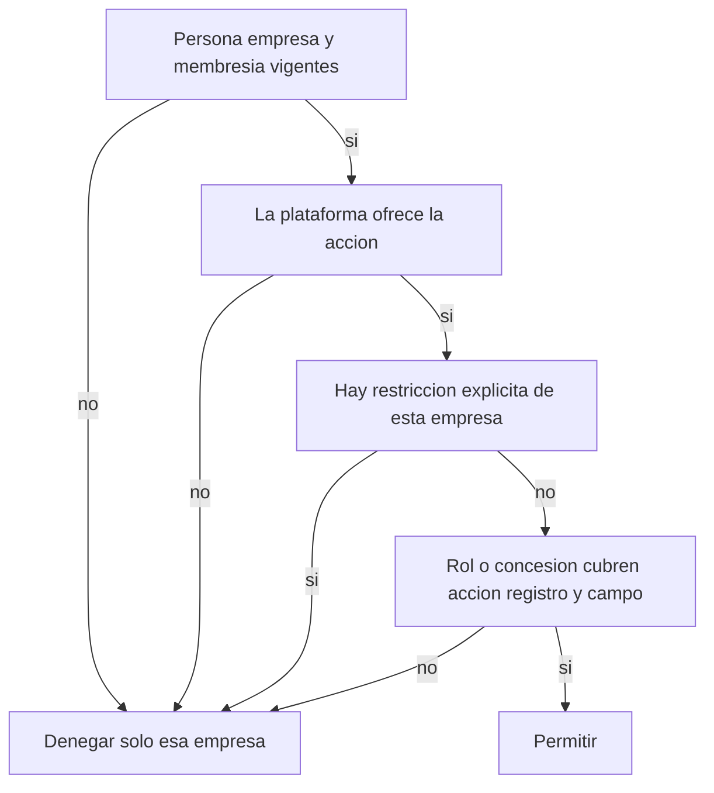

# Punto 8 — Paso 2: participación y permisos dentro de una empresa

Estado de este paso: **DISEÑADO / PENDIENTE DE REVISIÓN CODEX**.

Es un contrato de acceso. No es implementación, no crea modelos y no cierra el punto 8. El paso 1 ya adoptó la identidad de cuenta y empresa. Este paso fija quién puede hacer qué dentro de una sola empresa administrada.

Fuente del paso 1, por commit, para que el enlace no dependa de una rama sin integrar:

[docs/point-8-step-01-account-company-boundaries.md en 34a19eb](https://github.com/mariamayorcruz/Nexora/blob/34a19eb892a71f761f5f03a18494b8710d26b4de/docs/point-8-step-01-account-company-boundaries.md)

Commit: `34a19eb892a71f761f5f03a18494b8710d26b4de`. La copia `9831903` queda sustituida por esa revisión.

Base de código de este documento: `main` `b35b3a21afa48005eb49a2f7231e455eeeef35b6`. No se integraron los PR 18, 19 ni 20.

## 1. Estado actual

### Requisitos que este paso toma como cerrados

Quedan fuera de nueva discusión, por el encargo y por el paso 1:

- La cuenta cliente es distinta de `User` y de `Organization`.
- `propia`, `socio` y `agencia` son una relación comercial separada de `Membership`.
- Varias cuentas pueden relacionarse con una empresa sin abrir sus datos.
- Pertenecer a la cuenta, o a una jerarquía laboral, no concede acceso.
- La relación de agencia no concede acceso.
- Retirar el acceso de una agencia obliga a tratar los accesos que dependen de esa relación. Quitar solo el vínculo comercial no completa el retiro.
- `MembershipRole.OWNER` no acredita propiedad legal ni el vínculo `propia`.

### Archivos usados

| Referencia | Hecho que aporta |
|---|---|
| `prisma/schema.prisma:14-48` | `User` es la persona |
| `prisma/schema.prisma:53-98` | estados, `Organization`, `Membership` |
| `prisma/schema.prisma:187-215` | `CrmLead`, `userId`, `organizationId`, `company` |
| `src/lib/tenancy/tenant-context.ts:62-160` | resolución de persona y empresa |
| `src/lib/tenancy/resolve-crm-read-organization.ts:28-38` | lectura CRM por esa resolución |
| `src/lib/tenancy/resolve-crm-write-organization.ts:14-15` y `:38-48` | escritura CRM y comentario de rol |
| `src/lib/tenancy/ensure-user-organization.ts:173-179` | alta de membresía encontrada en `src` |
| `src/app/api/tenant/organizations/route.ts:8-39` | listado de empresas activas y del rol |
| `src/app/api/crm/leads/route.ts:40-66` y `:73-114` | listar y crear leads |
| `src/app/api/crm/leads/[leadId]/route.ts:32-83` | editar un lead |
| `src/app/api/crm/leads/[leadId]/message/route.ts:11-105` | anotar un mensaje y posible envío externo |
| `src/app/api/crm/stats/route.ts:12-27` | agregados de etapa y valor |
| `src/app/api/crm/settings/route.ts:26-34` y `:61-65` | ajustes por `userId` en GET y POST |
| `src/app/api/crm/followups/route.ts:60-93` | seguimiento con puerta mixta |
| `src/app/api/crm/calendar/events/route.ts:18-23` y `:42-45` | calendario por `userId` en GET y POST |
| `src/lib/tenancy/resolve-legacy-crm-write-organization.ts:237-242` | la respuesta quita `organizationId` y conserva el resto |

La búsqueda de `membership.create` en `src` solo encontró `ensure-user-organization.ts`. La búsqueda de métodos HTTP en `src/app/api/crm` encontró GET, POST y PATCH. No apareció DELETE.

### Hechos

1. Una persona y una empresa tienen como máximo una `Membership` (`prisma/schema.prisma:95`). El rol guardado es `OWNER`, `ADMIN` o `MEMBER`, con predeterminado `MEMBER`. El estado es `INVITED`, `ACTIVE`, `SUSPENDED` o `REMOVED`, con predeterminado `ACTIVE`.
2. El resolver admite la empresa solo con membresía `ACTIVE` y organización `ACTIVE` (`src/lib/tenancy/tenant-context.ts:103-108`). `INVITED`, `SUSPENDED` y `REMOVED` no pasan. Si hay varias membresías activas y no viene la cabecera, no elige una (`src/lib/tenancy/tenant-context.ts:142-148`).
3. En las rutas de leads y de stats, el rol no se consulta. El comentario de escritura dice que cualquier rol `ACTIVE` puede hacer las escrituras CRM existentes y remite el detalle al punto 30 (`src/lib/tenancy/resolve-crm-write-organization.ts:14-15`).
4. La única alta de membresía encontrada crea `OWNER` y `ACTIVE` (`src/lib/tenancy/ensure-user-organization.ts:173-179`). No apareció una transición que escriba `INVITED`, `SUSPENDED` o `REMOVED`. Esos estados existen en el enum y el resolver ya los rechaza, pero no hay un flujo de invitación en las rutas inspeccionadas.
5. `GET /api/tenant/organizations` devuelve el rol de cada membresía activa. Eso informa la selección de empresa. No autoriza acciones de CRM.
6. `CrmLead.organizationId` es obligatorio. `userId` se guarda al crear el lead con el actor de la petición (`src/app/api/crm/leads/route.ts:101-102`). El comentario del schema lo llama procedencia (`prisma/schema.prisma:191-192`). El PATCH no lo usa como filtro (`src/app/api/crm/leads/[leadId]/route.ts:55-58`). No hay columna de asignado comercial.
7. Borrar `User` borra sus `CrmLead` por `onDelete: Cascade` (`prisma/schema.prisma:190`). Borrar la empresa está restringido si hay leads (`prisma/schema.prisma:194`).
8. La lista y el PATCH devuelven el lead sin `organizationId` y con el resto de columnas, incluidas `value` y `notes`.

### Acciones CRM que sí existen

| Ruta | Efecto comprobado | Puerta actual |
|---|---|---|
| `GET /api/crm/leads` | Lista los leads de la empresa. Omite correos internos o de prueba. | Membresía activa de esa empresa. Cualquier rol. |
| `POST /api/crm/leads` | Crea el lead y escribe `userId` del actor. | La misma puerta de escritura. |
| `PATCH /api/crm/leads/[leadId]` | Cambia `name`, `email`, `phone`, `company`, `source`, `stage`, `value`, `confidence`, `nextAction`, `notes` y `lastContactedAt` si el id está en esa empresa. No cambia `userId`, `organizationId`, `status` ni `campaignId`. | Escritura de esa empresa. Si el id es de otra, responde que no existe y no escribe. |
| `POST /api/crm/leads/[leadId]/message` | Añade el texto a `notes`, actualiza `lastContactedAt` y, si el canal y la configuración alcanzan, intenta un envío externo. | Escritura de esa empresa. |
| `GET /api/crm/stats` | Cuenta leads y suma `value` de toda la empresa. | Lectura de esa empresa. |

### Límites de esta lectura

- `GET` y `POST /api/crm/settings` autorizan solo por `userId`. No usan la empresa.
- `GET` y `POST /api/crm/calendar/events`, y el arranque de la conexión, autorizan por `userId`.
- `POST /api/crm/followups` autoriza primero por `userId`. Solo si llega un `leadId` resuelve la empresa y lee ese lead. Un envío sin `leadId` no pasa por la empresa.
- No hay ruta CRM de archivar, borrar, exportar, compartir ni administrar miembros.
- El aislamiento comprobado es el de leads y stats. No se extiende, por esta lectura, a ajustes, calendario, seguimientos sin lead ni al resto de módulos.
- No se consultó producción ni secretos. No se corrige código.

## 2. Glosario

| Término | Definición de este contrato | Límite |
|---|---|---|
| Membresía | La `Membership` ya existente entre una persona y una empresa. Una por par. | Es la participación. No es la cuenta cliente ni la relación comercial. |
| Rol operativo | El paquete de capacidades asociado a esa única membresía. Los valores actuales `OWNER`, `ADMIN` y `MEMBER` son el hueco ya persistido. | `OWNER` significa, en el alta encontrada, la membresía inicial. No acredita propiedad legal ni vínculo `propia`. |
| Permiso o capacidad | Una acción concreta sobre el CRM de esa empresa, por ejemplo consultar o exportar. | El nombre de un área no es una capacidad. |
| Alcance | Qué registros de esa empresa cubre la capacidad: la empresa, los asignados o los compartidos de forma explícita. | Un alcance no cruza a otra empresa. |
| Acceso a campo | Lectura o edición de una clase de columnas del registro ya alcanzado. | Poder leer no concede editar, exportar ni compartir. |
| Concesión | Un permiso añadido a la membresía, con origen, empresa, acción, alcance y campos. | Suma permiso solo en su empresa. |
| Restricción | Una negación explícita, con origen, sobre una acción, un alcance o un campo de esa misma membresía y empresa. | Gana dentro de su empresa. No viaja a otra empresa. |
| Origen | La procedencia de una concesión o restricción: directa de la empresa, delegada o dependiente de una relación de agencia. | Sirve para revocar una cadena. No es jerarquía laboral. |
| Responsable operativo | Membresía `ACTIVE` de esa empresa con la capacidad efectiva de administrar miembros. | Es una función de continuidad. No es un traspaso legal. |

Perfiles de ejemplo usados más abajo (`marketing`, `ventas`, `jefatura`, `agencia`) son paquetes reutilizables. El nombre no concede nada: solo cuentan las capacidades escritas en el paquete.

## 3. Política recomendada

Nombre: **capacidades por empresa, con unión de orígenes y restricción local**.

Es la política del punto 30 para el acceso dentro de la empresa. Se evalúa sobre la membresía existente. No añade un segundo motor de roles ni otra fila de membresía para el mismo par.

### Condiciones

Todas se evalúan para la empresa de la petición.

1. Hay una persona autenticada.
2. La empresa está `ACTIVE`.
3. Existe la membresía de ese par.
4. La membresía está `ACTIVE`. `INVITED` todavía no es acceso.
5. Si hay registro, su `organizationId` es esa empresa.
6. La plataforma ofrece la acción. Esa oferta es una entrada externa. Este paso no define planes ni precios. Si la entrada falta, la acción se deniega. Un permiso local no enciende una función que la plataforma no ofrece.
7. La capacidad efectiva cubre la acción, el alcance del registro y el modo del campo.

Si una condición falla, el resultado es denegar esa acción en esa empresa. No se borra el usuario, no se borran leads y no se modifica otra empresa.

### Precedencia

En una sola empresa, para una acción, un registro y un campo:

1. Fallar una condición de la lista anterior deniega, con el motivo de esa condición.
2. Una restricción explícita que coincida con la acción y, si la restricción lo precisa, con el registro o el campo, gana a cualquier paquete y a cualquier concesión.
3. Si no hay restricción aplicable, se permite cuando el paquete del rol o alguna concesión cubre a la vez la acción, el alcance y el campo.
4. Si nadie cubre el caso, se deniega.

La cobertura de varios orígenes se une. Dos concesiones de lectura, una por asignados y otra por un lead compartido, permiten esos dos conjuntos. Ninguna concesión atraviesa una restricción que hable de la misma acción y el mismo campo.

Una restricción de exportar en la empresa A no se consulta al decidir la empresa B. No existe un DENY global de la persona. La membresía de A y la de B se deciden por separado, aunque la sesión sea la misma.

Combinar dos roles en la misma empresa no crea dos membresías: el par único ya lo impide. El rol aporta un paquete. Las concesiones aportan orígenes adicionales. El resultado es la unión, recortada por las restricciones de esa empresa. Un paquete amplio no anula una restricción estrecha. Una restricción de exportar no quita la lectura.

Editar un campo exige poder leerlo. Exportar y compartir no se deducen de leer. Administrar miembros no se deduce de consultar el CRM. El acceso completo de una empresa es el catálogo de capacidades de esa empresa que la plataforma ofrece, menos las restricciones explícitas. Completo no incluye otra empresa, la cuenta cliente, el personal de Nexora ni el soporte.

La jerarquía laboral y la asociación a la cuenta cliente no entran en la decisión.

### Paquetes sobre el enum actual

Propuesta de diseño, no comportamiento actual:

| Rol guardado | Paquete en el estado estable | Lectura de compatibilidad |
|---|---|---|
| `OWNER` | Responsable operativo: todas las capacidades del catálogo CRM de esta empresa, incluida la administración delegable. | Sigue sin ser título legal. |
| `ADMIN` | Las mismas capacidades de datos y de administración. No puede quitarse sus restricciones ni retirar al último responsable. | No es un segundo propietario. |
| `MEMBER` | Paquete vacío. Solo actúa por concesiones. | Hoy, en el código, un `MEMBER` activo usa las mismas rutas de leads que `OWNER`. El cambio de poder queda para un corte posterior con compatibilidad explícita. |

Mientras no exista un registro de concesiones, las rutas actuales siguen como están. La compatibilidad recomendada para ese corte futuro es conservar, para las membresías ya `ACTIVE`, el acceso de facto a las rutas que hoy existen, hasta que una concesión o una restricción quede escrita. No se infiere agencia ni propiedad desde el rol. Las rutas que no existen siguen denegadas.

### Catálogo de la empresa, con el CRM como ejemplo

Otros módulos podrán reutilizar las mismas condiciones, la misma precedencia y la misma separación por empresa. Este paso no les asigna capacidades.

| Capacidad | Acciones |
|---|---|
| `crm.lead.read` | Consultar leads y, con los campos permitidos, sus agregados. |
| `crm.lead.create` | Crear un lead. El `userId` resultante es procedencia del actor, no asignación. |
| `crm.lead.update` | Editar campos permitidos. Cubre también la ruta de mensaje, porque escribe `notes`. |
| `crm.lead.archive` | Archivar o borrar el lead cuando exista una ruta. Hoy no existe. |
| `crm.lead.export` | Exportar. Hoy no existe. No sale de `crm.lead.read`. |
| `crm.lead.share` | Compartir registros concretos con otra membresía de la misma empresa. Hoy no existe. |
| `company.membership.admin` | Invitar, activar, suspender y retirar membresías de esa empresa. |
| `company.permission.grant` | Conceder o restringir capacidades delegables de esa empresa. |

`crm.lead.read`, `crm.lead.create`, `crm.lead.update`, `crm.lead.archive`, `crm.lead.export` y `crm.lead.share` son delegables. La administración y la concesión también lo son, pero solo dentro de lo que el otorgante posee de forma efectiva. Una restricción no es delegable para levantarla sobre uno mismo.

### Pseudocódigo

Esto describe la decisión. No es código del repositorio y no se ejecuta.

```text
decidir(persona, empresa, accion, registro, campo, modo, consulta):
  si persona no está autenticada:
    denegar motivo=identidad
  si empresa.status no es ACTIVE:
    denegar motivo=empresa_no_vigente
  membresia = la única membresía de persona en empresa
  si no existe:
    denegar motivo=sin_membresia
  si membresia.status no es ACTIVE:
    denegar motivo=membresia_no_activa
  si registro existe y registro.organizationId no es empresa:
    denegar motivo=registro_otra_empresa
  si la oferta de plataforma para accion no es verdadera:
    denegar motivo=plataforma

  lectura = efectivo(membresia, empresa, crm.lead.read, registro, campo, leer)
  si consulta filtra, ordena o agrega campo y lectura no permite:
    denegar motivo=campo_no_legible
  si accion es crm.lead.update y modo es editar y lectura no permite:
    denegar motivo=el motivo de lectura si es restriccion_explicita
    si no, denegar motivo=edicion_sin_lectura
  si accion es crm.lead.export y lectura no permite:
    denegar motivo=el motivo de lectura si es restriccion_explicita
    si no, denegar motivo=exportacion_sin_lectura
  si accion es crm.lead.share y lectura no permite:
    denegar motivo=el motivo de lectura si es restriccion_explicita
    si no, denegar motivo=compartir_sin_lectura

  decision = efectivo(membresia, empresa, accion, registro, campo, modo)
  si decision permite:
    permitir
  denegar motivo=decision.motivo

efectivo(membresia, empresa, accion, registro, campo, modo):
  coberturas = paquete(membresia.rol) unido a concesiones vigentes
               de esta membresia y esta empresa
  si alguna restricción vigente de esta empresa coincide con accion
     y, cuando nombra registro o campo, también con ellos:
    devolver denegar motivo=restriccion_explicita
  si alguna cobertura permite accion, contiene el registro en su alcance
     y permite modo sobre campo:
    devolver permitir
  devolver denegar motivo=sin_permiso

alcance_contiene(cobertura, registro):
  si cobertura.alcance es empresa:
    registro.organizationId es la empresa de la cobertura
  si cobertura.alcance es asignados:
    existe una asignación futura de ese registro a esta membresía
  si cobertura.alcance es compartido:
    el registro está en la lista explícita de esa concesión
  CrmLead.userId no se consulta
```

Conceder y revocar tienen sus propias reglas en las secciones 6 y 7. También deniegan solo dentro de la empresa afectada. El diagrama resume las condiciones y la precedencia. La dependencia de leer antes de editar, exportar o compartir, y la denegación de un filtro sobre un campo oculto, están en el pseudocódigo.



## 4. Matriz de acciones

| Acción | Existe ahora | Capacidad | Completo en esa empresa | No se deduce de |
|---|---|---|---|---|
| Consultar | Sí. `GET /api/crm/leads` y `GET /api/crm/stats`. | `crm.lead.read` | Todos los leads de la empresa, con los campos que la plataforma deja ver y que una restricción no oculte. Los agregados usan ese mismo conjunto. | Tener membresía en otra empresa. |
| Crear | Sí. `POST /api/crm/leads`. | `crm.lead.create` | Puede crear en esa empresa. | Consultar. Crear no asigna el lead a su `userId`. |
| Editar | Sí. `PATCH` de los campos listados y `POST .../message`, que escribe `notes`. | `crm.lead.update` | Puede editar los campos con modo edición. El mensaje externo de la ruta actual queda bajo esta capacidad porque su efecto persistido es `notes`. | Consultar. Tampoco autoriza la ruta de seguimiento ni los ajustes por usuario. |
| Archivar o borrar | No hay método ni ruta. | `crm.lead.archive` | Cuando exista la ruta, solo leads de esa empresa. | Consultar o editar. No se realiza borrando `User`. |
| Exportar | No hay ruta. | `crm.lead.export` | Exporta solo registros y campos ya legibles. | `GET /api/crm/leads`. |
| Compartir | No hay ruta. | `crm.lead.share` | Comparte leads de esa empresa con otra membresía de la misma empresa. | Consultar. No crea membresía ni abre el resto de la empresa. |
| Administrar miembros y permisos | No hay ruta CRM. El alta encontrada crea `OWNER` activo. El listado de empresas no administra. | `company.membership.admin` y `company.permission.grant` | Invita, activa, suspende, retira y concede dentro de esa empresa, con las reglas de delegación y de último responsable. | Cualquier capacidad de leads. |

Perfiles de ejemplo, aplicables solo por las capacidades de cada fila:

| Perfil | Composición | Queda fuera |
|---|---|---|
| Completo / responsable operativo | Las ocho capacidades, alcance de empresa, lectura y edición de todas las clases de campo, sujeto a restricciones y a la oferta de plataforma. | Otra empresa y cualquier módulo no citado. |
| Administrador | Igual que el responsable para datos y administración. | Modificar sus propias restricciones y dejar la empresa sin responsable. |
| Miembro base | Paquete vacío. | Toda acción hasta una concesión. |
| Ejemplo de marketing | Concesión de `crm.lead.read`, alcance de empresa, clases de identidad, canal y gestión. | Editar, exportar, compartir, archivar, administrar y la clase reservada. |
| Ejemplo de ventas | Concesión de `crm.lead.read` y `crm.lead.update`, alcance de asignados, clases de identidad, canal y gestión. | La clase reservada, el resto de la empresa, exportar, compartir y administrar. |
| Ejemplo de jefatura | Paquete vacío mientras no haya concesiones propias. | Los registros del subordinado y cualquier herencia por jerarquía. |
| Ejemplo de colaborador de agencia | Solo concesiones cuyo origen depende de la relación de agencia, con el alcance que la empresa haya concedido. | La relación comercial por sí sola y las empresas no concedidas. |

## 5. Alcances y campos

### Alcances

| Alcance | Regla | Dato actual |
|---|---|---|
| Empresa | Todos los `CrmLead` con ese `organizationId`. | Ya existe la columna. |
| Asignados | Solo registros ligados en el futuro a esta membresía por una asignación explícita. | No existe. `CrmLead.userId` es procedencia del creador. Usarlo como asignado o como dueño comercial queda prohibido por este contrato. Si el dato futuro no está, el alcance no contiene registros y la acción se deniega. |
| Compartido | Solo los identificadores nombrados en una concesión de la misma empresa. | No existe. No se diseña aquí su tabla. Un compartido no incluye el resto de la empresa ni records de otra. |

La búsqueda, el filtro, el agregado y la exportación parten del conjunto ya recortado por empresa y por alcance. Un registro fuera de alcance no se devuelve, no se cuenta y no se usa para decidir un filtro. Ocultarlo solo en la pantalla no cumple el contrato.

### Clases de campo

Salen de columnas que ya tiene `CrmLead`. No se añaden columnas.

| Clase | Columnas | Lectura y edición |
|---|---|---|
| `f.identidad` | `name` | Pueden separarse. Editar exige leer. |
| `f.canal` | `email`, `phone` | Igual. |
| `f.gestion` | `company`, `source`, `stage`, `status`, `nextAction`, `lastContactedAt`, `confidence` | `status` hoy viaja en la lectura y el PATCH inspeccionado no lo escribe. Editar `status` no tiene ruta. |
| `f.reservado` | `value`, `notes` | Clase confidencial del ejemplo. Puede ocultarse sin ocultar el nombre. |

La proyección ocurre en el servidor. Una lista omite las clases sin lectura. No se sustituyen por un valor que confirme el dato. Un filtro, una ordenación o un agregado sobre una clase sin lectura se deniega entero: no se ejecuta el filtro y no se devuelve el conjunto recortado a escondidas. `GET /api/crm/stats` suma `value`; sin lectura de `f.reservado` se deniegan sus cifras. Las cuentas de registros solo incluyen el alcance visible y no revelan el total de la empresa.

Exportar una clase exige `crm.lead.export` y lectura de esa clase. Pedir en la exportación una clase oculta deniega la exportación. Compartir no copia el campo a otra empresa.

## 6. Ciclo de vida

| Estado actual | Efecto que el resolver ya tiene | Mecanismo futuro recomendado |
|---|---|---|
| `INVITED` | No pasa a `TenantContext`. | La invitación crea o deja la membresía en este estado. Todavía no hay acceso. La activación la pasa a `ACTIVE` después de autenticar a la persona invitada y de comprobar que la empresa sigue `ACTIVE`. |
| `ACTIVE` | Puede resolver la empresa. El rol sigue sin distinguir las rutas de leads. | Único estado que llega a la unión de capacidades. |
| `SUSPENDED` | No pasa el resolver. | Conserva la membresía y las concesiones, pero toda decisión de esa empresa deniega. La sesión o una caché no prolongan un permiso ya suspendido: cada decisión relee el estado. |
| `REMOVED` | No pasa el resolver. | Retiro de esa empresa. La persona y sus leads permanecen. |

No se fija una duración de la invitación ni de la suspensión. Sin una decisión posterior, no caducan solas. Revocar la invitación es pasar a `REMOVED` o retirar la fila de membresía de esa empresa, no borrar `User`.

La activación valida tres cosas que ya tienen identidad en el diseño: la persona autenticada, la empresa indicada y la membresía de ese par. Una invitación a la empresa A no activa la empresa B.

El último responsable operativo no se retira por un efecto lateral. Suspender, retirar o restringir `company.membership.admin` al último poseedor efectivo de esa empresa se deniega y no cambia datos. Antes, otro miembro `ACTIVE` de la misma empresa tiene que recibir esa capacidad por una concesión válida. Eso no transfiere propiedad legal ni la relación `propia`. Si la operación no puede dejar al menos un responsable, no se aplica ninguna parte.

## 7. Delegación y revocación

### Conceder

```text
conceder(otorgante, destino, empresa, permiso):
  decidir(otorgante, empresa, company.permission.grant) debe permitir
  decidir(otorgante, empresa, permiso.accion, permiso.registro, permiso.campo, permiso.modo) debe permitir
  permiso es delegable
  el alcance pedido no es más amplio que el alcance efectivo del otorgante
  destino tiene membresía en esa misma empresa
  si destino es otorgante:
    denegar motivo=autoelevacion
  si la operación levanta una restricción del otorgante:
    denegar motivo=restriccion_propia
  registrar origen=otorgante, empresa y concesión padre si nace de otra
```

Un administrador con lectura de asignados no puede conceder lectura de toda la empresa. Un miembro con lectura no puede concederse exportar. Una restricción propia sigue ganando aunque el paquete del rol sea amplio.

### Agencia retirada

La relación comercial y las concesiones son distintas. Al retirar el acceso de la agencia en una empresa:

1. Se identifican las concesiones de esa empresa cuyo origen depende de esa relación, y las concesiones que descienden de ellas.
2. Las concesiones de otro origen quedan fuera de ese conjunto y se tratan con una decisión explícita: conservar o revocar. El silencio no las borra ni las convierte en acceso de agencia.
3. Si al quitar el conjunto dependiente la empresa se quedara sin responsable operativo, la operación se deniega completa y no revoca una parte.
4. Si el responsable sigue existiendo, las concesiones dependientes dejan de estar vigentes.
5. La siguiente decisión relee ese estado. Una sesión abierta o una caché no conservan la concesión retirada.
6. No se borra `User`, no se borran `CrmLead` y no se toca otra empresa ni otra relación de la misma agencia.

El schema actual es incompatible con usar el borrado de `User` como revocación: ese borrado elimina los leads de esa persona en cascada, incluidos los de empresas que no se están retirando. El retiro de acceso cambia la membresía o la vigencia de las concesiones de una empresa.

## 8. Casos de aceptación

Recorrido lógico del pseudocódigo. Los datos futuros se suponen solo cuando la columna los nombra. En estos casos la oferta de plataforma es verdadera, para que el motivo sea el de permiso; la falta de una ruta es una brecha de producto distinta. No son pruebas ejecutables ni datos reales.

| Caso | Contexto | Acción | Resultado | Motivo | Dato futuro requerido |
|---|---|---|---|---|---|
| 1. Dos empresas | Ana, membresía activa en A con lectura de marketing y en B con lectura y edición de ventas sobre asignados. No hay asignación nombrada en B. | Consultar el listado de A. Exportar A. Consultar el listado completo de B. | A se consulta sin `value` ni `notes`. Exportar A se deniega. El listado completo de B se deniega y no recibe los leads de A. | A tiene `crm.lead.read` de empresa. A no tiene `crm.lead.export`. B solo cubre asignados y no hay asignación, así que su alcance está vacío. | Asignación, solo si más adelante se quiere permitir registros concretos de B. |
| 2. Invitado | Bruno, membresía `INVITED` en A. Sesión válida. | `GET /api/crm/leads` de A. | Denegar. | `membresia_no_activa`. La invitación no es acceso. El resolver actual ya exige `ACTIVE`. | Flujo que cree el estado `INVITED`. Hoy el enum existe y no apareció quien lo escriba. |
| 3. Marketing | Concesión de lectura de empresa para identidad, canal y gestión. | Consultar leads. Exportar esos leads. | La consulta permite las tres clases y omite `f.reservado`. La exportación se deniega. | Hay `crm.lead.read`. No hay `crm.lead.export`. | Ninguno para la denegación de exportar. La ruta de exportar tampoco existe. |
| 4. Ventas | Concesión de lectura y edición sobre asignados. `f.reservado` sin lectura. Lead asignado L1 y lead L2 de la misma empresa. | Consultar L1, editar `stage` de L1, editar `value` de L1, consultar L2. | L1 se consulta sin `value` ni `notes`. El `stage` se puede editar. `value` se deniega. L2 se deniega. | El alcance contiene L1. Editar `value` falla por `edicion_sin_lectura`. L2 no está asignado. | Asignación explícita. Sin ella, también L1 se deniega. No usar `userId`. |
| 5. Jefatura | Jefa con membresía activa y paquete vacío. Un subordinado tiene L1 asignado. | Consultar L1. | Denegar. | `sin_permiso`. La jerarquía no es entrada de `decidir`. | Ninguno. Una concesión propia sería otro caso. |
| 6. Un registro compartido | Membresía activa con paquete vacío y una concesión compartida solo de L1, lectura de identidad y canal. | Consultar L1. Consultar L2. Exportar L1. | L1 se permite con esos campos. L2 y la exportación se deniegan. | El alcance compartido nombra L1. No hay lectura de empresa ni `crm.lead.export`. | Lista explícita de compartidos. |
| 7. Autoelevación | Delegado con lectura y `company.permission.grant`. Una restricción le niega exportar. Intenta concederse `crm.lead.export`. | `conceder` hacia sí mismo. | Denegar. Sus concesiones y su restricción no cambian. | `decidir` de exportar devuelve `restriccion_explicita`, así que no lo posee. Si la restricción no existiera y lo poseyera, el destino igual a sí mismo denegaría con `autoelevacion`. | Registro de origen y de restricción. |
| 8. Suspensión con sesión | La sesión sigue emitida. Membresía A `SUSPENDED` con lectura antigua. Membresía B `ACTIVE` con lectura. | Consultar A y consultar B. | A se deniega. B se permite según su propio paquete. No se borra la persona ni leads. | `membresia_no_activa` solo en A. La sesión no conserva el permiso. | Invalidar cachés al suspender. El resolver ya relee el estado si no hay caché. |
| 9. Agencia e independencia | En C1 hay lectura cuyo origen es la agencia y un compartido de L9 cuyo origen es directo. C2 tiene otra concesión de la misma agencia. Se retira el acceso de agencia en C1 y queda un responsable no dependiente. | Consultar C1, consultar L9, consultar C2. | La lectura de empresa en C1 se deniega. L9 sigue hasta una decisión explícita. C2 no cambia. Los leads siguen. | Solo se retiran las concesiones dependientes de C1. El origen directo no entra en ese conjunto. | Origen y cadena de cada concesión. Identidad de la relación de agencia, definida en el paso 1 y todavía no persistida. |
| 10. Último responsable | Una sola membresía efectiva con `company.membership.admin`. | Suspenderla o retirar esa capacidad. | Denegar. No hay cambio parcial. | La empresa debe conservar un responsable operativo. No es un traspaso legal. | Saber qué concesiones dependen de la agencia para no contarlas si ya fueron revocadas. |
| 11. Id de otra empresa | Miembro activo de A. El lead pertenece a B. | `PATCH` de ese id contra A. | Denegar, sin escritura. | `registro_otra_empresa`. La ruta actual responde que no existe cuando el id no está en la empresa. | Ninguno. `organizationId` ya existe. |
| 12. Campo restringido | El perfil de ventas del caso 4, con L1 asignado. | Listar L1. Filtrar por `value`. Exportar incluyendo `value`. Pedir la suma de `value`. | La lista omite `value` y `notes`. El filtro y la suma se deniegan con `campo_no_legible`. La exportación se deniega con `exportacion_sin_lectura`. | No hay lectura efectiva de `f.reservado`. Aunque la hubiera, faltaría `crm.lead.export` y la exportación seguiría en `sin_permiso`. | Asignación para que L1 sea visible. La exportación sigue sin ruta. |

## 9. Decisiones recomendadas y corte siguiente

Estas decisiones forman una sola política. La revisión de Codex puede sustituirlas. No reabren D1–D3.

| Id | Decisión recomendada | Razón | Depende de |
|---|---|---|---|
| P1 | Denegar por defecto. Dentro de una empresa, la restricción explícita gana a la unión del rol y de las concesiones. Cada empresa se decide aparte. | Hay acceso completo, limitado o nulo, y una negación en A no puede apagar B. | Membresía por par, ya existente. |
| P2 | El punto 30 se apoya en `Membership`. El rol es un paquete. Los nombres de área son ejemplos de paquetes, no poderes. | Evita un segundo RBAC y el permiso implícito por puesto. | Enum actual. |
| P3 | En el estado estable, `MEMBER` no lleva capacidades. Hasta escribir concesiones, las membresías activas conservan el uso de facto de las rutas CRM ya existentes. | Hoy cualquier rol activo usa esas rutas. Aplicar el paquete vacío sin transición les quitaría el CRM. | No inferir agencia ni propiedad desde el rol. |
| P4 | Asignado y compartido son alcances futuros. Sin su dato, no contienen registros. `userId` no los sustituye. | El schema solo guarda procedencia. | No diseñar todavía la tabla. |
| P5 | Editar exige leer el campo. Exportar, compartir y administrar son capacidades distintas. `value` y `notes` forman la clase reservada del ejemplo. | La lista actual devuelve esas columnas a cualquiera que consulta. | Proyección en servidor cuando se implemente. |
| P6 | La invitación no caduca por un plazo inventado. Solo `ACTIVE` accede. | El enum ya separa `INVITED` y el resolver ya lo excluye. | Un flujo futuro que escriba `INVITED`. |
| P7 | Revocar la agencia retira solo la cadena dependiente de esa empresa, de forma completa, y se detiene si desaparece el último responsable. Lo independiente se lista y se decide aparte. | El paso 1 exige tratar los accesos, no solo el vínculo comercial. | Origen de cada concesión. |
| P8 | Retirar acceso cambia el estado de la membresía o la vigencia de concesiones. No borra `User` ni leads. | El borrado de `User` ya borra leads en cascada. | Estados ya existentes. |

El corte de implementación más pequeño, después de la revisión y fuera de este PR, sería una función pura de `decidir` y de `conceder`, alimentada con datos de prueba. Usaría como entradas reales la persona, el estado de la empresa, el estado y el rol de la membresía y el `organizationId` del lead. Las asignaciones, los compartidos, los orígenes y la oferta de plataforma entrarían como argumentos de prueba, no como tablas. No se conectaría a las rutas, no habría migración y el comportamiento actual permanecería. Conectar `GET`, `POST` o `PATCH` exige antes cerrar la compatibilidad P3, porque esas rutas hoy no distinguen rol.

## 10. Cierre y trazabilidad

| Pieza | Estado |
|---|---|
| Contrato de acceso dentro de una empresa | Diseñado en este documento |
| Revisión Codex de P1–P8 | Pendiente |
| Identidad de cuenta, empresa y relación comercial | Adoptada en el paso 1, commit `34a19eb892a71f761f5f03a18494b8710d26b4de` |
| Código, schema, migraciones, rutas y PR 20 | Sin cambios |
| Permisos de cuenta cliente, personal de Nexora, soporte, planes, facturación y retención | Fuera de este paso |
| Punto 8 completo | No |

Requisitos cubiertos por la política: acceso completo, limitado o nulo; CRM compartido solo por concesión; perfiles de operación, administración, miembro, marketing, ventas, jefatura y agencia sin poderes por el nombre; delegación sin escalar; suspensión y retiro por empresa; revocación de la cadena de agencia junto al trato explícito de lo independiente; continuidad del responsable operativo; denegación en servidor para lista, filtro, agregado y exportación.

Pendientes ajenos a este diseño: persistir concesiones, restricciones, asignaciones y compartidos; escribir los estados de invitación; definir la oferta comercial de la plataforma; conectar el contrato a las rutas; permisos de la cuenta cliente; personal interno; soporte; finanzas.

Límites de la comprobación: las citas se contrastaron con `main` `b35b3a21afa48005eb49a2f7231e455eeeef35b6`. Los doce casos se recorrieron contra el pseudocódigo y la matriz. Las denegaciones no borran persona, leads ni otra empresa. El diagrama se validó en local con Mermaid CLI. No hubo build ni tests de aplicación.
