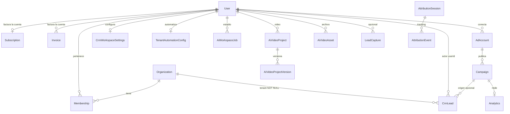
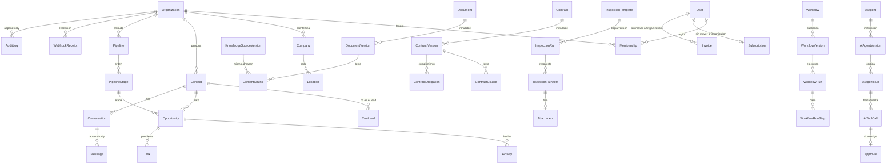

# Point 8 — diagramas, etapas, decisiones y PR 18

## Estado real del PR 18

Verificado al crear esta rama, después de `git fetch origin main`:

| Campo | Valor |
|---|---|
| Número | 18 |
| Estado | OPEN, draft |
| Base | `main` |
| Rama | `cursor/point8c-revenue-core-930b` |
| Head | `60c178716bec6b40003365e0bdc06856e0a067f3` |
| Título | Point 8C: Stripe MRR projection and collected revenue |
| `main` | `b35b3a21afa48005eb49a2f7231e455eeeef35b6` (PR 17 integrado) |

El diff `main..60c1787` incluye, entre otros, la migración aditiva de proyección de ingresos que vive solo en ese commit, columnas de proyección en `Subscription` e `Invoice`, y los modelos `StripeWebhookEvent` y `PendingStripeInvoice`. Esos archivos no están en esta rama.

Este paquete no hace merge, no despliega y no edita esa rama. Revenue Core no es el Core Data Model. Point 8 no está COMPLETE.

## Diagrama actual

Hecho en `main`. Las relaciones son las de `prisma/schema.prisma`.

No aparecen contacto, empresa cliente, conversación, mensaje, pipeline, documento, contrato, inspección, workflow, agente, aprobación ni bitácora.

## Diagrama propuesto

Propuesta sin aprobación. Las cajas punteadas no existen. La facturación de Nexora se queda en `User`.

## Decisiones bloqueantes

Ninguna recomendación de esta lista está aceptada.

| Id | Pregunta | Recomendación | Si se ignora |
|---|---|---|---|
| Q1 | ¿El empleado es distinto del usuario? | Sí. No añadir columnas laborales a `User`. No crear la tabla hasta aceptar el dominio. | Se mezcla el login con la ficha laboral. |
| Q2 | ¿Qué permisos existen además de `OWNER`, `ADMIN`, `MEMBER` y el admin por correo? | No sembrar una matriz. Escribir la lista antes de tablas o RLS. | El RBAC nace de nombres sueltos. |
| Q3 | ¿El contacto es distinto del lead y de `LeadCapture`? | Sí. No renombrar `CrmLead`. | Se pierde la captura y se duplica la persona. |
| Q4 | ¿La empresa cliente es distinta del tenant? | Sí. `Organization` sigue siendo el tenant. `CrmLead.company` no se vuelve tabla por un script ciego. | Se mezclan clientes de un mismo workspace. |
| Q5 | ¿Cuáles son los estados de oportunidad, tarea, contrato, inspección, workflow y aprobación? | No publicarlos en código hasta una lista firmada. | Cada etapa inventa un enum incompatible. |
| Q6 | ¿Equipo, insumos, incidentes e inspección entran en Point 8 o en un punto posterior? | No construirlos en la primera etapa de esquema. No marcarlos `diferir` sin respuesta. | Se abre un dominio vacío o se borra de la lista sin aceptación. |
| Q7 | ¿Hay índice vectorial y de qué dimensión? | Chunks de texto primero, sin vector. | Se elige un motor dentro de una migración. |
| Q8 | ¿El playbook de `src/lib/sales-playbook.ts` es la política oficial o solo un default de UI? | Tratarlo como default de UI. No copiarlo a tablas como reglamento. | Cinco etapas quedan congeladas por accidente. |
| Q9 | ¿Qué se retiene y qué se borra de mensajes, adjuntos, chunks y bitácora? | Sin plazo no hay job de borrado. | Un cron borra evidencia sin regla. |
| Q10 | ¿Qué acciones entran en la bitácora? | Catálogo antes de la tabla. Excluir secretos y cuerpo completo de mensajes. | La bitácora guarda de más o no sirve. |
| Q11 | ¿El aislamiento nuevo es de aplicación, RLS, o los dos, dado que `auth.uid()` no es el `cuid()` de `User`? | Decidirlo en la etapa de acceso, no aquí. | Una policy no corta las lecturas de Prisma. |

## Etapas

Cada etapa es un PR distinto, con pruebas locales, `tsc`, lint y build. El documento no las ejecuta. El orden es de dependencia. No se salta a Point 9.

### P8-D0 — este paquete

Documentación. Sin esquema, sin API, sin UI.

- Aceptación: los 52 conceptos están en la matriz, las rutas citadas existen, el diff no sale de `docs/point-8/`.
- Rollback: revertir el PR documental.
- Registro: no cambia a `diseñado`.

### P8-S1 — primera etapa recomendada

Aceptar por escrito Q1, Q3 y Q4, y decir si Q6 queda dentro de Point 8. Sin migración.

- Dependencia: este paquete revisado.
- Esquema: ninguno.
- API y UI: ninguna.
- Backfill: ninguno.
- Prueba: el registro de la matriz cita la aceptación y sigue sin llamar `implementado` a lo que no tiene código.
- Rollout: merge del documento de decisiones, sin `migrate deploy`.
- Aceptación: Q1, Q3 y Q4 dejan de estar abiertas. Q6 tiene respuesta sí o no.

No se recomienda crear tablas antes de eso. El hueco más visible del producto, los mensajes metidos en `CrmLead.notes` y las burbujas fabricadas en conversaciones, espera a Q3 y Q9.

### P8-S2 — mensajes, solo si Q3 y Q9 están aceptadas

- Esquema aditivo: `Conversation`, `Message`. `CrmLead` no se borra ni se renombra.
- API: leer y añadir mensaje del lead del tenant. Dejar de concatenar `notes` en esa ruta.
- UI: `conversaciones` muestra filas, no `buildMessages`.
- Backfill: no automático. Un informe puede contar notas no vacías.
- Prueba local: dos organizaciones no leen el hilo de la otra; repetir el alta no duplica `externalId`.
- Rollback: la aplicación anterior ignora las tablas nuevas. `notes` histórico permanece.
- Aceptación: un mensaje enviado queda en `Message` y la otra organización no lo ve.

### P8-S3 — empresa cliente y contacto, solo si Q4 está aceptada

- Esquema: `Company`, `Contact`. `CrmLead.company` sigue hasta un backfill aceptado.
- Sin unicidad por nombre.
- Rollback: tablas nuevas sin uso de la app anterior.

### P8-S4 — pipeline y oportunidad, solo si Q5 y Q8 están aceptadas

- Si la lista de etapas aceptada es la de `CRM_ALLOWED_STAGES`, se puede sembrar porque la semilla quedó escrita en la decisión, no porque el constante exista.
- `Opportunity` no sustituye `Subscription`.

### P8-S5 — actividad y tarea

Depende de S2 o S4 según el sujeto aceptado. Estados de Q5.

### P8-S6 — adjunto y versión de documento

Depende de Q7 y Q9. `ContentChunk` sin vector. Storage con prefijo de tenant. No mueve `AiVideoAsset` todavía.

### P8-S7 — contrato

Depende de Q5. No toca `Invoice`.

### P8-S8 — workflow y agente

Definición, versión, corrida, paso, tool call. `Approval` solo con Q2. No convierte n8n ni `AiWorkspaceJob` en la misma tabla.

### P8-S9 — recepción de webhook genérica

Después de saber si el PR 18 ya integró `StripeWebhookEvent`. Si ya está integrado, no se duplica el recibo de Stripe. Si no, S9 no bloquea el merge de 18 ni al revés: son proveedores distintos hasta una decisión de unificación.

### P8-S10 — bitácora

Depende de Q9 y Q10. Antes de cualquier RBAC que prometa dejar rastro.

### P8-S11 — permisos y RLS

Última de acceso. Depende de Q2 y Q11. No se infiere de este paquete. Sigue prohibido borrar `userId` y mover la facturación.

### P8-S12 — dominio físico

Solo si Q6 dice que equipo, insumo, incidente e inspección son de Point 8. Plantilla, snapshot en la corrida, respuestas y foto como adjunto. Si Q6 dice que no, el diferimiento aceptado se escribe en la matriz y el concepto no se implementa. Eso sí puede cerrar el concepto. Un silencio no.

## Coordinación con deploy

Ninguna etapa de esquema entra a producción con el auto-deploy de la aplicación si la migración todavía no se aplicó. El orden, cuando haya autorización, es `migrate deploy` de esa migración aditiva y después el código que lee las columnas. No se reescribe una migración ya aplicada. No se usa `db push`, `migrate dev`, `migrate resolve` ni baseline contra producción.

Las pruebas de esas etapas usan Postgres local validado como desechable y no leen `DATABASE_URL` de producción como respaldo. El patrón ya está en los validadores de tenencia (`assertDisposableDatabaseUrl` en `scripts/fr004-lib.ts`).

## Registro

Los 52 conceptos permanecen en `pendiente decisión` después de P8-D0. Evidencia: `docs/point-8/01-reconciliation-matrix.md`.

Point 8 COMPLETE exige, para cada concepto, o bien etapas requeridas en `verificado`, o bien un diferimiento con aceptación explícita citada en la matriz. Este paquete no cumple esa condición. Point 9 no empieza.
